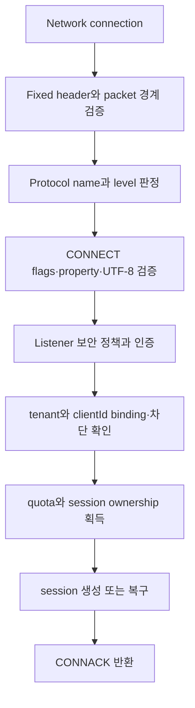

# MQTT protocol과 session 스펙

이 문서는 MQTT client가 NaruMQ listener에 연결해 인증하고 publish·subscribe하며 session을 재개할 때 관찰하는 동작을 정의한다. Cluster 내부 복제 방식은 [cluster spec](cluster-session-and-delivery.md), tenant 권한 판정은 [security spec](tenancy-and-security.md)을 기준으로 한다.

| 항목 | 값 |
| --- | --- |
| 상태 | Draft |
| 관련 요구사항 | MQTT-01~MQTT-13, CLIENT-01~CLIENT-08 |
| 근거 | [PRD 8장과 9.1절](../requirements/PRD.md), [OASIS MQTT 3.1.1](https://docs.oasis-open.org/mqtt/mqtt/v3.1.1/mqtt-v3.1.1.html), [OASIS MQTT 5.0](https://docs.oasis-open.org/mqtt/mqtt/v5.0/mqtt-v5.0.html) |
| 관련 Architecture | [System overview](../architectures/system-overview.md), [Broker core](../architectures/broker-core.md) |
| 관련 Contract | [MQTT client compatibility v1](../contracts/mqtt-client-compatibility-v1.md) |
| 해설 | [MQTT 전달 보장과 QoS·Session·Will protocol 흐름](../explainers/mqtt-delivery-guarantees-and-protocol-flows.md) |

## 현재 구현 상태: Phase 1 단일 노드 QoS 1/2 delivery·retained·will slice

현재 구현은 개발·검증 전용 loopback plaintext TCP ingress까지 연결되어 실제
MQTT 3.1.1/5.0 client가 `CONNECT → SUBSCRIBE/PUBLISH → PING/DISCONNECT`를
실행할 수 있다. 이 listener는 TLS, 인증과 tenant 경계가 없으므로 literal loopback
주소로만 열 수 있다. Retained runtime은 단일 process 안의 bounded development
profile이며 cluster durability와는 별도 경계다.

- `internal/domain/mqtt`는 CONNECT/CONNACK, QoS 0·1·2 PUBLISH, PUBACK/PUBREC/PUBREL/PUBCOMP,
  SUBSCRIBE 계열과 PINGREQ/PINGRESP/DISCONNECT를 decode·encode한다. PING packet은
  Remaining Length 0만 허용하고 MQTT 5 DISCONNECT는 property-free allowlist만 지원한다.
- `internal/domain/routing`은 non-shared `+`·`#` filter, `$` system topic 경계,
  session별 중복 제거와 overlap 최대 granted QoS를 결정한다. `No Local`은 동일
  publisher session을 제외하고, `Retain As Published`는 live delivery의 RETAIN을
  결정하며, `Retain Handling`은 SUBSCRIBE replay 시점에만 적용한다.
- `internal/application/subscribe`는 요청 순서를 유지한 SUBACK를 만들고, retained
  replay batch를 route mutation 전에 queue에 원자적으로 예약한다. MQTT 3.1.1과
  MQTT 5의 non-shared retained replay 및 MQTT 5 subscription options를 지원한다.
- `internal/application/publish`는 QoS 0·1·2 retained PUBLISH를 exact topic별로
  replace/delete한 뒤 option-aware live fan-out을 수행한다. zero-byte retained
  PUBLISH도 established subscriber에게는 live delivery로 전달한다.
- `internal/application/ports/retained`와 `internal/adapters/memory/retained`는
  topic·payload·publisher identity byte 상한을 함께 적용하는 process-local,
  non-durable retained repository를 제공한다. 저장 성공은 queue 전달 실패와
  독립적이며 retained value를 되돌리지 않는다.
- ingress에서 수신하는 publish는 QoS 0·1·2를 지원한다. QoS 1은 메시지 라우팅 후
  PUBACK을 반환하며, QoS 2는 수신 시 PUBREC을 반환하고 PUBREL 수신 시 라우팅 후
  PUBCOMP를 반환한다. 중복 패킷 식별자 재전송 시 중복 라우팅 없이 동일 ACK를
  반환하여 수렴한다.
- 송신 delivery는 구독자의 granted QoS와 메시지 QoS 중 낮은 QoS로 전송하며,
  QoS 1 및 QoS 2의 경우 connection별 packet identifier allocator를 통해
  식별자를 할당하고 구독자의 PUBACK 또는 PUBREC/PUBREL/PUBCOMP 핸드셰이크를
  완료한다.
- `internal/adapters/memory/sessionstore`는 비내구성 lifecycle map이고,
  `internal/adapters/clock`은 system clock이다. Message Expiry, ACL·tenant,
  shared subscription, takeover, durable offline queue, persistence·replication과
  TLS/auth는 이 slice에서 지원하지 않는다.

## 1. Listener 계약

1. TCP와 TLS listener는 MQTT 3.1.1 protocol level 4와 MQTT 5.0 protocol level 5를 수용해야 한다.
2. listener마다 bind address, TLS 정책, 인증 방식, 최대 연결 수, connection rate와 packet 제한을 독립 적용해야 한다.
3. 평문 TCP listener는 기본 설정에서 비활성화해야 한다.
4. WebSocket과 WSS는 P1 선택 기능이다. 활성화하면 MQTT packet과 session 의미가 TCP listener와 같아야 한다.
5. connection은 설정된 CONNECT timeout 안에 유효한 CONNECT를 보내야 한다. timeout 또는 malformed packet이면 session을 만들지 않고 연결을 닫아야 한다.
6. development profile의 평문 `-tcp-listen`은 `127.0.0.0/8` 또는 `::1` literal
   loopback만 허용한다. TLS listener는 `-tls-listen`으로 별도 활성화하며,
   TLS 1.2 이상, 허용된 AEAD cipher suite와 설정된 서버 인증서를 적용한다.
   TLS listener는 외부 interface에 bind할 수 있지만, mTLS가 설정되면 trust anchor와
   클라이언트 인증서 유효성 및 identity binding을 검증해야 한다.
7. `-tcp-listen`과 `-tls-listen`은 하나의 `tcp.Server`에 함께 등록할 수 있고,
   listener별 transport 보안 정책을 유지하면서 동일한 session·route registry를 공유한다.
8. CONNECT 뒤에는 negotiated version으로 packet을 decode하고, 모든 socket write는 한
   writer goroutine의 bounded control queue 또는 delivery wake를 통과한다.
9. binary smoke와 실제 loopback wire 검증은 `tests/integration/mqtt_ingress_test.go`와
   TLS/mTLS transport 검증은 `tests/integration/mqtt_tls_test.go` 및 `cmd/narumq`를
   기준으로 한다.

## 2. CONNECT 처리 순서

서버는 CONNECT를 다음 순서로 처리해야 한다.

각 단계가 실패하면 이후 단계의 durable state를 만들어서는 안 된다. ownership을 얻은 뒤 응답 전 실패하면 재시도 시 같은 session 상태로 수렴해야 한다.

### 2.1 Protocol version

| 입력 | 외부 동작 |
| --- | --- |
| Protocol Name `MQTT`, level 4 | MQTT 3.1.1로 처리한다. |
| Protocol Name `MQTT`, level 5 | MQTT 5.0으로 처리한다. |
| Protocol Name `MQIsdp` 또는 level 3 | MQTT 3.1.0 비지원으로 거절한다. session을 만들지 않는다. |
| 지원하지 않는 level | MQTT 3.1.1 형식으로 판정 가능한 경우 CONNACK `0x01`을 반환하고 연결을 닫는다. MQTT 5 형식으로 판정 가능한 경우 CONNACK `0x84`를 반환하고 연결을 닫는다. |
| packet 구조상 version을 안전하게 판정할 수 없음 | 응답 없이 연결을 닫을 수 있다. malformed packet으로 기록한다. |

MQTT 3.1.0 거절은 `reason="unsupported_protocol_version"`, `protocol="3.1.0"`으로 집계해야 한다. 원문 credential은 로그에 남기지 않는다.

### 2.2 Session 선택

session key는 `(tenantId, clientId)`다. tenant와 clientId가 하나라도 달라지면 기존 session을 재개해서는 안 된다.

| Protocol 입력 | Session 동작 | CONNACK |
| --- | --- | --- |
| MQTT 3.1.1 `Clean Session=1` | 기존 session을 폐기하고 새 session으로 시작한다. 연결 종료 뒤 session을 보존하지 않는다. | `Session Present=0` |
| MQTT 3.1.1 `Clean Session=0` | 만료되지 않은 기존 session을 복구한다. 없으면 새 persistent session을 만든다. | 복구했을 때만 `Session Present=1` |
| MQTT 5 `Clean Start=1` | 기존 session을 폐기하고 새 session으로 시작한다. | `Session Present=0` |
| MQTT 5 `Clean Start=0` | 만료되지 않은 기존 session을 복구한다. | 복구했을 때만 `Session Present=1` |
| MQTT 5 `Session Expiry Interval=0` | network connection 종료 뒤 session을 제거한다. | 위 규칙에 따름 |

동일 session key로 새 connection이 인증과 ownership 획득에 성공하면 새 connection이 owner가 된다.
production target에서는 MQTT 5이면 이전 connection에 `DISCONNECT 0x8E`(`Session taken over`)를
보내고, MQTT 3.1.1은 연결을 닫아야 한다. 현재 development slice는 takeover를 구현하지 않고
active duplicate를 negative CONNACK으로 거절한다.

## 3. Publish와 내구성 ACK

### 3.1 수신 QoS 상태

| QoS | 성공 경계 | 재전송·중복 처리 |
| --- | --- | --- |
| 0 | packet을 수용해 routing queue로 넘긴 시점 | ACK가 없다. 장애 시 유실될 수 있다. |
| 1 | 메시지와 필요한 전달 상태가 configured durability barrier를 통과한 뒤 성공 PUBACK | 같은 Packet Identifier와 DUP 재전송을 최소 한 번 의미로 처리한다. 이미 성공 처리한 packet은 중복 durable message를 만들지 않고 일관된 PUBACK을 반환해야 한다. |
| 2 | 수신 PUBLISH와 handshake 상태가 durability barrier를 통과한 뒤 성공 PUBREC | PUBREL과 PUBCOMP까지 상태를 복구한다. 중복 PUBLISH·PUBREL은 같은 handshake 결과로 수렴해야 한다. |

quorum, 저장 quota 또는 replication 조건을 충족하지 못하면 성공 PUBACK/PUBREC을 반환해서는 안 된다. MQTT 5에서는 상황에 맞는 `0x89`(`Server busy`), `0x97`(`Quota exceeded`) 또는 `0x83`(`Implementation specific error`)를 사용할 수 있다. MQTT 3.1.1에서 packet 단위 실패를 표현할 수 없으면 연결을 닫을 수 있다. 어느 경우든 성공 ACK로 위장해서는 안 된다.

이 slice는 단일 노드 인메모리 프로세스 로컬 환경에서 수신 QoS 1 및 QoS 2 핸드셰이크를 지원한다.
수신 QoS 1은 fan-out 성공 후 성공 PUBACK(MQTT 5는 ReasonCode 0)을 반환하며, 중복 패킷
재전송 시 중복 전달 없이 동일한 PUBACK을 반환한다.
수신 QoS 2는 1단계에서 PUBREC을 반환하고, 클라이언트로부터 PUBREL이 수신되면 실제 fan-out을
수행한 뒤 PUBCOMP를 반환하여 핸드셰이크를 완료한다. 중복 PUBLISH 또는 PUBREL 재전송 시
동일한 PUBREC 또는 PUBCOMP로 수렴한다.
용량 초과(`retained.ErrFull`) 등의 실패 시 MQTT 5는 `0x97` 등의 negative ACK/DISCONNECT를 반환하고,
MQTT 3.1.1은 연결을 닫는다.
### 3.2 송신 QoS와 offline queue

1. 전달 QoS는 publish QoS와 subscription granted QoS 중 낮은 값이어야 한다.
2. persistent session의 offline queue는 message expiry와 tenant quota를 적용해야 한다.
3. QoS 1 송신 상태는 PUBACK까지, QoS 2 송신 상태는 PUBCOMP까지 복구할 수 있어야 한다.
4. 재접속 뒤 미완료 packet을 재전송할 때 MQTT 표준의 DUP 규칙을 적용해야 한다.
5. expiry가 지난 message는 전달하지 않고 expired 사유로 집계해야 한다.

## 4. Subscribe와 routing 입력

1. Topic Filter의 `+`, `#` 위치와 UTF-8을 표준대로 검증해야 한다.
2. 겹치는 subscription이 같은 client session에 여러 번 match하면 MQTT version의 표준 전달 규칙과 granted QoS를 적용해야 한다.
3. `$share/{group}/{filter}`는 tenant 안의 같은 group에서 한 활성 subscriber를 선택해야 한다. 선택된 subscriber가 전달을 완료하지 못하면 session·QoS 규칙에 따라 다른 member가 이어받을 수 있어야 한다.
4. MQTT 5 subscription option은 exact filter별로 보존하고 다음처럼 적용해야 한다.
   - `No Local=true`면 publication publisher와 같은 `clientId`의 live delivery를 제외한다.
   - `Retain As Published=false`면 established-subscription delivery의 RETAIN을 지우고, `true`면 incoming RETAIN을 보존한다.
   - SUBSCRIBE가 발생시킨 retained replay는 `Retain As Published` 값과 무관하게 항상 RETAIN을 설정한다.
   - `Retain Handling=0`은 항상 replay하고, `1`은 새 exact filter일 때만 replay하며, `2`는 replay하지 않는다.
5. 권한이 없는 filter는 subscribe 결과에서 거절해야 하며 route index에 추가해서는 안 된다.
6. unsubscribe는 존재하지 않는 subscription에도 안전하게 재시도할 수 있어야 한다.

## 5. Retained Message

이번 Phase 1 development profile의 retained state는 process-local bounded memory
repository 하나에 보관하며 restart·replication·quorum durability를 제공하지 않는다.

- 입력 `PUBLISH`가 `Retain=true`이고 payload가 비어 있지 않으면 exact
  Topic Name의 retained value를 publisher session identity 및 QoS와 함께 replace한다.
- retained PUBLISH의 zero-byte payload는 exact topic value를 삭제한다.
  삭제 packet 자체는 established subscription에 live publication으로 전달된다.
- `Retain=false`인 PUBLISH는 retained repository를 읽거나 변경하지 않는다.
- 새 non-shared subscription은 matching retained value를 topic 정렬 순서로 replay한다.
  MQTT 3.1.1과 MQTT 5 `Retain Handling=0`은 항상 replay하고, `=1`은 exact filter가
  새로 생길 때만 replay하며, `=2`는 replay하지 않는다.
- Replay delivery의 RETAIN은 항상 `true`다. Established-subscription delivery는
  matching filter 중 RAP가 하나라도 켜져 있고 incoming RETAIN이 true일 때만 RETAIN을
  유지한다. `No Local`은 stored publisher session과 subscriber session이 같으면
  replay와 live delivery를 모두 제외한다.
- retained replay의 QoS는 stored QoS와 granted QoS 중 작은 값이며, 현재 ingress와
  writer profile은 QoS 0만 성공적으로 출력한다.
- Message Expiry, tenant/ACL, shared subscription replay, Will, durable storage,
  replication과 restart recovery는 이 slice의 범위가 아니다. retained repository
  capacity failure는 기존 value와 live fan-out을 변경하지 않는다.

## 6. Will Message

Will은 CONNECT의 인증·ACL·quota 검증을 통과한 뒤 session state에 등록해야 한다.

| 종료 원인 | Will 동작 |
| --- | --- |
| client의 정상 DISCONNECT | 발행하지 않는다. MQTT 5 `0x04`(`Disconnect with Will Message`)는 표준대로 발행한다. |
| network 단절, keepalive timeout, protocol 오류 | Will Delay가 없으면 표준 시점에 발행한다. |
| MQTT 5 Will Delay 안에 같은 session key로 재접속 | 발행하지 않는다. |
| Session Expiry가 Will Delay보다 먼저 끝남 | MQTT 5 표준이 정한 더 이른 시점에 처리한다. |
| MQTT 3.1.1 server 주도 연결 종료 | Will이 설정돼 있으면 발행될 수 있다. no-Will 보장 대상이 아니다. |

Will publish에도 tenant 격리, ACL, payload·rate quota, retained와 delivery 규칙을 적용해야 한다. Drain 중 규칙은 [drain spec](drain-and-rolling-update.md)을 따른다.

## 7. Resource limit과 protocol 오류

| 조건 | MQTT 5 동작 | MQTT 3.1.1 동작 |
| --- | --- | --- |
| packet size 초과 | 가능한 경우 `0x95` 후 종료 | packet을 처리하지 않고 종료 |
| Receive Maximum 초과 | `DISCONNECT 0x93` | 연결별 inflight 한도를 넘기지 않도록 read backpressure 또는 종료 |
| message rate 초과 | `0x96` 또는 `0x97`이 허용되는 packet에서 반환 | backpressure 후 필요하면 종료 |
| connection rate 초과 | CONNACK `0x9F` 또는 handshake 전 종료 | CONNACK `0x03` 또는 handshake 전 종료 |
| malformed packet·invalid UTF-8 | 표준 reason code가 허용되면 반환한 뒤 종료 | 즉시 종료 |
| slow client·write queue 포화 | bounded queue와 timeout 적용 후 종료 | 동일 |

모든 connection queue와 inflight collection에는 설정된 상한이 있어야 한다. 제한에 도달했을 때 무제한 할당으로 진행해서는 안 된다.

현재 TCP adapter는 위 표의 packet·queue 상한을 적용해 oversize/malformed 입력,
keepalive timeout, bounded control queue 포화와 blocked write timeout에서 연결을 닫는다.
단일 노드 memory queue는 offline persistent delivery를 보존하지 않으므로 disconnected
persistent session으로의 delivery 결과는 `ErrUnavailable`이다.

## 8. 수용 시험

- MQTT 3.1.1/5.0 compliance matrix가 지원한다고 선언한 모든 normative statement를 자동 test와 연결한다.
- 현재 Phase 0 matrix는 [`tests/conformance/mqtt-compliance-v1.json`](../../tests/conformance/mqtt-compliance-v1.json)이며, 46개 statement와 MQTT/TEST requirement 및 test function을 함께 기록한다.
- `go run ./tools/verify traceability`가 matrix → source와 source → matrix를 모두 검사한다. matrix에만 있거나 source에만 있는 statement, 또는 requirement union이 다른 연결은 합격으로 처리하지 않는다.
- QoS별 정상, DUP, reconnect, owner crash와 expiry 시나리오를 검증한다.
- `MQIsdp`, level 3과 비정상 version 조합이 session을 만들지 않는지 검증한다.
- wildcard 경계, shared subscription failover와 MQTT 5 subscription option 조합을 검증한다.
- parser fuzzing, slowloris, packet·queue 상한 시험에서 memory와 goroutine leak이 없어야 한다.
- 두 protocol version client가 같은 외부 topic에서 ACL 범위 안의 메시지를 상호 전달해야 한다.
- 이 slice의 acceptance mapping은 `tests/integration/mqtt_ingress_test.go`의 MQTT 3.1.1/5.0
  CONNECT, QoS 0 fan-out, retained replace/delete, SUBACK-before-replay,
  Retain Handling, No Local, Retain As Published, PINGRESP, normal DISCONNECT,
  persistent Session Present, unsupported/malformed CONNECT와 QoS negative ACK/close
  시나리오다.
- `MQTT-3.3.1-5`~`MQTT-3.3.1-13`, `MQTT-3.8.3-3`, `MQTT-3.8.4-3/4`는
  `tests/conformance/mqtt-compliance-v1.json`에서 양 protocol version test와
  source traceability comment를 함께 가져야 한다.
- 이 matrix와 gate는 전체 MQTT 표준 적합성 선언이 아니다. Message Expiry,
  ACL·tenant, shared subscription runtime과 durable cluster replication은 후속 범위로 남아 있다.
