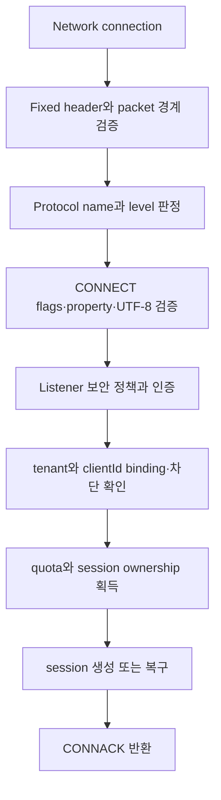

# MQTT protocol과 session 스펙

이 문서는 MQTT client가 NaruMQ listener에 연결해 인증하고 publish·subscribe하며 session을 재개할 때 관찰하는 동작을 정의한다. Cluster 내부 복제 방식은 [cluster spec](cluster-session-and-delivery.md), tenant 권한 판정은 [security spec](tenancy-and-security.md)을 기준으로 한다.

| 항목 | 값 |
| --- | --- |
| 상태 | Draft |
| 관련 요구사항 | MQTT-01~MQTT-13, CLIENT-01~CLIENT-08 |
| 근거 | [PRD 8장과 9.1절](../requirements/PRD.md), [OASIS MQTT 3.1.1](https://docs.oasis-open.org/mqtt/mqtt/v3.1.1/mqtt-v3.1.1.html), [OASIS MQTT 5.0](https://docs.oasis-open.org/mqtt/mqtt/v5.0/mqtt-v5.0.html) |
| 관련 Architecture | [System overview](../architectures/system-overview.md), [Broker core](../architectures/broker-core.md) |
| 관련 Contract | [MQTT client compatibility v1](../contracts/mqtt-client-compatibility-v1.md) |
| 관련 결정 | [ADR-0057 MQTT WebSocket/WSS listener](../decisions/ADR-0057-mqtt-websocket-listener.md) |
| 해설 | [MQTT 전달 보장과 QoS·Session·Will protocol 흐름](../explainers/mqtt-delivery-guarantees-and-protocol-flows.md) |

2026-10-05 승인된 resource limit 구현 범위는 §1의 packet 완성 시간과 §7.1·§8.1이다. 나머지 Draft 범위의 채택 상태는 바꾸지 않는다.

## 현재 구현 상태: standalone QoS 1/2와 dynamic cluster의 제한된 durable QoS 1/2 delivery

Standalone runtime은 MQTT 3.1.1/5.0 client의 `CONNECT → SUBSCRIBE/PUBLISH → PING/DISCONNECT`와 process-local session delivery를 제공한다.
기본 startup은 `-security-config` secure mode로 JWT/JWKS, fixed-profile Argon2id username/password 또는 verified client certificate mTLS authentication과 tenant-aware ACL을 적용한다.
mTLS는 handshake가 검증한 client certificate의 `commonName`, `dnsSan`, `emailSan` selector를 strict identity binding으로 바꾸며 configured Client ID가 허용 목록과 일치해야 한다.
인증·tenant 경계 없는 plaintext ingress는 `-allow-insecure-anonymous-mqtt`를 지정한 literal loopback `-tcp-listen` development·benchmark 예외에서만 허용하며 TLS listener에는 적용하지 않는다.

Dynamic cluster는 별도 `-cluster-config` composition root다. QoS 0 retained PUBLISH와 detached persistent session의 QoS 0 offline queue는 Raft에 commit해 replay하고 NMQBKUP3 archive에 포함한다([Cluster §4.1](cluster-session-and-delivery.md#41-offline-message-capture와-전달), §11.8–§11.9). ADR-0015와 ADR-0019는 QoS 1/2 delivery와 ACK 경계를 정한다. Target 있는 delivery는 관련 command commit 뒤 ACK하고, target 없는 QoS 1 client PUBLISH는 delivery command 대신 proposal 없는 fresh quorum ReadIndex barrier 뒤 PUBACK한다([Cluster §4.2](cluster-session-and-delivery.md#42-qos-12-durable-delivery)). QoS 2 publisher inbound handshake는 target과 무관하게 commit한다. Detached QoS 1/2 delivery, takeover, backup restore, process kill과 quorum-loss 동작은 제한된 process acceptance로 확인했다(§11.11). Production storage/EBS power-loss, BP-03, N/N-1과 TEN-08은 포함하지 않는다.

- `internal/domain/mqtt`는 CONNECT/CONNACK, QoS 0·1·2 PUBLISH, PUBACK/PUBREC/PUBREL/PUBCOMP,
  SUBSCRIBE 계열과 PINGREQ/PINGRESP/DISCONNECT를 decode·encode한다. PING packet은
  Remaining Length 0만 허용하고 MQTT 5 DISCONNECT는 property-free allowlist만 지원한다.
- MQTT 5 CONNECT는 Session Expiry Interval(0x11), Receive Maximum(0x21),
  Maximum Packet Size(0x27)를 받는다. 성공 CONNACK은 server Receive Maximum과
  Maximum Packet Size를 알린다.
- `internal/domain/routing`은 non-shared 및 `$share/{ShareName}/{filter}` 공유 구독,
  `+`·`#` filter, `$` system topic 경계, session별 중복 제거와 overlap 최대 granted QoS를
  결정한다. 공유 구독은 그룹 내 가입자를 Round-Robin으로 primary에 선택하고, 선택된
  member의 delivery queue가 full 또는 unavailable이면 같은 group의 다음 eligible member로
  순서대로 handoff한다.
  `No Local`은 비공유 구독에서 동일 publisher session을 제외하며(공유 구독에 NoLocal 설정 시
  0x82 Protocol Error 거절), `Retain As Published`는 live delivery의 RETAIN을 결정하며,
  `Retain Handling`은 SUBSCRIBE replay 시점에만 적용한다.
- `internal/application/subscribe`는 요청 순서를 유지한 SUBACK를 만들고, retained
  replay batch를 route mutation 전에 queue에 원자적으로 예약한다. MQTT 3.1.1과
  MQTT 5의 non-shared retained replay 및 MQTT 5 subscription options를 지원하며,
  공유 구독 가입 시 retained message replay를 억제([MQTT-4.8.2-1])하고 NoLocal을 프로토콜 에러로 거절([MQTT-3.8.3-4])한다.
- `internal/application/publish`는 tenant와 exact topic별 retained PUBLISH를 replace/delete한다. Standalone profile은 QoS 0·1·2 ingress를 처리한다. Dynamic cluster는 QoS 0 retained/offline 경로와 ADR-0015의 QoS 1/2 durable publish 경로를 분리하며, target 없는 QoS 1 client PUBLISH/Will은 ADR-0019의 proposal 없는 ReadIndex barrier 뒤 처리한다. Commit·barrier 순서와 ACK 조건은 [Cluster §4.2](cluster-session-and-delivery.md#42-qos-12-durable-delivery)에 정의한다.
- `internal/domain/mqtt`의 MQTT 5 PUBLISH는 Message Expiry Interval property를 검증하고,
  application은 ingress 수신 시각과 interval을 한 번만 계산해 absolute deadline으로
  변환한다. Standalone delivery queue와 memory retained repository는 `now >= deadline`에서 lazy purge한다. Dynamic cluster retained state는 expiry deadline과 proposal 시각을 command에 포함해 Raft apply에서 만료를 결정적으로 제거한다. MQTT 5 onward PUBLISH에는 올림한 남은 초를 다시 넣으며 MQTT 3.1.1 wire에는 property를 쓰지 않아도 같은 deadline을 적용한다.
- `internal/application/ports/retained`와 `internal/adapters/memory/retained`는 bounded tenant/topic repository를 제공한다. Standalone mode에서는 이것이 process-local authority다. Dynamic cluster mode에서는 같은 adapter가 replay lookup projection이며, 권위 있는 retained state는 replicated state machine이 소유한다. Startup·snapshot restore 뒤 projection을 rebuild하며 실패하면 readiness를 허용하지 않는다. Cluster retained process evidence는 [§11.8](cluster-session-and-delivery.md#118-retained-replication과-backup-v2-수용-매핑)에 있다.
- Standalone ingress는 QoS 0·1·2를 지원한다. QoS 1은 메시지 라우팅 후 PUBACK을 반환하며, QoS 2는 수신 시 PUBREC을 반환하고 PUBREL 수신 시 라우팅 후 PUBCOMP를 반환한다. 중복 Packet Identifier 재전송 시 중복 라우팅 없이 동일 ACK를 반환한다.
- Standalone outbound delivery는 구독자의 granted QoS와 메시지 QoS 중 낮은 QoS로 전송하며 QoS 1/2 subscriber handshake를 완료한다. Dynamic cluster QoS 1/2 durable delivery도 MQTT handshake를 복구할 수 있지만 process acceptance는 [Cluster §11.11](cluster-session-and-delivery.md#1111-qos-12-durable-delivery-수용-매핑)의 범위에 한정된다. Cluster retained replay의 evidence는 QoS 0이 §11.8, QoS 1/2가 [§11.32](cluster-session-and-delivery.md#1132-qos-12-retained-수용-매핑)에 있다.
- 만료되지 않은 persistent session은 network connection이 종료되어도 process-local
  delivery queue의 FIFO queued entry와 완료되지 않은 송신 QoS 1/2 상태를 보존한다.
  새 connection은 `CONNACK`을 먼저 전송한 뒤 복구 packet을 전송해야 한다.
- 복구된 QoS 1/2 `PUBLISH`는 저장된 Packet Identifier를 재사용하고 `DUP=1`로
  전송한다. QoS 2가 PUBLISH 단계 뒤 `PUBREC`까지 완료된 상태는 같은 Identifier의
  `PUBREL`로 재개한다. reconnect protocol version에 맞춰 packet을 다시 인코딩한다.
- Message Expiry가 지난 queued entry와 PUBLISH-stage 송신 상태는 제거하고 전송하지
  않는다. 이미 PUBLISH를 수신한 뒤 `PUBCOMP`를 기다리는 QoS 2 `PUBREL` 상태는
  원래 publication deadline과 무관하게 복구한다.
`internal/adapters/memory/sessionstore`와 delivery queue는 session state와 local delivery projection을 process-local memory에 둔다. Standalone mode는 이를 process restart, replication 또는 durable storage recovery에 보존하지 않는다. Cluster mode에서는 detached QoS 0 offline queue를 [Cluster §4.1](cluster-session-and-delivery.md#41-offline-message-capture와-전달), QoS 1/2 durable target queue 및 inbound/outbound protocol state를 [§4.2](cluster-session-and-delivery.md#42-qos-12-durable-delivery)에 따라 Raft에서 복구한다. QoS 1/2 evidence와 production durability 한계는 [§11.11](cluster-session-and-delivery.md#1111-qos-12-durable-delivery-수용-매핑)을 참조한다. TLS transport와 mTLS client authentication은 listener 계약에 정의한 범위에서 지원한다.

영속 session의 queued·in-flight delivery state는 clean reset 또는 Session Expiry가
끝날 때만 제거한다. 정상적인 persistent disconnect에서는 session, route와 함께 delivery
state를 유지한다.

## 1. Listener 계약

1. TCP, TLS, WebSocket과 WSS listener는 MQTT 3.1.1 protocol level 4와 MQTT 5.0 protocol level 5를 수용해야 한다.
2. listener마다 bind address, TLS 정책, 인증 방식, 최대 연결 수, connection rate와 packet 제한을 독립 적용해야 한다.
3. 평문 TCP listener는 기본 설정에서 비활성화해야 한다. MQTT listener를 활성화할 때는 [security spec](tenancy-and-security.md)의 secure mode를 선택해야 한다. Standalone은 `-security-config`로, dynamic cluster는 필수 field `mqtt.securityConfigFile`로 secure mode를 지정한다. 유일한 예외는 standalone development·benchmark mode다. 이 mode는 `-tcp-listen`의 literal loopback bind와 `-allow-insecure-anonymous-mqtt`를 함께 지정한다. 두 mode를 함께 지정하거나 TLS listener에 예외 mode를 적용해서는 안 된다.
4. WebSocket과 WSS listener는 MQTT packet과 session 의미를 TCP listener와 같게 제공해야 한다. WebSocket handshake는 `/mqtt` 경로와 `mqtt` subprotocol을 요구하고 binary frame만 허용한다. WSS는 기존 TLS profile을 사용한다. 각 listener의 admission 제한을 TLS handshake와 HTTP upgrade 전에 적용한다. TLS handshake와 HTTP upgrade는 10초 안에 끝나야 한다.
5. connection은 설정된 CONNECT timeout 안에 유효한 CONNECT를 보내야 한다. timeout 또는 malformed packet이면 session을 만들지 않고 연결을 닫아야 한다.
   CONNECT 뒤 첫 byte가 도착한 packet은 `-packet-read-timeout`(기본 30s) 안에
   완성되어야 한다. 시간을 넘기면 응답 없이 연결을 닫는다. KeepAlive=0이고
   미완성 byte가 없는 유휴 연결은 유지한다.
6. Development profile의 평문 `-tcp-listen`은 `127.0.0.0/8` 또는 `::1` literal loopback만 허용한다. 이 listener는 `-allow-insecure-anonymous-mqtt`를 명시한 경우에만 anonymous MQTT를 허용한다. TLS listener는 `-tls-listen`으로 활성화하고 TLS 1.2 이상, 허용된 AEAD cipher suite와 설정된 server certificate를 적용한다. `request` 또는 `require` client authentication에는 strict security config의 mTLS identity binding이 필요하다. TLS adapter는 verified chain의 leaf certificate에서 application `ClientCertificateDTO`를 만들고, authentication adapter는 exact Common Name, DNS SAN 또는 email SAN을 match한다. WSS는 같은 TLS 설정을 사용한다.
7. `-tcp-listen`, `-tls-listen`, `-ws-listen`과 `-wss-listen`은 하나의 `tcp.Server`에 함께 등록할 수 있고 listener별 transport 보안 정책을 유지하면서 같은 session·route registry를 공유한다.
8. CONNECT 뒤에는 negotiated version으로 packet을 decode하고, 모든 socket write는 한 writer goroutine의 bounded control queue 또는 delivery wake를 통과한다.
9. Binary smoke, 실제 loopback wire와 TLS/mTLS socket, password 인증은 [§8 수용 시험](#8-수용-시험)의 시나리오로 확인한다.
10. Dynamic cluster의 평문 `mqtt.tcpListenAddress`는 loopback 제한 없이 유효한 host:port를 허용한다. Wildcard와 DNS 이름도 포함한다. 이 listener는 secure mode에서만 열린다. Security config에 `jwt` 또는 `passwordIdentities`가 있으면 username·password 없는 CONNECT를 `missing_credentials`로 거절한다. `mtlsIdentities`만 있으면 평문 TCP에는 client certificate가 없으므로 CONNECT를 `missing_certificate`로 거절한다. CONNACK reason은 MQTT 3.1.1에서 `0x05`, MQTT 5에서 `0x87`이다. 평문 TCP는 CONNECT credential을 암호화하지 않는다. 결정 근거는 [ADR-0052 §1.5](../decisions/ADR-0052-configuration-tiers-and-cluster-policy.md#15-형식과-cluster-mqtt-tls)(G3)다.
11. Standalone 평문 `-ws-listen`은 literal loopback IP(`127.0.0.0/8` 또는 `::1`)만 허용하고 `-security-config`를 요구한다. `-allow-insecure-anonymous-mqtt`는 TCP에만 적용하며 WS/WSS와 함께 사용할 수 없다. Dynamic cluster의 평문 `mqtt.webSocket.listenAddress`는 유효한 host:port를 허용하지만 `mqtt.securityConfigFile`을 요구한다. WSS는 `mqtt.tls` 또는 기존 standalone `-tls-*` 설정을 사용한다.

## 2. CONNECT 처리 순서

서버는 CONNECT를 다음 순서로 처리해야 한다.

각 단계가 실패하면 이후 단계의 durable state를 만들어서는 안 된다. ownership을 얻은 뒤 응답 전 실패하면 재시도 시 같은 session 상태로 수렴해야 한다.

인증 단계는 configured verified client certificate가 있으면 mTLS provider만 사용한다.
그 CONNECT에 Username 또는 Password가 함께 있으면 dual credential 오류로 거절하며 다른
provider로 fallback하지 않는다. Certificate가 없으면 configured JWT 또는 password provider를
사용한다. 두 방식 모두 MQTT Username과 Password flag가 필요하다. JWT에는 compact token을,
password 방식에는 case-sensitive Username과 원문 Password bytes를 전달한다.
인증·Client ID binding·Will ACL이 성공하기 전에는 session, route, queue를 변경하지 않는다.

### 2.1 Protocol version

| 입력 | 외부 동작 |
| --- | --- |
| Protocol Name `MQTT`, level 4 | MQTT 3.1.1로 처리한다. |
| Protocol Name `MQTT`, level 5 | MQTT 5.0으로 처리한다. |
| Protocol Name `MQIsdp`, level 3 | MQTT 3.1.0 wire variant로 인식하지만 비지원으로 거절한다. 응답 없이 연결을 닫고 session을 만들지 않는다. |
| Protocol Name `MQTT`, level 3 | MQTT 3.1.0 wire variant로 인식하지만 MQTT 3.1.1 형식의 CONNACK `0x01`을 반환한 뒤 연결을 닫고 session을 만들지 않는다. |
| 지원하지 않는 level | MQTT 3.1.1 형식으로 판정 가능한 경우 CONNACK `0x01`을 반환하고 연결을 닫는다. MQTT 5 형식으로 판정 가능한 경우 CONNACK `0x84`를 반환하고 연결을 닫는다. |
| packet 구조상 version을 안전하게 판정할 수 없음 | 응답 없이 연결을 닫을 수 있다. malformed packet으로 기록한다. |

두 MQTT 3.1.0 wire variant의 거절은 `reason="unsupported_protocol_version"`, `protocol="3.1.0"`으로 같은 Metric에 집계해야 한다. 원문 credential은 로그에 남기지 않는다. `MQIsdp`와 `MQTT`의 Protocol Name 차이는 응답 정책만 바꾼다.

### 2.2 Session 선택

session key는 `(tenantId, clientId)`다. tenant와 clientId가 하나라도 달라지면 기존 session을 재개해서는 안 된다.

| Protocol 입력 | Session 동작 | CONNACK |
| --- | --- | --- |
| MQTT 3.1.1 `Clean Session=1` | 기존 session을 폐기하고 새 session으로 시작한다. 연결 종료 뒤 session을 보존하지 않는다. | `Session Present=0` |
| MQTT 3.1.1 `Clean Session=0` | 만료되지 않은 기존 session을 복구한다. 없으면 새 persistent session을 만든다. | 복구했을 때만 `Session Present=1` |
| MQTT 5 `Clean Start=1` | 기존 session을 폐기하고 새 session으로 시작한다. | `Session Present=0` |
| MQTT 5 `Clean Start=0` | 만료되지 않은 기존 session을 복구한다. | 복구했을 때만 `Session Present=1` |
| MQTT 5 `Session Expiry Interval=0` | network connection 종료 뒤 session을 제거한다. | 위 규칙에 따름 |

동일 session key로 새 connection이 인증과 ownership 획득에 성공하면 새 connection이 owner가 된다.
production target에서는 MQTT 5이면 이전 connection에 `DISCONNECT 0x8E`(`Session taken over`)를
보내고, MQTT 3.1.1은 연결을 닫아야 한다. 현재 development slice는 takeover를 구현하지 않고
active duplicate를 negative CONNACK으로 거절한다.

## 3. Publish와 내구성 ACK

### 3.1 수신 QoS 상태

| QoS | 성공 경계 | 재전송·중복 처리 |
| --- | --- | --- |
| 0 | packet을 수용해 routing queue로 넘긴 시점 | ACK가 없다. 장애 시 유실될 수 있다. |
| 1 | 메시지와 필요한 전달 상태가 configured durability barrier를 통과한 뒤 성공 PUBACK | 같은 Packet Identifier와 DUP 재전송을 최소 한 번 의미로 처리한다. 이미 성공 처리한 packet은 중복 durable message를 만들지 않고 일관된 PUBACK을 반환해야 한다. |
| 2 | 수신 PUBLISH와 handshake 상태가 durability barrier를 통과한 뒤 성공 PUBREC | PUBREL과 PUBCOMP까지 상태를 복구한다. 중복 PUBLISH·PUBREL은 같은 handshake 결과로 수렴해야 한다. |
수신 QoS 1/2 핸드셰이크가 PUBACK 또는 PUBCOMP로 완료되면 client는 같은 연결에서 Packet Identifier를 다시 사용할 수 있다. 이때 `DUP=0`인 새 PUBLISH는 새 교환이며, broker는 기존 완료 상태만 바꾸고 메시지를 새로 처리해야 한다. 진행 중인 교환 상태는 재사용으로 덮어쓰지 않는다. QoS 2 완료 상태의 tombstone은 반복 PUBREL을 멱등 처리하며, 같은 Packet Identifier의 새 RECEIVE가 commit될 때 교체한다.

Dynamic cluster의 durable TCP 연결은 handshake 단계 둘을 별도 FIFO 작업 lane으로 처리한다. 첫 lane은 `PUBLISH`·`PUBACK`·`PUBREC`, 둘째는 `PUBREL`·`PUBCOMP`를 처리한다. 각 lane은 16개 대기 항목으로 제한하고, 처리 중 항목을 포함한 두 lane의 입력 byte 합계는 `MaxPacketSize+5` 이하로 제한해 TCP 읽기에 backpressure를 건다. PUBLISH 수신 순서, PUBREL 수신 순서, 같은 방향·Packet Identifier의 전체 수신 순서는 유지한다. 나머지 control packet은 앞선 두 lane의 작업이 끝난 뒤 처리한다. Decoder가 소유한 packet 값만 lane에 전달한다. `deliveryMu`는 map·PacketID 예약/해제·상태 변경을 보호하며, durable I/O를 기다리는 동안은 잠그지 않는다. 예약한 ID는 promotion이 끝날 때까지 유지하고, durable commit 성공 뒤 상태를 갱신한 다음 ACK/PUBREL을 전송한다. 비정상 종료 시 socket을 닫고 모든 phase worker와 writer가 끝난 뒤 session을 cleanup한다. 정상 DISCONNECT는 앞선 phase 작업과 제어 패킷을 먼저 끝내고 cleanup한 뒤 socket을 닫는다. Cleanup 표시는 `deliveryMu` 아래 설정해 늦게 완료된 promotion이 닫힌 connection에 상태를 다시 넣지 못하게 한다. Fresh read barrier, quorum commit, epoch fencing과 재시도 시 예약 유지 계약은 바꾸지 않는다.

첫 lane의 durable PUBLISH는 준비·제출과 완료를 분리한다. 준비 단계는 수신 순서대로 검증하고, 준비된 변경을 driver의 대기 목록에 넣는다. Driver는 각 변경의 고유한 ReadIndex context로 새 quorum proof를 요청한다. Proof의 index까지 local apply/projection이 끝난 뒤에만, 대기 목록의 입력 순서대로 실제 Raft proposal을 제출한다. 앞선 proof가 늦으면 뒤의 변경도 추월하지 않으며, 취소된 변경은 제출하지 않는다. 이때 반환하는 pending 값은 proof나 성공 ACK의 근거가 아니다. 별도 완료 worker가 제출 순서대로 WAL 내구성·quorum commit·local apply/projection 완료를 기다린 뒤 inbound 상태를 갱신하고 PUBACK/PUBREC을 전송한다. 서로 다른 Packet Identifier의 다음 PUBLISH는 앞선 proof·commit 완료를 기다리지 않고 준비할 수 있다. 같은 ID의 재전송·재사용은 앞선 완료까지 기다리며, control barrier와 종료 처리는 준비된 모든 pending 값의 완료 처리까지 포함한다. Retained 및 QoS 0 PUBLISH는 기존 동기 경로를 사용하고 앞선 제출의 완료 뒤 처리한다. Lane의 16개 제한과 공용 byte 제한은 제출 후 완료 대기 항목까지 포함한다. 동기 application 호출은 같은 pending 값을 즉시 기다리는 API를 사용한다. 기존 quorum proof를 재사용하거나 read-before-write를 생략하지 않으며, ReadIndex/control은 proposal 수집 timer 때문에 기다리지 않는다.

둘째 lane의 비-retained QoS 2 `PUBREL`도 같은 준비·완료 방식을 사용한다. Inbound state가 가리키는 원래 PUBLISH를 기준으로 RELEASE를 준비하고 입력 순서대로 fresh proof 뒤 제출한다. 완료 worker가 release commit을 확인한 뒤에만 tombstone과 PUBCOMP를 만든다. Retained RELEASE와 이미 완료된 duplicate PUBREL은 앞선 pending 완료 뒤 기존 동기 경로로 처리한다. 같은 방향·ID의 predecessor 규칙과 lane 전체 제한은 두 lane에 동일하게 적용한다.

송신 ACK의 `ADVANCE`·`COMPLETE`도 lane에서 준비하고 완료 worker가 commit 결과 뒤 outbound map·PacketID를 변경한다. `deliveryqueue.Queue.BeginReplaceOutbound`와 `BeginCompleteOutbound`가 application 소유 pending transition을 반환한다. Cluster queue는 새 proof 뒤 durable 변경을 제출하고, pending 완료 시에만 local queue를 변경한다. Memory queue는 I/O가 없으므로 같은 변경을 즉시 수행한 완료 값을 반환한다. PUBREL 전송과 PacketID 해제는 완료 뒤에만 가능하다. 같은 방향·ID의 predecessor 규칙은 duplicate PUBREC/PUBCOMP 및 sender ID 재사용에도 적용한다.

송신 writer는 queued QoS 1/2 메시지를 최대 8개씩 준비해 `deliveryqueue.Queue.PromoteBatch`에 넘긴다. `PeekBatch`는 caller가 제공한 고정 크기 배열까지만 FIFO 항목과 소유한 payload를 반환한다. Batch는 durable SEND마다 별도 fresh proof를 요구하며 여러 SEND를 하나의 의미 없는 성공으로 합치지 않는다. 모든 pending 결과를 회수하고, 성공한 연속 prefix만 local queue에서 outbound로 옮긴다. Writer는 그 prefix만 순서대로 wire에 보낸다. 앞선 SEND의 응답이 실패해도 뒤의 SEND가 이미 commit되었을 수 있으므로, 실패 뒤의 모든 suffix는 PacketID 예약을 재시도 또는 연결 정리까지 보존한다. 일부 prefix가 성공했더라도 나머지 오류를 성공으로 바꾸지 않는다. 재시도는 같은 ID를 사용하고, local queue처럼 durable sequence가 없는 항목도 예약 하나를 여러 메시지에 중복 사용하지 않는다. Local mutation이나 wire PUBLISH가 proof·commit보다 앞서서는 안 된다. 기존 단일 항목 promotion과 memory queue도 같은 FIFO·expiry·capacity·PacketID 규칙을 적용한다.

quorum, 저장 quota 또는 replication 조건을 충족하지 못하면 성공 PUBACK/PUBREC을 반환해서는 안 된다. MQTT 5에서는 상황에 맞는 `0x89`(`Server busy`), `0x97`(`Quota exceeded`) 또는 `0x83`(`Implementation specific error`)를 사용할 수 있다. MQTT 3.1.1에서 packet 단위 실패를 표현할 수 없으면 연결을 닫을 수 있다. 어느 경우든 성공 ACK로 위장해서는 안 된다.

이 slice는 단일 노드 인메모리 프로세스 로컬 환경에서 수신 QoS 1 및 QoS 2 핸드셰이크를 지원한다.
수신 QoS 1은 fan-out 성공 후 성공 PUBACK(MQTT 5는 ReasonCode 0)을 반환하며, 중복 패킷
재전송 시 중복 전달 없이 동일한 PUBACK을 반환한다.
수신 QoS 2는 1단계에서 PUBREC을 반환하고, 클라이언트로부터 PUBREL이 수신되면 실제 fan-out을
수행한 뒤 PUBCOMP를 반환하여 핸드셰이크를 완료한다. 중복 PUBLISH 또는 PUBREL 재전송 시
동일한 PUBREC 또는 PUBCOMP로 수렴한다.
용량 초과(`retained.ErrFull`) 등의 실패 시 MQTT 5는 `0x97` 등의 negative ACK/DISCONNECT를 반환하고,
MQTT 3.1.1은 연결을 닫는다.
### 3.2 송신 QoS와 offline queue

1. 전달 QoS는 publish QoS와 subscription granted QoS 중 낮은 값이어야 한다.
2. process-local delivery queue entry는 Message Expiry deadline과 현재 bounded
   capacity를 적용해야 한다. 만료되지 않은 persistent session은 연결이 끊긴 동안에도
   FIFO queued entry와 완료되지 않은 outbound QoS 1/2 state를 보존해야 한다.
3. QoS 1 송신 상태는 PUBACK까지, QoS 2 송신 상태는 PUBCOMP까지 복구할 수 있어야 한다.
   QoS 2에서 PUBLISH 뒤 PUBREC까지 성공한 상태는 PUBREL 전송 단계로 복구한다.
4. 재접속 뒤 미완료 PUBLISH를 재전송할 때 저장된 Packet Identifier와 `DUP=1`을
   사용한다. 복구된 PUBREL도 저장된 Packet Identifier를 사용하며, 새 connection의
   MQTT protocol version으로 인코딩한다.
5. queued entry 또는 PUBLISH-stage retransmission의 expiry가 지나면 상태에서 제거하고
   전송하지 않는다. 만료로 제거된 상태는 `expired` 사유로 집계해야 하며, 구체적인
   Metric 이름과 histogram bucket은 `SPEC-TBD-07`에서 확정한다. PUBREL 대기 상태는
   PUBLISH가 이미 수신되었으므로 원래 publication deadline이 지나도 복구한다.
6. `CONNACK`은 같은 reconnect에서 복구된 packet보다 먼저 wire에 기록되어야 한다.
   복구된 outbound state는 Packet Identifier 오름차순으로 한 번만 재개한 뒤 새 queued
   entry를 FIFO 순서로 처리한다.

## 4. Subscribe와 routing 입력

1. Topic Filter의 `+`, `#` 위치와 UTF-8을 표준대로 검증해야 한다.
2. 겹치는 subscription이 같은 client session에 여러 번 match하면 MQTT version의 표준 전달 규칙과 granted QoS를 적용해야 한다.
3. `$share/{group}/{filter}`는 tenant 안의 같은 group에서 한 활성 subscriber를 선택해야 한다. 선택된 subscriber가 전달을 완료하지 못하면 session·QoS 규칙에 따라 다른 member가 이어받을 수 있어야 한다. Cluster에서 선택된 subscriber의 owner node에 도달할 수 없거나 그 session이 CleanStart reset·삭제로 사라지면 QoS 1 이상 message는 다른 member가 이어받는다. QoS 2는 이미 보내기 시작한 message를 다른 member에게 보내지 않는다. Cluster 동작은 [Cluster §4.2](cluster-session-and-delivery.md#42-qos-12-durable-delivery)를 따른다.
4. MQTT 5 subscription option은 exact filter별로 보존하고 다음처럼 적용해야 한다.
   - `No Local=true`면 publication publisher와 같은 `clientId`의 live delivery를 제외한다.
   - `Retain As Published=false`면 established-subscription delivery의 RETAIN을 지우고, `true`면 incoming RETAIN을 보존한다.
   - SUBSCRIBE가 발생시킨 retained replay는 `Retain As Published` 값과 무관하게 항상 RETAIN을 설정한다.
   - `Retain Handling=0`은 항상 replay하고, `1`은 새 exact filter일 때만 replay하며, `2`는 replay하지 않는다.
5. 권한이 없는 filter는 subscribe 결과에서 거절해야 하며 route index에 추가해서는 안 된다.
6. unsubscribe는 존재하지 않는 subscription에도 안전하게 재시도할 수 있어야 한다.
7. Broker는 해당 SUBSCRIBE가 발생시킨 retained replay PUBLISH를 보내기 전에 그 SUBSCRIBE의 SUBACK을 wire에 기록해야 한다(MUST). SUBSCRIBE 적용과 SUBACK 전송 중에는 TCP writer가 queued delivery를 보류하고, SUBACK 기록 뒤 delivery를 재개한다.

## 5. Retained Message

Standalone development profile은 bounded process-local retained repository를 사용한다. Dynamic cluster profile은 Raft committed retained state를 권위 있는 값으로 쓰고 node-local repository를 replay용 projection으로 재구성한다. Retained replication과 cross-node replay acceptance는 QoS 0 PUBLISH를 [Cluster §11.8](cluster-session-and-delivery.md#118-retained-replication과-backup-v2-수용-매핑)에서, QoS 1/2 `Retain=true` PUBLISH를 [Cluster §11.32](cluster-session-and-delivery.md#1132-qos-12-retained-수용-매핑)에서 확인한다. QoS 1/2 retained mutation 순서는 [Cluster §4.2](cluster-session-and-delivery.md#42-qos-12-durable-delivery)를 따른다. QoS 2는 PUBREL을 받을 때 retained state를 commit한다. Retained mutation은 fresh read barrier와 정확한 member profile 확인 뒤 route matching/live fan-out보다 먼저 commit되어야 한다. Commit 실패 시 해당 PUBLISH의 live fan-out을 시작하지 않는다.

- Retained key는 tenant와 exact Topic Name의 쌍 `(tenantId, topic)`이다. 같은 topic이어도 tenant가 다르면 서로 다른 value를 보관한다.
- 입력 `PUBLISH`가 `Retain=true`이고 payload가 비어 있지 않으면 해당 tenant/topic의 마지막 value를 publisher session identity 및 QoS와 함께 replace한다.
- retained PUBLISH의 zero-byte payload는 해당 tenant/topic value를 삭제한다. 삭제 packet 자체는 established subscription에 live publication으로 전달된다.
- `Retain=false`인 PUBLISH는 retained repository를 읽거나 변경하지 않는다.
- MQTT 5 Message Expiry Interval이 있으면 ingress 수신 시각에 interval 초를 더한 absolute deadline을 retained value에 저장한다. `interval=0`인 retained PUBLISH는 delete로 처리한다. Standalone repository와 cluster replay projection은 `List(now)`에서 `now >= deadline`인 값을 제거하므로 만료 값은 replay되지 않는다. Raft 권위 state는 다음 retained command를 apply할 때 그 command의 proposal 시각으로 만료 entry를 제거한다. 다음 command 전까지 만료 entry가 snapshot/archive와 용량 한도에 남을 수 있다. MQTT 3.1.1에는 Message Expiry property가 없지만 다른 protocol version에서 저장한 deadline은 replay 시 계속 적용한다.
- 새 non-shared subscription은 matching retained value를 topic 정렬 순서로 replay한다. 공유 구독(`$share/...`)은 Retain Handling 옵션과 무관하게 retained value를 replay하지 않는다([MQTT-4.8.2-1]). MQTT 3.1.1과 MQTT 5 `Retain Handling=0`은 항상 replay하고, `=1`은 exact filter가 새로 생길 때만 replay하며, `=2`는 replay하지 않는다.
- Replay delivery의 RETAIN은 항상 `true`다. Established-subscription delivery는 matching filter 중 RAP가 하나라도 켜져 있고 incoming RETAIN이 true일 때만 RETAIN을 유지한다. `No Local`은 stored publisher session과 subscriber session이 같으면 replay와 live delivery를 모두 제외한다.
- Retained replay의 QoS는 stored QoS와 granted QoS 중 작은 값이며 MQTT writer는 QoS 0·1·2 outbound handshake를 적용한다. Cluster ingress도 입력 PUBLISH의 QoS를 retained value에 저장한다.
- Retained state의 적용 한도는 기존 global 기준(value 1,024개, 계산된 총 16 MiB, payload당 1,000,000 bytes)에 tenant별 `retainedBytes` 저장 quota를 더해 [ADR-0017](../decisions/ADR-0017-tenant-storage-quota.md)에 따라 검사한다. Retained value의 계산 bytes는 tenant ID, topic, payload와 publisher routing ID의 byte 길이를 합산한다. Tenant quota 초과는 기존 non-expired value를 보존하고 live fan-out을 시작하지 않지만, 같은 apply에서 expired entry는 proposal 시각에 따라 제거될 수 있다.
- Message Expiry는 bounded queue와 retained repository에서 지원한다. MQTT 5 outbound PUBLISH에는 현재 시각 기준 올림한 남은 초를 넣고, MQTT 3.1.1 outbound에는 expiry property를 생략한다. Delivery queue의 queued·in-flight state는 process-local persistent session 범위에서 reconnect까지 보존하지만 process restart와 replication은 이 slice의 범위가 아니다. Cluster retained state는 committed snapshot에서 restart/restore 뒤 재구성한다.

## 6. Will Message

Will은 CONNECT의 인증·ACL·quota 검증을 통과한 뒤 session state에 등록해야 한다.

| 종료 원인 | Will 동작 |
| --- | --- |
| client의 정상 DISCONNECT | 발행하지 않는다. MQTT 5 `0x04`(`Disconnect with Will Message`)는 표준대로 발행한다. |
| network 단절, keepalive timeout, protocol 오류 | Will Delay가 없으면 표준 시점에 발행한다. |
| MQTT 5 Will Delay 안에 같은 session key로 재접속 | 발행하지 않는다. |
| Session Expiry가 Will Delay보다 먼저 끝남 | MQTT 5 표준이 정한 더 이른 시점에 처리한다. |
| MQTT 3.1.1 server 주도 연결 종료 | Will이 설정돼 있으면 발행될 수 있다. no-Will 보장 대상이 아니다. |

Will publish에도 tenant 격리, ACL, payload·rate quota, retained와 delivery 규칙을 적용해야 한다. Drain 중 규칙은 [drain spec](drain-and-rolling-update.md)을 따른다.

## 7. Resource limit과 protocol 오류

| 조건 | MQTT 5 동작 | MQTT 3.1.1 동작 |
| --- | --- | --- |
| packet size 초과 | 가능한 경우 `0x95` 후 종료 | packet을 처리하지 않고 종료 |
| Receive Maximum 초과 | `DISCONNECT 0x93` | 연결별 inflight 한도를 넘기지 않도록 read backpressure 또는 종료 |
| message rate 초과 | `0x96` 또는 `0x97`이 허용되는 packet에서 반환 | backpressure 후 필요하면 종료 |
| connection rate 초과 | CONNACK `0x9F` 또는 handshake 전 종료 | CONNACK `0x03` 또는 handshake 전 종료 |
| malformed packet·invalid UTF-8 | 표준 reason code가 허용되면 반환한 뒤 종료 | 즉시 종료 |
| slow client·write queue 포화 | bounded queue와 timeout 적용 후 종료 | 동일 |

모든 connection queue와 inflight collection에는 설정된 상한이 있어야 한다. 제한에 도달했을 때 무제한 할당으로 진행해서는 안 된다.

### 7.1 현재 상한과 초과 동작

Receive Maximum은 ACK가 끝나지 않은 QoS 1/2 PUBLISH 수의 상한이다. Maximum
Packet Size는 fixed header를 포함한 전체 packet byte 수의 상한이다.

| 상한 | 설정 기준 | 초과 시 MQTT 5 | 초과 시 MQTT 3.1.1 |
| --- | --- | --- | --- |
| Remaining Length | [Process configuration v1 §1.1, §1.3](../contracts/process-configuration-v1.md) | CONNECT 뒤 DISCONNECT `0x95` 후 종료. CONNECT 전 응답 없이 종료 | 종료 |
| Inbound Receive Maximum(PUBACK·PUBCOMP·PUBREC≥0x80을 아직 쓰지 않은 QoS 1/2 PUBLISH 수) | [Process configuration v1 §1.1, §1.3](../contracts/process-configuration-v1.md) | DISCONNECT `0x93` 후 종료 | 종료 |
| 시작된 packet 완성 시간(CONNECT 뒤) | [Process configuration v1 §1.1, §1.3](../contracts/process-configuration-v1.md) | 응답 없이 종료 | 응답 없이 종료 |
| CONNECT 완료 시간 | [Process configuration v1 §1.1, §1.3](../contracts/process-configuration-v1.md) | 응답 없이 종료 | 응답 없이 종료 |
| Listener 동시 연결 수와 connection rate | [Process configuration v1 §1.1, §1.3](../contracts/process-configuration-v1.md) | TCP accept 뒤, TLS handshake·HTTP upgrade·CONNECT 전에 응답 없이 종료 | 같음 |
| Socket write 시간 | [Process configuration v1 §1.1, §1.3](../contracts/process-configuration-v1.md) | 종료 | 종료 |
| 연결별 control queue | [Process configuration v1 §1.1, §1.3](../contracts/process-configuration-v1.md) | 종료 | 종료 |
| Session별 delivery queue | [Process configuration v1 §1.1, §1.3](../contracts/process-configuration-v1.md) | 기존 §3 backpressure 규칙 | 기존 규칙 |
| 연결별 수신 buffer | 설정 없음 | 4 KiB에서 시작해 받은 byte가 차면 2배씩 늘림(최대 Remaining Length+5), 비면 4 KiB로 반환 | — |
| Malformed packet·invalid UTF-8(CONNECT 뒤) | MQTT protocol 규칙 | DISCONNECT `0x81` 후 종료 | 종료 |
| Protocol error(CONNECT 뒤 두 번째 CONNECT 등, reader가 발견한 경우) | MQTT protocol 규칙 | DISCONNECT `0x82` 후 종료 | 종료 |
| Client Receive Maximum(outbound) | Client CONNECT property `0x21`; 생략 시 65535 | 미확인 QoS 1/2 PUBLISH가 설정값에 도달하면 새 PUBLISH를 보류한다. PUBREL·PUBACK 등 다른 packet은 지연하지 않는다 | 해당 없음 |
| Client Maximum Packet Size(outbound) | Client CONNECT property `0x27`; 생략 시 제한 없음 | 넘는 PUBLISH는 보내지 않고 전송 완료로 처리한다. QoS 1/2는 promote 후 즉시 complete한다. 다른 packet이 넘으면 보내지 않고 종료한다 | 해당 없음 |

`-max-packet-size`의 허용 범위는 [Process configuration v1 §1.1](../contracts/process-configuration-v1.md)에서 정한다. TCP `NewServer`도 codec과 같은 규칙을 적용한다. 범위를 벗어나면 `ErrInvalidConfig`로 거절한다. 이 검사는 수신 buffer 크기와 CONNACK 한도를 계산하기 전에 끝나야 한다.

CONNECT 단계의 malformed·oversize는 protocol version을 신뢰할 수 없으므로
CONNACK 없이 닫는다. Cluster durable phase lane이 늦게 발견한 protocol 오류도
기존처럼 DISCONNECT 없이 닫는다.

완료된 inbound exchange 기록은 DUP 판정을 위해 같은 Packet Identifier를 다시
사용하기 전까지 남는다. 이 기록은 Packet Identifier 공간(65535)으로 제한한다.
미완료 exchange는 Receive Maximum으로 제한한다. MQTT 3.1.1에서도 초과 시
종료한다. Read backpressure는 미완료 QoS 2의 PUBREL 수신을 막을 수 있어 쓰지 않는다.

Tenant 한도는 [Tenant §5.2](tenancy-and-security.md#52-연결-상태와-traffic-한도)를 따른다. Rate 대기는 앞 문단의 read backpressure 금지에 대한 유일한 예외다. 대기 시간과 허용 범위는 [Process configuration v1 §1.4](../contracts/process-configuration-v1.md)에서 정한다.
Listener 연결 한도는 TCP, TLS, WebSocket과 WSS에 독립 적용한다. 연결 수는 listener가 허용한 뒤
아직 `Close`되지 않은 socket 수다. CONNECT 전 socket도 포함한다. 첫 `Close`에서만
연결 수를 한 번 줄인다. 최대 연결 수를 먼저 검사하고, 그다음 connection rate를 검사한다.

Connection rate는 token bucket으로 적용한다. Token은 새 socket을 허용할 수 있는
수량이다. Bucket 용량과 초당 보충량은 설정한 rate와 같다. 시작할 때 bucket은
가득 차 있다. 허용한 socket만 token 1개를 쓰며 거절한 socket은 쓰지 않는다.
Clock이 뒤로 가면 token을 보충하지 않는다.

Listener 연결 한도와 connection rate의 field 이름, 기본값, 허용 범위와 cluster config key는 [Process configuration v1 §1.1, §1.3](../contracts/process-configuration-v1.md)에서 정한다. 값 `0`은 해당 한도를 끈다. 두 값이 모두 `0`이면 admission wrapper를 만들지 않는다.

Admission은 raw TCP listener에서 TLS handshake와 HTTP upgrade 전에 적용한다. TLS/WSS는 TLS wrapper 안쪽, WebSocket upgrade는 WebSocket adapter 안쪽에서 거절한다. 거절된 socket은 MQTT CONNECT를 처리하지 않으므로 CONNACK을 보내지 않는다. 이 방식은 handshake와 connection goroutine 비용을 줄인다. 거절 로그는 남기지 않고 `narumq_mqtt_listener_admission_rejected_total{transport,reason}`만 올린다.

Memory delivery queue는 만료되지 않은 persistent session의 queued·in-flight
delivery를 reconnect까지 보존한다. Clean start/session expiry와 message expiry
deadline에 도달한 state만 제거한다. Cluster recovery 범위는 §4와 cluster spec을 따른다.

## 8. 수용 시험

테스트 연결과 결과는 [테스트 컨벤션](../conventions/test-conventions.md)의 시나리오 보고서로 확인한다. 과거 실행 기록은 [검증 기록](../verification/mqtt-protocol-and-session.md)에 있다.

- MQTT 3.1.1/5.0 compliance matrix가 지원한다고 선언한 모든 normative statement를 자동 test와 연결한다.
- 현재 Phase 1 matrix는 [`tests/conformance/mqtt-compliance-v1.json`](../../tests/conformance/mqtt-compliance-v1.json)이며, 61개 statement와 MQTT/TEST requirement 및 test function을 함께 기록한다.
- `go run ./tools/verify traceability`가 matrix → source와 source → matrix를 모두 검사한다. matrix에만 있거나 source에만 있는 statement, 또는 requirement union이 다른 연결은 합격으로 처리하지 않는다.
- `MQTT-3.3.1-5`~`MQTT-3.3.1-13`, `MQTT-3.8.3-3`, `MQTT-3.8.4-3/4`는 tests/conformance/mqtt-compliance-v1.json에서 양 protocol version test와 source traceability comment를 함께 가져야 한다. `MQTT-3.3.2-5/6`는 MQTT 5.0 Message Expiry property와 만료 흐름을 검증하는 test 및 source traceability comment를 가져야 하며 MQTT 3.1.1에는 이 property를 적용하지 않는다.
- 이 matrix와 gate는 전체 MQTT 표준 적합성 선언이 아니다. ACL·tenant와 durable cluster replication은 후속 범위로 남아 있다.
- QoS별 정상, DUP, reconnect, owner crash와 Message Expiry 시나리오를 검증한다. Owner crash 시나리오는 [cluster spec](cluster-session-and-delivery.md)이 기준이다.

| 시나리오 ID | 요구사항 ID | 조건과 입력 | 기대 결과 |
| --- | --- | --- | --- |
| MQTT-SCN-001 | - | Compliance matrix에는 있으나 source에 대응 test가 없는 statement, 또는 matrix에 없는 statement를 가리키는 source traceability comment를 만든다. | `go run ./tools/verify traceability`는 matrix → source와 source → matrix를 모두 검사하고 이를 합격으로 처리하지 않는다. |
| MQTT-SCN-002 | MQTT-13 | Protocol Name `MQIsdp` level 3 CONNECT와 Protocol Name `MQTT` level 3 CONNECT를 각각 보낸다. | `MQIsdp`는 응답 없이 연결을 닫고, `MQTT` level 3은 MQTT 3.1.1 CONNACK `0x01` 뒤 연결을 닫는다. 두 경우 모두 session을 만들지 않는다. `narumq_mqtt_connect_rejected_total{protocol="3.1.0",reason="unsupported_protocol_version"}`가 두 wire variant를 함께 집계한다. |
| MQTT-SCN-003 | MQTT-02 | MQTT 3.1.1과 5.0 publisher가 QoS 1 PUBLISH를 보낸다. subscriber가 ACK한 뒤 같은 Packet Identifier로 `DUP=1` 재전송과 `DUP=0` 새 PUBLISH를 차례로 보낸다. | 첫 PUBLISH는 라우팅 뒤 PUBACK을 받는다. `DUP=1` 재전송은 같은 PUBACK을 받고 subscriber에게 중복 전달하지 않는다. `DUP=0` 새 PUBLISH는 새 교환이며 두 번째 PUBACK과 새 전달이 따른다. |
| MQTT-SCN-004 | MQTT-02 | MQTT 3.1.1과 5.0 publisher가 QoS 2 PUBLISH를 보내고 PUBREC, PUBREL, PUBCOMP 순서로 완료한다. 중복 PUBLISH·PUBREL과 완료 뒤 같은 Packet Identifier 재사용도 보낸다. | PUBREC은 수신 시 반환하고 PUBREL을 받은 뒤에만 fan-out과 PUBCOMP를 수행한다. 중복 PUBLISH·PUBREL은 같은 PUBREC·PUBCOMP로 수렴하고 중복 전달이 없다. 완료 뒤 `DUP=0` 새 PUBLISH는 새 교환으로 처리한다. |
| MQTT-SCN-005 | MQTT-02 | Dynamic cluster의 durable TCP 연결에서 QoS 1/2 PUBLISH가 PUBACK·PUBCOMP로 완료된 뒤 같은 Packet Identifier로 `DUP=0` PUBLISH를 보낸다. PUBCOMP 전 QoS 2 PUBLISH도 보낸다. | 완료된 교환의 Identifier는 새 교환으로 commit한다. PUBCOMP 전 QoS 2 PUBLISH는 진행 중인 RECEIVE 상태를 덮어쓰지 않고 보존한다. |
| MQTT-SCN-006 | MQTT-02, MQTT-03 | MQTT 5 QoS 1 subscriber와 MQTT 3.1.1 QoS 2 subscriber가 각자 topic을 구독하고, MQTT 5 publisher가 같은 QoS로 발행한다. subscriber는 PUBACK 또는 PUBREC·PUBCOMP로 응답한다. | QoS 1은 PUBLISH와 PUBACK으로, QoS 2는 PUBLISH·PUBREC·PUBREL·PUBCOMP로 handshake를 완료한다. 완료 뒤 남는 packet이 없다. |
| MQTT-SCN-007 | MQTT-03, MQTT-08 | Persistent session의 subscriber가 연결을 끊은 동안 메시지를 받고, 이후 다시 연결한다. Clean reset과 queued Message Expiry도 시험한다. | `CONNACK`을 먼저 보낸 뒤 queued entry를 FIFO 순서로 전달한다. Clean reset은 queue를 비운다. 만료된 queued entry는 전달하지 않는다. |
| MQTT-SCN-008 | MQTT-02 | Persistent session이 QoS 1/2 송신 중 연결을 잃은 뒤 같은 session으로 다시 연결한다. PUBLISH 단계와 PUBREL 단계, expiry가 지난 상태를 포함한다. | 미완료 PUBLISH는 저장된 Packet Identifier와 `DUP=1`로 재전송한다. PUBREC까지 끝난 상태는 같은 Identifier의 PUBREL로 재개한다. PUBLISH 단계에서 expiry가 지난 상태는 전달하지 않는다. |
| MQTT-SCN-009 | MQTT-04, MQTT-08 | MQTT 5 retained PUBLISH에 Message Expiry Interval 10초를 설정한다. 3초 뒤와 10초 뒤에 새 subscription으로 replay를 요청한다. | 3초 뒤 replay는 남은 interval 7을 담아 전달한다. 10초 뒤(`now >= deadline`)에는 replay하지 않는다. |
| MQTT-SCN-010 | MQTT-01, MQTT-02, MQTT-06 | MQTT 3.1.1 subscriber와 MQTT 5.0 publisher가 같은 topic을 교환한다. subscriber가 PINGREQ를 보내고 두 client가 정상 DISCONNECT한다. | 두 version client가 같은 외부 topic에서 메시지를 주고받는다. SUBACK과 PINGRESP를 받는다. 정상 DISCONNECT 뒤 연결이 닫힌다. |
| MQTT-SCN-011 | MQTT-01, MQTT-03 | MQTT 5 persistent session(`SessionExpiryInterval=60`)으로 연결하고 정상 DISCONNECT한 뒤 같은 Client ID로 다시 연결한다. | 첫 CONNACK은 `Session Present=0`, 재연결 CONNACK은 `Session Present=1`이다. |
| MQTT-SCN-012 | MQTT-01, MQTT-13 | 지원하지 않는 CONNECT와 malformed CONNECT를 보낸다. | 연결을 닫고 해당 Client ID의 session을 만들지 않는다. |
| MQTT-SCN-013 | MQTT-04 | retained PUBLISH로 값을 만들고 같은 topic에 다른 값과 zero-byte payload를 보낸 뒤, 새 subscription으로 retained replay를 받는다. | 같은 tenant/topic의 마지막 값만 replace하고 zero-byte payload는 삭제한다. SUBSCRIBE가 발생시킨 retained replay PUBLISH보다 그 SUBSCRIBE의 SUBACK을 먼저 wire에 기록한다. |
| MQTT-SCN-014 | MQTT-08 | MQTT 5 subscription option `Retain Handling` 0/1/2, `No Local`, `Retain As Published`를 조합해 SUBSCRIBE하고 retained replay와 live delivery를 받는다. MQTT 3.1.1에는 runtime option을 보내 본다. | `Retain Handling=0`은 항상 replay하고 `1`은 새 exact filter에만 replay하며 `2`는 replay하지 않는다. `No Local`은 같은 publisher session의 delivery를 제외한다. replay의 RETAIN은 항상 설정하고 live delivery는 `Retain As Published`에 따른다. MQTT 3.1.1은 runtime option을 거절한다. |
| MQTT-SCN-015 | MQTT-04, MQTT-11 | retained 저장 용량이 가득 찬 상태에서 MQTT 5와 MQTT 3.1.1 client가 새 retained PUBLISH를 보낸다. | MQTT 5는 DISCONNECT `0x97` 뒤 연결을 닫고 MQTT 3.1.1은 연결을 닫는다. |
| MQTT-SCN-016 | MQTT-07 | 같은 `$share` group의 member 하나가 persistent offline이며 delivery queue가 가득 찬 상태에서 메시지를 publish한다. 이후 그 member가 다시 연결한다. | 같은 group의 다른 eligible member가 메시지를 이어받는다. 다시 연결한 member는 보존한 queued delivery를 받는다. |
| MQTT-SCN-017 | MQTT-06 | `+`·`#` wildcard 위치가 올바르거나 잘못된 filter와 `$` system topic, 잘못된 UTF-8 filter를 등록한다. | 표준 규칙대로 filter를 검증한다. wildcard filter는 `$` system topic과 match하지 않는다. 잘못된 filter는 거절한다. |
| MQTT-SCN-018 | MQTT-09, MQTT-10 | Cluster mode에서 TCP/TLS/WS/WSS listener를 설정하고, TLS 설정 실패를 포함해 listener를 연다. | 설정된 endpoint마다 listener를 연다. TLS 설정이 실패하면 이미 연 TCP listener를 닫는다. |
| MQTT-SCN-019 | MQTT-09, SEC-03, SEC-04 | TLS 1.2와 1.3 socket, 신뢰하는·신뢰하지 않는·만료된 client certificate, Client ID와 certificate identity가 다른 CONNECT를 시험한다. | TLS 1.2/1.3에서 CONNECT와 delivery가 성공한다. 신뢰하지 않는 CA와 만료된 certificate는 거절한다. mTLS identity와 Client ID가 정확히 같아야 하며 아니면 MQTT 5 wire CONNACK으로 거절한다. |
| MQTT-SCN-020 | MQTT-09, SEC-02 | `-tls-client-auth`를 `require` 또는 `request`로 지정하고 mTLS identity binding 또는 JWT·password 설정을 빼거나 넣는다. | `require`는 mTLS identity binding이 하나 이상 있어야 한다. `request`는 JWT 또는 password 인증 설정이 있어야 한다. 조건을 어기면 시작을 거절한다. |
| MQTT-SCN-021 | MQTT-09, SEC-05 | Password identity를 설정하고 올바른 Username·Password, 잘못된 Password, 알 수 없는 Username, credential 없는 CONNECT를 MQTT 3.1.1과 5.0으로 보낸다. TLS listener와 dynamic cluster listener에서 시험한다. | 올바른 credential은 CONNACK 성공이다. 잘못된 Password와 알 수 없는 Username은 같은 reason으로 거절한다. credential이 없으면 거절한다. 거절 reason은 MQTT 3.1.1에서 `0x05`, MQTT 5에서 `0x87`이다. |
| MQTT-SCN-022 | MQTT-02, CLU-14 | Dynamic cluster durable 연결에서 앞선 PUBLISH의 commit이 끝나기 전에 다음 PUBLISH, 중복 PUBREL, 송신 ACK, 송신 promotion을 보낸다. | 준비된 다음 변경은 앞선 commit 대기 중에도 진행한다. 성공 ACK·PUBREL·Packet Identifier 재사용은 해당 commit 뒤에만 일어난다. 중복 PUBREL은 Identifier 재사용 전에 보존한다. |
| MQTT-SCN-023 | CLU-14 | durable PUBLISH 하나의 commit이 실패한다. QoS 1과 QoS 2에서 시험한다. | 이미 제출한 pending 작업을 모두 회수하고 성공 PUBACK·PUBREC을 보내지 않는다. |
| MQTT-SCN-024 | CLU-14 | 3-node Raft에서 여러 durable 변경을 제출하고 일부를 취소하거나 proof를 늦춘다. | 제출 순서대로 proposal을 만들고 앞선 proof가 늦으면 뒤의 변경도 추월하지 않는다. 취소된 변경은 제출하지 않는다. |
| MQTT-SCN-025 | CLU-14 | batch SEND에서 앞선 SEND가 commit됐지만 호출자에게 quorum 오류가 돌아오고 뒤의 SEND도 commit된다. 일부 prefix만 wire에 보낸 경우도 시험한다. | 같은 Identifier로 재시도해 수렴하고 ADVANCE·COMPLETE 뒤 replicated message가 제거된다. durable·local queue 모두 모든 suffix Identifier를 보존하고 재시도 wire topic과 PacketID 대응이 유지된다. |

### 8.1 Resource limit·비정상 입력 수용 매핑

| 시나리오 ID | 요구사항 ID | 조건과 입력 | 기대 결과 |
| --- | --- | --- | --- |
| MQTT-SCN-026 | MQTT-11 | MQTT 3.1.1과 5.0으로 연결한다. | MQTT 5 CONNACK에 Receive Maximum과 Maximum Packet Size 두 상한이 있다. MQTT 3.1.1 body는 2 byte다. |
| MQTT-SCN-027 | MQTT-11, MQTT-12 | CONNECT 뒤 packet 크기 초과, malformed packet, protocol error, Receive Maximum 초과를 보낸다. | MQTT 5는 DISCONNECT `0x95`·`0x81`·`0x82`·`0x93` 뒤 종료한다. MQTT 3.1.1은 응답 없이 종료한다. |
| MQTT-SCN-028 | MQTT-11 | Inbound Receive Maximum에 도달한 뒤 ACK를 보내고 새 PUBLISH와 미완료 Identifier의 재전송을 보낸다. | ACK 뒤 새 PUBLISH를 수용한다. 미완료 Identifier 재전송은 quota를 추가하지 않는다. |
| MQTT-SCN-029 | MQTT-11, MQTT-12 | CONNECT 뒤 packet의 첫 byte만 보내고 완성하지 않는다. KeepAlive=0인 유휴 연결도 둔다. | 부분 packet은 `-packet-read-timeout` 뒤 응답 없이 종료한다. KeepAlive=0이고 미완성 byte가 없는 유휴 연결은 유지한다. |
| MQTT-SCN-030 | MQTT-12 | 수신 buffer에 byte를 채우고 비운다. | 작은 초기 buffer에서 시작해 단계별로 두 배씩 늘고, 소비해 비면 초기 크기로 반환한다. |
| MQTT-SCN-031 | MQTT-11 | control queue 용량을 1로 두고 PINGREQ를 쌓는다. | 연결을 종료한다. |
| MQTT-SCN-032 | MQTT-11 | 읽지 않는 subscriber의 delivery queue를 가득 채운다. | 해당 session을 종료한다. publisher는 PINGRESP를 받는다. |
| MQTT-SCN-033 | MQTT-11 | Queued·in-flight 용량을 넘겨 enqueue와 promote를 시도한다. | `ErrFull`을 반환한다. 실패한 promote는 head를 보존한다. 앞선 delivery는 FIFO를 유지한다. |
| MQTT-SCN-034 | MQTT-11, MQTT-12 | `NewServer`에 MQTT 최대값+1과 `int` 최대값 packet 설정을 넣는다. | `ErrInvalidConfig`로 거절한다. |
| MQTT-SCN-035 | MQTT-11 | 실제 binary를 Remaining Length 268435455로 시작하고 MQTT 5로 연결해 PING한다. | 연결과 PING이 성공한다. CONNACK이 Receive Maximum과 Maximum Packet Size를 알린다. |
| MQTT-SCN-036 | MQTT-11 | Client가 CONNECT property `0x21`로 Receive Maximum을 알린다. 미확인 QoS 1/2 PUBLISH가 그 값에 도달한다. | 새 PUBLISH를 보류하고 ACK 뒤 다음 PUBLISH를 전달한다. 복구 PUBREL 등 다른 packet은 지연하지 않는다. |
| MQTT-SCN-037 | MQTT-11 | Client가 CONNECT property `0x27`로 Maximum Packet Size를 알린다. 그보다 큰 PUBLISH와 작은 PUBLISH를 전달한다. | 큰 PUBLISH는 보내지 않고 전송 완료로 제거한다. 작은 PUBLISH는 순서대로 전달한다. |
| MQTT-SCN-038 | MQTT-11 | Client Maximum Packet Size보다 큰 CONNACK을 보내야 한다(성공과 거절 CONNACK, cluster 사용 불가 포함). | CONNACK을 보내지 않고 종료한다. |
| MQTT-SCN-039 | MQTT-12 | 비정상 byte stream을 connection에 반복 입력한다. | 연결 goroutine이 종료하고 panic이 없다. |
| MQTT-SCN-040 | MQTT-11, MQTT-12 | CONNECT 전 부분 입력 소켓 64개와 느린 reader, 반복 오류 연결을 만든 뒤 모두 닫는다. | Heap 증가가 16 MiB 미만이다. 종료 뒤 connection·goroutine·heap이 회수된다. |
| MQTT-SCN-041 | MQTT-11, MQTT-12 | 실제 binary의 flag와 wire 동작을 확인한다(Receive Maximum 초과, 부분 packet, `-receive-maximum 0`). | 광고 한도가 CONNACK에 나타난다. Receive Maximum 초과는 DISCONNECT `0x93` 뒤 종료한다. 부분 packet은 timeout 뒤 종료한다. `-receive-maximum 0`은 지정 오류로 종료한다. |
| MQTT-SCN-042 | MQTT-11 | 실제 Paho Go와 Python SDK를 listener 한도 기본값 0 설정에서 기존 handshake로 연결한다. | SDK 호환 시나리오 전체가 통과하고 CONNACK과 기존 handshake가 호환된다. |

### 8.2 Listener 연결 수·connection rate 수용 매핑

| 시나리오 ID | 요구사항 ID | 조건과 입력 | 기대 결과 |
| --- | --- | --- | --- |
| MQTT-SCN-043 | MQTT-09, MQTT-11 | Admission listener에 nil 의존성, 잘못된 transport, 범위를 벗어난 값, 두 한도가 모두 `0`인 설정을 넣는다. | 잘못된 설정을 거절하고, 무제한 wrapper는 만들지 않는다. |
| MQTT-SCN-044 | MQTT-09, MQTT-11 | 최대 연결 수 1에서 CONNECT 전 socket을 포함해 두 번째 socket을 열고, 첫 socket을 두 번 `Close`한다. | 초과 socket은 종료한다. 중복 `Close`는 연결 수를 한 번만 줄이고 slot을 반환한다. |
| MQTT-SCN-045 | MQTT-09, MQTT-11 | Rate 2로 시작해 시간을 흘리고 burst 상한을 넘기며 clock을 뒤로 돌린다. | 초기 rate개를 허용하고 시간만큼 보충한다. burst 상한을 넘기지 않고 역행 clock에서는 보충하지 않는다. |
| MQTT-SCN-046 | MQTT-09, MQTT-11 | 최대 연결 수와 rate를 함께 설정하고 최대 연결 수를 넘는 socket을 연다. | 최대 연결 수를 먼저 검사한다. 거절한 socket은 token을 쓰지 않아 같은 clock에서 다음 연결을 허용한다. |
| MQTT-SCN-047 | MQTT-09 | Inner listener의 Accept가 오류를 반환한다. | 오류를 그대로 반환한다(`net.ErrClosed` 유지). |
| MQTT-SCN-048 | MQTT-09, MQTT-10, MQTT-11 | Metric registry에 거절을 transport·reason별로, 알 수 없는 label과 함께 기록한다. | `narumq_mqtt_listener_admission_rejected_total`은 TCP·TLS·WS·WSS 8개 고정 series만 출력하고 알 수 없는 label은 무시한다. |
| MQTT-SCN-049 | MQTT-09, MQTT-11 | 최대 연결 수를 넘겨 MQTT 3.1.1과 5.0 client를 연결한다. 다른 listener도 연결한다. | 초과 연결은 CONNACK 없이 종료한다. slot을 회수하면 다시 연결할 수 있다. 다른 listener는 계속 허용한다. |
| MQTT-SCN-050 | MQTT-09, MQTT-11 | connection rate를 넘겨 연결한 뒤 1초를 기다려 다시 연결한다. | 초과 연결은 종료하고 Metric이 1 증가한다. 1초 보충 뒤 CONNACK이 성공한다. |
| MQTT-SCN-051 | MQTT-09, MQTT-11 | TLS listener에 admission 한도를 설정하고 한도를 넘는 raw TCP socket을 연다. | Server는 `*tls.Conn`을 받는다. 초과 raw TCP socket은 TLS handshake 전에 종료한다. TLS Metric이 증가한다. |
| MQTT-SCN-052 | MQTT-09, MQTT-11 | Standalone과 cluster 설정에 범위를 벗어난 값, listener 없는 한도, 소수 JSON 값을 넣는다. | 범위를 벗어난 값과 listener 없는 한도, 소수 JSON을 거절한다. 설정한 listener는 지정한 endpoint에 binding한다. |
| MQTT-SCN-053 | MQTT-09, MQTT-11 | 실제 binary에 연결 수와 rate 한도를 넘겨 연결하고, 범위 밖 값(1000001)을 지정한다. | 한도를 넘은 연결을 읽기 0 byte로 종료하고 Metric이 각각 1이다. 회수 뒤 CONNACK이 성공한다. 범위 오류로 시작을 거절한다. |

### 8.3 WebSocket/WSS 수용 매핑

| 시나리오 ID | 요구사항 ID | 조건과 입력 | 기대 결과 |
| --- | --- | --- | --- |
| MQTT-10-SCN-01 | MQTT-10 | WebSocket client가 `/mqtt`와 `mqtt` subprotocol로 handshake한다. binary·text frame과 잘못된 path·subprotocol도 보낸다. | `/mqtt`와 `mqtt` subprotocol만 협상하고 binary message를 byte stream으로 처리한다. Text frame과 잘못된 path·subprotocol은 거절한다. |
| MQTT-10-SCN-02 | MQTT-10 | Read/write deadline을 두고 upgrade timeout, listener close, 응답 없는 peer 종료를 만든다. | Read/write deadline은 timeout으로 분류된다. Upgrade timeout, listener close와 unresponsive peer 종료는 제한 시간 안에 끝난다. |
| MQTT-10-SCN-03 | MQTT-10, SEC-12 | WS client가 연결하고 blocklist에 올린 source IP로도 연결한다. | WS는 TCP peer IP와 `ws` label을 노출한다. Blocklist는 전달된 peer IP를 사용한다. |
| MQTT-10-SCN-04 | MQTT-10, SEC-03 | WSS client가 verified client certificate로 연결하고, `require`에서 certificate 없이 handshake한다. | WSS는 verified client certificate와 `wss` label을 노출한다. `require`에서 client certificate가 없는 handshake를 거절한다. |
| MQTT-10-SCN-05 | MQTT-10 | MQTT 3.1.1과 MQTT 5 client가 WebSocket으로 CONNECT, SUBSCRIBE, QoS 0/1/2 PUBLISH를 한다. | TCP와 같은 결과를 낸다. |
| MQTT-10-SCN-06 | MQTT-10 | TCP publisher가 WS subscriber에게, WSS publisher가 TLS subscriber에게 발행한다. | 메시지를 전달한다. |
| MQTT-10-SCN-07 | MQTT-10, SEC-02, SEC-05 | WSS로 password 인증과 mTLS identity binding을 사용해 연결한다. | 기존 TLS와 같은 결과를 낸다. |
| MQTT-10-SCN-08 | MQTT-05, MQTT-10 | WS client가 Will을 설정하고 KeepAlive timeout을 낸다. | Will을 발행하고 `MQTT connection handling failed` warning을 남기지 않는다. |
| MQTT-10-SCN-09 | MQTT-10, MQTT-11 | WS·WSS listener에 admission 한도를 설정하고 live client가 있는 상태에서 종료한다. | Listener별 admission 한도와 connection metric에 `ws`·`wss` label을 적용한다. live client 종료가 제한 시간 안에 끝난다. |
| MQTT-10-SCN-10 | MQTT-10, API-09 | Dynamic cluster의 한 node에 WS subscriber, 다른 node에 WS publisher를 연결하고 node config API를 조회한다. | 두 node가 메시지를 교환한다. Node config API는 적용된 `mqtt.webSocket` 값을 반환한다. |
