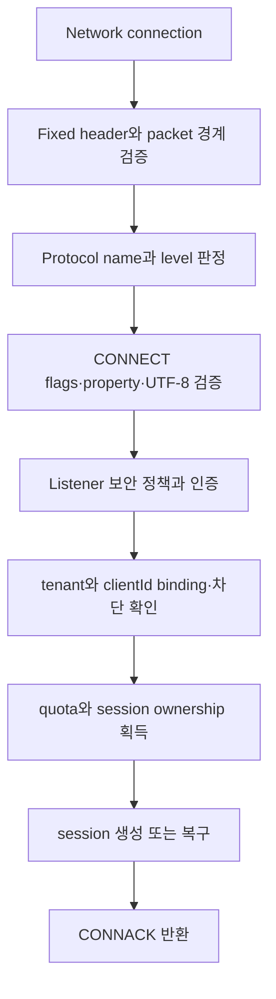

# MQTT protocol과 session 스펙

이 문서는 MQTT client가 NaruMQ listener에 연결해 인증하고 publish·subscribe하며 session을 재개할 때 관찰하는 동작을 정의한다. Cluster 내부 복제 방식은 [cluster spec](cluster-session-and-delivery.md), tenant 권한 판정은 [security spec](tenancy-and-security.md)을 기준으로 한다.

| 항목 | 값 |
| --- | --- |
| 상태 | Draft |
| 관련 요구사항 | MQTT-01~MQTT-13, CLIENT-01~CLIENT-08 |
| 근거 | [PRD 8장과 9.1절](../requirements/PRD.md), [OASIS MQTT 3.1.1](https://docs.oasis-open.org/mqtt/mqtt/v3.1.1/mqtt-v3.1.1.html), [OASIS MQTT 5.0](https://docs.oasis-open.org/mqtt/mqtt/v5.0/mqtt-v5.0.html) |
| 관련 Architecture | [System overview](../architectures/system-overview.md), [Broker core](../architectures/broker-core.md) |
| 관련 Contract | [MQTT client compatibility v1](../contracts/mqtt-client-compatibility-v1.md) |
| 해설 | [MQTT 전달 보장과 QoS·Session·Will protocol 흐름](../explainers/mqtt-delivery-guarantees-and-protocol-flows.md) |

## 현재 구현 상태: Phase 1 standalone QoS 1/2 delivery와 dynamic cluster retained replication

Standalone runtime은 MQTT 3.1.1/5.0 client의 `CONNECT → SUBSCRIBE/PUBLISH → PING/DISCONNECT`와 process-local session delivery를 제공한다. 기본 standalone startup은 `-security-config` secure mode로 JWT/JWKS 또는 verified client certificate mTLS authentication과 tenant-aware ACL을 적용한다. mTLS는 handshake가 검증한 client certificate의 `commonName`, `dnsSan`, `emailSan` selector를 strict identity binding으로 바꾸며 configured Client ID가 허용 목록과 일치해야 한다. 인증·tenant 경계 없는 plaintext ingress는 `-allow-insecure-anonymous-mqtt`를 지정한 literal loopback `-tcp-listen` development·benchmark 예외에서만 허용하며 TLS listener에는 적용하지 않는다.

Dynamic cluster는 별도 `-cluster-config` composition root다. 현재 cluster MQTT ingress는 QoS 0 retained PUBLISH와 detached persistent session의 QoS 0 offline queue를 Raft로 commit하고 cross-node replay하며 NMQBKUP3 archive에 포함한다(세부 규칙은 [Cluster §4.1](cluster-session-and-delivery.md#41-offline-message-capture와-전달) 참조). 이 범위는 일반 QoS 1/2 durable ACK를 의미하지 않는다. 자세한 evidence는 [Cluster §11.8](cluster-session-and-delivery.md#118-retained-replication과-backup-v2-수용-매핑)과 [§11.9](cluster-session-and-delivery.md#119-offline-queue-replication과-backup-v3-수용-매핑)에 있다.

- `internal/domain/mqtt`는 CONNECT/CONNACK, QoS 0·1·2 PUBLISH, PUBACK/PUBREC/PUBREL/PUBCOMP,
  SUBSCRIBE 계열과 PINGREQ/PINGRESP/DISCONNECT를 decode·encode한다. PING packet은
  Remaining Length 0만 허용하고 MQTT 5 DISCONNECT는 property-free allowlist만 지원한다.
- `internal/domain/routing`은 non-shared 및 `$share/{ShareName}/{filter}` 공유 구독,
  `+`·`#` filter, `$` system topic 경계, session별 중복 제거와 overlap 최대 granted QoS를
  결정한다. 공유 구독은 그룹 내 가입자를 Round-Robin으로 primary에 선택하고, 선택된
  member의 delivery queue가 full 또는 unavailable이면 같은 group의 다음 eligible member로
  순서대로 handoff한다.
  `No Local`은 비공유 구독에서 동일 publisher session을 제외하며(공유 구독에 NoLocal 설정 시
  0x82 Protocol Error 거절), `Retain As Published`는 live delivery의 RETAIN을 결정하며,
  `Retain Handling`은 SUBSCRIBE replay 시점에만 적용한다.
- `internal/application/subscribe`는 요청 순서를 유지한 SUBACK를 만들고, retained
  replay batch를 route mutation 전에 queue에 원자적으로 예약한다. MQTT 3.1.1과
  MQTT 5의 non-shared retained replay 및 MQTT 5 subscription options를 지원하며,
  공유 구독 가입 시 retained message replay를 억제([MQTT-4.8.2-1])하고 NoLocal을 프로토콜 에러로 거절([MQTT-3.8.3-4])한다.
- `internal/application/publish`는 tenant와 exact topic별 retained PUBLISH를 replace/delete한다. Standalone profile은 QoS 0·1·2 ingress를 처리한다. Dynamic cluster TCP ingress는 현재 QoS 0만 허용하고, retained mutation은 `RetainedCommitter`로 Raft commit한 뒤 route matching/live fan-out을 시작한다.
- `internal/domain/mqtt`의 MQTT 5 PUBLISH는 Message Expiry Interval property를 검증하고,
  application은 ingress 수신 시각과 interval을 한 번만 계산해 absolute deadline으로
  변환한다. Standalone delivery queue와 memory retained repository는 `now >= deadline`에서 lazy purge한다. Dynamic cluster retained state는 expiry deadline과 proposal 시각을 command에 포함해 Raft apply에서 만료를 결정적으로 제거한다. MQTT 5 onward PUBLISH에는 올림한 남은 초를 다시 넣으며 MQTT 3.1.1 wire에는 property를 쓰지 않아도 같은 deadline을 적용한다.
- `internal/application/ports/retained`와 `internal/adapters/memory/retained`는 bounded tenant/topic repository를 제공한다. Standalone mode에서는 이것이 process-local authority다. Dynamic cluster mode에서는 같은 adapter가 replay lookup projection이며, 권위 있는 retained state는 replicated state machine이 소유한다. Startup·snapshot restore 뒤 projection을 rebuild하며 실패하면 readiness를 허용하지 않는다. Cluster retained process evidence는 [§11.8](cluster-session-and-delivery.md#118-retained-replication과-backup-v2-수용-매핑)에 있다.
- Standalone ingress는 QoS 0·1·2를 지원한다. QoS 1은 메시지 라우팅 후 PUBACK을 반환하며, QoS 2는 수신 시 PUBREC을 반환하고 PUBREL 수신 시 라우팅 후 PUBCOMP를 반환한다. 중복 Packet Identifier 재전송 시 중복 라우팅 없이 동일 ACK를 반환한다.
- Standalone outbound delivery는 구독자의 granted QoS와 메시지 QoS 중 낮은 QoS로 전송하며, QoS 1/2는 connection별 packet identifier로 구독자 handshake를 완료한다. Cluster retained ingress는 QoS 0만 허용한다.
- 만료되지 않은 persistent session은 network connection이 종료되어도 process-local
  delivery queue의 FIFO queued entry와 완료되지 않은 송신 QoS 1/2 상태를 보존한다.
  새 connection은 `CONNACK`을 먼저 전송한 뒤 복구 packet을 전송해야 한다.
- 복구된 QoS 1/2 `PUBLISH`는 저장된 Packet Identifier를 재사용하고 `DUP=1`로
  전송한다. QoS 2가 PUBLISH 단계 뒤 `PUBREC`까지 완료된 상태는 같은 Identifier의
  `PUBREL`로 재개한다. reconnect protocol version에 맞춰 packet을 다시 인코딩한다.
- Message Expiry가 지난 queued entry와 PUBLISH-stage 송신 상태는 제거하고 전송하지
  않는다. 이미 PUBLISH를 수신한 뒤 `PUBCOMP`를 기다리는 QoS 2 `PUBREL` 상태는
  원래 publication deadline과 무관하게 복구한다.
`internal/adapters/memory/sessionstore`와 delivery queue는 session/offline-delivery state를 process-local memory에 저장한다. Standalone mode에서 이 session state는 process restart, replication, durable storage 복구를 지원하지 않는다. Cluster mode에서 detached persistent session의 QoS 0 offline queue는 [Cluster §4.1](cluster-session-and-delivery.md#41-offline-message-capture와-전달)에 따라 Raft로 복제되고 복구된다. TLS transport와 mTLS client authentication은 listener 계약에 정의한 범위에서 지원한다.

영속 session의 queued·in-flight delivery state는 clean reset 또는 Session Expiry가
끝날 때만 제거한다. 정상적인 persistent disconnect에서는 session, route와 함께 delivery
state를 유지한다.

## 1. Listener 계약

1. TCP와 TLS listener는 MQTT 3.1.1 protocol level 4와 MQTT 5.0 protocol level 5를 수용해야 한다.
2. listener마다 bind address, TLS 정책, 인증 방식, 최대 연결 수, connection rate와 packet 제한을 독립 적용해야 한다.
3. 평문 TCP listener는 기본 설정에서 비활성화해야 한다. MQTT listener를 활성화할 때는 [security spec](tenancy-and-security.md)의 `-security-config` secure mode를 선택해야 하며, 유일한 예외는 `-tcp-listen`의 literal loopback bind와 `-allow-insecure-anonymous-mqtt`를 함께 지정하는 development·benchmark mode다. 두 mode를 함께 지정하거나 TLS listener에 예외 mode를 적용해서는 안 된다.
4. WebSocket과 WSS는 P1 선택 기능이다. 활성화하면 MQTT packet과 session 의미가 TCP listener와 같아야 한다.
5. connection은 설정된 CONNECT timeout 안에 유효한 CONNECT를 보내야 한다. timeout 또는 malformed packet이면 session을 만들지 않고 연결을 닫아야 한다.
6. development profile의 평문 `-tcp-listen`은 `127.0.0.0/8` 또는 `::1` literal
   loopback만 허용한다. 이 listener는 `-allow-insecure-anonymous-mqtt`를 명시한 경우에만
   anonymous MQTT를 허용한다. TLS listener는 `-tls-listen`으로 별도 활성화하며,
   TLS 1.2 이상, 허용된 AEAD cipher suite와 설정된 서버 인증서를 적용한다.
   `request` 또는 `require` client authentication을 선택하면 strict security config의
   mTLS identity binding이 필요하다. TLS adapter는 verified chain의 leaf certificate에서
   application `ClientCertificateDTO`를 만들고, authentication adapter가 exact
   Common Name, DNS SAN 또는 email SAN match를 수행한다.
7. `-tcp-listen`과 `-tls-listen`은 하나의 `tcp.Server`에 함께 등록할 수 있고,
   listener별 transport 보안 정책을 유지하면서 동일한 session·route registry를 공유한다.
8. CONNECT 뒤에는 negotiated version으로 packet을 decode하고, 모든 socket write는 한
   writer goroutine의 bounded control queue 또는 delivery wake를 통과한다.
9. binary smoke와 실제 loopback wire 검증은 `tests/integration/mqtt_ingress_test.go`와
   TLS/mTLS transport 검증은 `tests/integration/mqtt_tls_test.go` 및 `cmd/narumq`를
   기준으로 한다.

## 2. CONNECT 처리 순서

서버는 CONNECT를 다음 순서로 처리해야 한다.

각 단계가 실패하면 이후 단계의 durable state를 만들어서는 안 된다. ownership을 얻은 뒤 응답 전 실패하면 재시도 시 같은 session 상태로 수렴해야 한다.

인증 단계는 configured verified client certificate가 있으면 mTLS provider만 사용한다.
그 CONNECT에 Username/Password가 함께 있으면 dual credential 오류로 거절하며 JWT로
fallback하지 않는다. certificate가 없으면 JWT provider가 configured된 경우에만
Username/Password 양쪽 flag와 token을 요구한다. 인증·Client ID binding·Will ACL이
성공하기 전에는 session, route, queue를 변경하지 않는다.

### 2.1 Protocol version

| 입력 | 외부 동작 |
| --- | --- |
| Protocol Name `MQTT`, level 4 | MQTT 3.1.1로 처리한다. |
| Protocol Name `MQTT`, level 5 | MQTT 5.0으로 처리한다. |
| Protocol Name `MQIsdp`, level 3 | MQTT 3.1.0 wire variant로 인식하지만 비지원으로 거절한다. 응답 없이 연결을 닫고 session을 만들지 않는다. |
| Protocol Name `MQTT`, level 3 | MQTT 3.1.0 wire variant로 인식하지만 MQTT 3.1.1 형식의 CONNACK `0x01`을 반환한 뒤 연결을 닫고 session을 만들지 않는다. |
| 지원하지 않는 level | MQTT 3.1.1 형식으로 판정 가능한 경우 CONNACK `0x01`을 반환하고 연결을 닫는다. MQTT 5 형식으로 판정 가능한 경우 CONNACK `0x84`를 반환하고 연결을 닫는다. |
| packet 구조상 version을 안전하게 판정할 수 없음 | 응답 없이 연결을 닫을 수 있다. malformed packet으로 기록한다. |

두 MQTT 3.1.0 wire variant의 거절은 `reason="unsupported_protocol_version"`, `protocol="3.1.0"`으로 같은 Metric에 집계해야 한다. 원문 credential은 로그에 남기지 않는다. `MQIsdp`와 `MQTT`의 Protocol Name 차이는 응답 정책만 바꾼다.

### 2.2 Session 선택

session key는 `(tenantId, clientId)`다. tenant와 clientId가 하나라도 달라지면 기존 session을 재개해서는 안 된다.

| Protocol 입력 | Session 동작 | CONNACK |
| --- | --- | --- |
| MQTT 3.1.1 `Clean Session=1` | 기존 session을 폐기하고 새 session으로 시작한다. 연결 종료 뒤 session을 보존하지 않는다. | `Session Present=0` |
| MQTT 3.1.1 `Clean Session=0` | 만료되지 않은 기존 session을 복구한다. 없으면 새 persistent session을 만든다. | 복구했을 때만 `Session Present=1` |
| MQTT 5 `Clean Start=1` | 기존 session을 폐기하고 새 session으로 시작한다. | `Session Present=0` |
| MQTT 5 `Clean Start=0` | 만료되지 않은 기존 session을 복구한다. | 복구했을 때만 `Session Present=1` |
| MQTT 5 `Session Expiry Interval=0` | network connection 종료 뒤 session을 제거한다. | 위 규칙에 따름 |

동일 session key로 새 connection이 인증과 ownership 획득에 성공하면 새 connection이 owner가 된다.
production target에서는 MQTT 5이면 이전 connection에 `DISCONNECT 0x8E`(`Session taken over`)를
보내고, MQTT 3.1.1은 연결을 닫아야 한다. 현재 development slice는 takeover를 구현하지 않고
active duplicate를 negative CONNACK으로 거절한다.

## 3. Publish와 내구성 ACK

### 3.1 수신 QoS 상태

| QoS | 성공 경계 | 재전송·중복 처리 |
| --- | --- | --- |
| 0 | packet을 수용해 routing queue로 넘긴 시점 | ACK가 없다. 장애 시 유실될 수 있다. |
| 1 | 메시지와 필요한 전달 상태가 configured durability barrier를 통과한 뒤 성공 PUBACK | 같은 Packet Identifier와 DUP 재전송을 최소 한 번 의미로 처리한다. 이미 성공 처리한 packet은 중복 durable message를 만들지 않고 일관된 PUBACK을 반환해야 한다. |
| 2 | 수신 PUBLISH와 handshake 상태가 durability barrier를 통과한 뒤 성공 PUBREC | PUBREL과 PUBCOMP까지 상태를 복구한다. 중복 PUBLISH·PUBREL은 같은 handshake 결과로 수렴해야 한다. |

quorum, 저장 quota 또는 replication 조건을 충족하지 못하면 성공 PUBACK/PUBREC을 반환해서는 안 된다. MQTT 5에서는 상황에 맞는 `0x89`(`Server busy`), `0x97`(`Quota exceeded`) 또는 `0x83`(`Implementation specific error`)를 사용할 수 있다. MQTT 3.1.1에서 packet 단위 실패를 표현할 수 없으면 연결을 닫을 수 있다. 어느 경우든 성공 ACK로 위장해서는 안 된다.

이 slice는 단일 노드 인메모리 프로세스 로컬 환경에서 수신 QoS 1 및 QoS 2 핸드셰이크를 지원한다.
수신 QoS 1은 fan-out 성공 후 성공 PUBACK(MQTT 5는 ReasonCode 0)을 반환하며, 중복 패킷
재전송 시 중복 전달 없이 동일한 PUBACK을 반환한다.
수신 QoS 2는 1단계에서 PUBREC을 반환하고, 클라이언트로부터 PUBREL이 수신되면 실제 fan-out을
수행한 뒤 PUBCOMP를 반환하여 핸드셰이크를 완료한다. 중복 PUBLISH 또는 PUBREL 재전송 시
동일한 PUBREC 또는 PUBCOMP로 수렴한다.
용량 초과(`retained.ErrFull`) 등의 실패 시 MQTT 5는 `0x97` 등의 negative ACK/DISCONNECT를 반환하고,
MQTT 3.1.1은 연결을 닫는다.
### 3.2 송신 QoS와 offline queue

1. 전달 QoS는 publish QoS와 subscription granted QoS 중 낮은 값이어야 한다.
2. process-local delivery queue entry는 Message Expiry deadline과 현재 bounded
   capacity를 적용해야 한다. 만료되지 않은 persistent session은 연결이 끊긴 동안에도
   FIFO queued entry와 완료되지 않은 outbound QoS 1/2 state를 보존해야 한다.
3. QoS 1 송신 상태는 PUBACK까지, QoS 2 송신 상태는 PUBCOMP까지 복구할 수 있어야 한다.
   QoS 2에서 PUBLISH 뒤 PUBREC까지 성공한 상태는 PUBREL 전송 단계로 복구한다.
4. 재접속 뒤 미완료 PUBLISH를 재전송할 때 저장된 Packet Identifier와 `DUP=1`을
   사용한다. 복구된 PUBREL도 저장된 Packet Identifier를 사용하며, 새 connection의
   MQTT protocol version으로 인코딩한다.
5. queued entry 또는 PUBLISH-stage retransmission의 expiry가 지나면 상태에서 제거하고
   전송하지 않는다. 만료로 제거된 상태는 `expired` 사유로 집계해야 하며, 구체적인
   Metric 이름과 histogram bucket은 `SPEC-TBD-07`에서 확정한다. PUBREL 대기 상태는
   PUBLISH가 이미 수신되었으므로 원래 publication deadline이 지나도 복구한다.
6. `CONNACK`은 같은 reconnect에서 복구된 packet보다 먼저 wire에 기록되어야 한다.
   복구된 outbound state는 Packet Identifier 오름차순으로 한 번만 재개한 뒤 새 queued
   entry를 FIFO 순서로 처리한다.

## 4. Subscribe와 routing 입력

1. Topic Filter의 `+`, `#` 위치와 UTF-8을 표준대로 검증해야 한다.
2. 겹치는 subscription이 같은 client session에 여러 번 match하면 MQTT version의 표준 전달 규칙과 granted QoS를 적용해야 한다.
3. `$share/{group}/{filter}`는 tenant 안의 같은 group에서 한 활성 subscriber를 선택해야 한다. 선택된 subscriber가 전달을 완료하지 못하면 session·QoS 규칙에 따라 다른 member가 이어받을 수 있어야 한다.
4. MQTT 5 subscription option은 exact filter별로 보존하고 다음처럼 적용해야 한다.
   - `No Local=true`면 publication publisher와 같은 `clientId`의 live delivery를 제외한다.
   - `Retain As Published=false`면 established-subscription delivery의 RETAIN을 지우고, `true`면 incoming RETAIN을 보존한다.
   - SUBSCRIBE가 발생시킨 retained replay는 `Retain As Published` 값과 무관하게 항상 RETAIN을 설정한다.
   - `Retain Handling=0`은 항상 replay하고, `1`은 새 exact filter일 때만 replay하며, `2`는 replay하지 않는다.
5. 권한이 없는 filter는 subscribe 결과에서 거절해야 하며 route index에 추가해서는 안 된다.
6. unsubscribe는 존재하지 않는 subscription에도 안전하게 재시도할 수 있어야 한다.

## 5. Retained Message

Standalone development profile은 bounded process-local retained repository를 사용한다. Dynamic cluster profile은 Raft committed retained state를 권위 있는 값으로 쓰고 node-local repository를 replay용 projection으로 재구성한다. Cluster ingress는 현재 QoS 0 PUBLISH만 지원한다. `Retain=true` mutation은 fresh read barrier와 정확한 member profile 확인 뒤 route matching/live fan-out보다 먼저 commit되어야 한다. Commit 실패 시 해당 PUBLISH의 live fan-out을 시작하지 않는다.

- Retained key는 tenant와 exact Topic Name의 쌍 `(tenantId, topic)`이다. 같은 topic이어도 tenant가 다르면 서로 다른 value를 보관한다.
- 입력 `PUBLISH`가 `Retain=true`이고 payload가 비어 있지 않으면 해당 tenant/topic의 마지막 value를 publisher session identity 및 QoS와 함께 replace한다.
- retained PUBLISH의 zero-byte payload는 해당 tenant/topic value를 삭제한다. 삭제 packet 자체는 established subscription에 live publication으로 전달된다.
- `Retain=false`인 PUBLISH는 retained repository를 읽거나 변경하지 않는다.
- MQTT 5 Message Expiry Interval이 있으면 ingress 수신 시각에 interval 초를 더한 absolute deadline을 retained value에 저장한다. `interval=0`인 retained PUBLISH는 delete로 처리한다. Standalone repository와 cluster replay projection은 `List(now)`에서 `now >= deadline`인 값을 제거하므로 만료 값은 replay되지 않는다. Raft 권위 state는 다음 retained command를 apply할 때 그 command의 proposal 시각으로 만료 entry를 제거한다. 다음 command 전까지 만료 entry가 snapshot/archive와 용량 한도에 남을 수 있다. MQTT 3.1.1에는 Message Expiry property가 없지만 다른 protocol version에서 저장한 deadline은 replay 시 계속 적용한다.
- 새 non-shared subscription은 matching retained value를 topic 정렬 순서로 replay한다. 공유 구독(`$share/...`)은 Retain Handling 옵션과 무관하게 retained value를 replay하지 않는다([MQTT-4.8.2-1]). MQTT 3.1.1과 MQTT 5 `Retain Handling=0`은 항상 replay하고, `=1`은 exact filter가 새로 생길 때만 replay하며, `=2`는 replay하지 않는다.
- Replay delivery의 RETAIN은 항상 `true`다. Established-subscription delivery는 matching filter 중 RAP가 하나라도 켜져 있고 incoming RETAIN이 true일 때만 RETAIN을 유지한다. `No Local`은 stored publisher session과 subscriber session이 같으면 replay와 live delivery를 모두 제외한다.
- Retained replay의 QoS는 stored QoS와 granted QoS 중 작은 값이며 MQTT writer는 QoS 0·1·2 outbound handshake를 적용한다. Cluster ingress가 저장하는 retained value의 QoS는 현재 0이다.
- Retained state의 적용 한도는 모든 tenant를 합친 전체 기준이다: value 1,024개, 계산된 총 16 MiB, payload당 1,000,000 bytes. 총 크기는 tenant ID, topic, payload와 publisher routing ID의 byte 길이를 합산한다. Tenant별 저장 quota는 제공하지 않는다. Capacity conflict는 기존 non-expired value를 덮어쓰지 않고 live fan-out을 시작하지 않지만, 같은 apply에서 expired entry는 proposal 시각에 따라 제거될 수 있다.
- Message Expiry는 bounded queue와 retained repository에서 지원한다. MQTT 5 outbound PUBLISH에는 현재 시각 기준 올림한 남은 초를 넣고, MQTT 3.1.1 outbound에는 expiry property를 생략한다. Delivery queue의 queued·in-flight state는 process-local persistent session 범위에서 reconnect까지 보존하지만 process restart와 replication은 이 slice의 범위가 아니다. Cluster retained state는 committed snapshot에서 restart/restore 뒤 재구성한다.

## 6. Will Message

Will은 CONNECT의 인증·ACL·quota 검증을 통과한 뒤 session state에 등록해야 한다.

| 종료 원인 | Will 동작 |
| --- | --- |
| client의 정상 DISCONNECT | 발행하지 않는다. MQTT 5 `0x04`(`Disconnect with Will Message`)는 표준대로 발행한다. |
| network 단절, keepalive timeout, protocol 오류 | Will Delay가 없으면 표준 시점에 발행한다. |
| MQTT 5 Will Delay 안에 같은 session key로 재접속 | 발행하지 않는다. |
| Session Expiry가 Will Delay보다 먼저 끝남 | MQTT 5 표준이 정한 더 이른 시점에 처리한다. |
| MQTT 3.1.1 server 주도 연결 종료 | Will이 설정돼 있으면 발행될 수 있다. no-Will 보장 대상이 아니다. |

Will publish에도 tenant 격리, ACL, payload·rate quota, retained와 delivery 규칙을 적용해야 한다. Drain 중 규칙은 [drain spec](drain-and-rolling-update.md)을 따른다.

## 7. Resource limit과 protocol 오류

| 조건 | MQTT 5 동작 | MQTT 3.1.1 동작 |
| --- | --- | --- |
| packet size 초과 | 가능한 경우 `0x95` 후 종료 | packet을 처리하지 않고 종료 |
| Receive Maximum 초과 | `DISCONNECT 0x93` | 연결별 inflight 한도를 넘기지 않도록 read backpressure 또는 종료 |
| message rate 초과 | `0x96` 또는 `0x97`이 허용되는 packet에서 반환 | backpressure 후 필요하면 종료 |
| connection rate 초과 | CONNACK `0x9F` 또는 handshake 전 종료 | CONNACK `0x03` 또는 handshake 전 종료 |
| malformed packet·invalid UTF-8 | 표준 reason code가 허용되면 반환한 뒤 종료 | 즉시 종료 |
| slow client·write queue 포화 | bounded queue와 timeout 적용 후 종료 | 동일 |

모든 connection queue와 inflight collection에는 설정된 상한이 있어야 한다. 제한에 도달했을 때 무제한 할당으로 진행해서는 안 된다.

현재 TCP adapter는 위 표의 packet·queue 상한을 적용해 oversize/malformed 입력,
keepalive timeout, bounded control queue 포화와 blocked write timeout에서 연결을 닫는다.
memory delivery queue는 만료되지 않은 persistent session의 queued·in-flight delivery를
reconnect까지 보존하며, clean start/session expiry와 expiry deadline에 도달한 state만
제거한다. process restart와 replication 뒤 recovery는 이 slice의 범위가 아니다.

## 8. 수용 시험

- MQTT 3.1.1/5.0 compliance matrix가 지원한다고 선언한 모든 normative statement를 자동 test와 연결한다.
- 현재 Phase 1 matrix는 [`tests/conformance/mqtt-compliance-v1.json`](../../tests/conformance/mqtt-compliance-v1.json)이며, 48개 statement와 MQTT/TEST requirement 및 test function을 함께 기록한다.
- `go run ./tools/verify traceability`가 matrix → source와 source → matrix를 모두 검사한다. matrix에만 있거나 source에만 있는 statement, 또는 requirement union이 다른 연결은 합격으로 처리하지 않는다.
- QoS별 정상, DUP, reconnect, owner crash와 Message Expiry 시나리오를 검증한다.
- `MQIsdp` level 3은 응답 없이 닫고, `MQTT` level 3은 MQTT 3.1.1 CONNACK `0x01` 뒤 닫으며, 두 경우 모두 session을 만들지 않아야 한다.
  이 동작과 Metric 집계는 `tests/integration/management_api_test.go::TestMQTT310RejectionIsObservable`에서 두 wire variant를 함께 검증한다.
- wildcard 경계, shared subscription failover와 MQTT 5 subscription option 조합을 검증한다.
- parser fuzzing, slowloris, packet·queue 상한 시험에서 memory와 goroutine leak이 없어야 한다.
- 두 protocol version client가 같은 외부 topic에서 ACL 범위 안의 메시지를 상호 전달해야 한다.
- 이 slice의 acceptance mapping은 `tests/integration/mqtt_ingress_test.go`의 MQTT 3.1.1/5.0
  CONNECT, QoS 0 fan-out, retained replace/delete, retained Message Expiry,
  SUBACK-before-replay, Retain Handling, No Local, Retain As Published, PINGRESP,
  normal DISCONNECT, persistent Session Present, persistent offline delivery,
  outbound QoS 1/2 recovery, unsupported/malformed CONNECT와 QoS negative ACK/close
  시나리오다. `TestMQTTIngressPersistentOfflineDelivery`는 CONNACK-before-recovery,
  FIFO, clean reset과 queued Message Expiry를 검증하고,
  `TestMQTTIngressPersistentOutboundQoSRecovery`는 PUBLISH/PUBREL 단계 recovery와
  Packet Identifier·DUP 규칙을 검증한다.
- `TestMQTTIngressSharedSubscriptionHandoff`는 delivery queue가 가득 찬 persistent offline
  member에서 같은 group의 다른 member로 handoff하고 reconnect queued delivery를 보존하는
  실제 socket-level MQTT-07 failover 증거다.
- `tests/integration/mqtt_tls_test.go`는 TLS 1.2/1.3, trusted/untrusted/expired client
  certificate, mTLS identity의 exact Client ID binding과 MQTT 5 wire CONNACK 결과를
  실제 socket에서 검증한다. `cmd/narumq` TLS flag test는 client-auth mode와 mTLS
  identity binding의 strict configuration 조합을 검증한다.
- `MQTT-3.3.1-5`~`MQTT-3.3.1-13`, `MQTT-3.8.3-3`,
  `MQTT-3.8.4-3/4`는 tests/conformance/mqtt-compliance-v1.json에서 양 protocol
  version test와 source traceability comment를 함께 가져야 한다. `MQTT-3.3.2-5/6`는
  MQTT 5.0 Message Expiry property와 만료 흐름을 검증하는 test 및 source traceability
  comment를 가져야 하며 MQTT 3.1.1에는 이 property를 적용하지 않는다.
- 이 matrix와 gate는 전체 MQTT 표준 적합성 선언이 아니다. ACL·tenant와 durable
  cluster replication은 후속 범위로 남아 있다.
