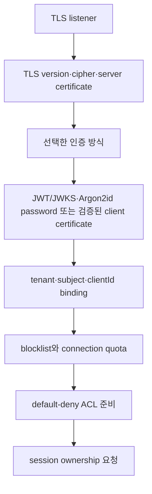

# Tenant와 security 스펙

이 문서는 MQTT·관리 요청을 tenant에 귀속하고, topic·상태·자원을 격리하며, 인증·인가·감사를 일관되게 적용하는 외부 동작을 정의한다.

| 항목 | 값 |
| --- | --- |
| 상태 | Active (Phase 1 security and tenant isolation slice) |
| 적용 범위 | TEN-01~TEN-05, SEC-02~SEC-04, SEC-06, SEC-08의 JWKS fail-closed 동작, SEC-10 Management API 인증·RBAC·node-local 감사 조회, SEC-07 credential 회전·폐기와 SEC-12 client·identity·IP blocklist를 정의한다. Dynamic cluster의 저장 quota(TEN-08)는 [ADR-0017](../decisions/ADR-0017-tenant-storage-quota.md)와 §5.1에서 정한다. Policy quota는 `cluster-policy-tenant-quotas` feature를 활성화한 뒤 `ClusterPolicy.tenantQuotas`로 관리한다. TEN-06·TEN-07의 node-local 연결·session·subscription·PUBLISH traffic 한도는 §5.2를, TEN-09 local noisy-neighbor p99 기준은 §5.3을 따른다. Management plane 감사는 node-local hash chain에 저장한다. |
| 근거 | [PRD 9.3절, 9.4절과 11.4절](../requirements/PRD.md), [RFC 8725](https://www.rfc-editor.org/rfc/rfc8725.html) |
| 관련 spec | [MQTT protocol과 session](mqtt-protocol-and-session.md), [Management API](management-api-and-observability.md) |
| 관련 Architecture | [Security boundaries](../architectures/security-boundaries.md), [Threat model](../architectures/threat-model.md), [System overview](../architectures/system-overview.md) |
| 관련 Contract | [Audit event v1](../contracts/audit-event-v1.md), [Management API v1](../contracts/management-api-v1.md) |

## 1. 인증 결과 계약

인증 adapter는 성공 시 다음 논리 값을 반환해야 한다. 외부 provider의 원본 자료형을 이 경계 밖으로 노출해서는 안 된다.

| 필드 | 의미 |
| --- | --- |
| `tenantId` | 신뢰된 설정 또는 credential binding에서 결정한 tenant |
| `subject` | issuer 안에서 검증된 principal 식별자 |
| `credentialId` | 회전·폐기와 감사를 위한 비밀이 아닌 식별자 |
| `allowedClientIds` | 정확한 값 또는 승인된 pattern으로 표현한 허용 범위 |
| `roles` | 관리 plane의 RBAC role 목록 |
| `expiresAt` | 재인증 또는 연결 재평가에 쓰는 만료 시각 |

client가 username, token claim, MQTT property 또는 topic으로 제출한 `tenantId`를 독립적인 신뢰 근거 없이 사용해서는 안 된다. 인증 성공 뒤에도 tenant와 clientId binding, 차단 목록과 listener 정책을 확인해야 한다.

## 2. MQTT 연결 인증

어느 단계든 실패하면 session ownership을 요청해서는 안 된다. 실패는 protocol version이 허용하는 CONNACK reason 또는 연결 종료로 표현하고 인증 실패 Metric을 기록해야 한다.

### 2.1 TLS와 mTLS

- TLS listener는 TLS 1.2 이상만 허용해야 한다.
- 허용 protocol과 cipher suite는 listener별 allowlist로 관리해야 한다.
- mTLS는 configured trust anchor, 유효 기간, key usage와 identity mapping을 모두 검증해야 한다.
- 신뢰하지 않는 CA, 만료·폐기 인증서 또는 identity 불일치는 거절해야 한다.
- node 간 연결은 별도 trust domain의 mTLS와 member allowlist를 모두 통과해야 한다.
- MQTT client mTLS의 verified certificate는 `commonName`, `dnsSan`, `emailSan` selector 중 설정된
  하나와 case-sensitive exact match되어 하나의 static binding을 선택해야 한다. zero match는
  unmapped, multiple match는 ambiguous로 fail-closed한다.
- TLS handshake가 trust chain, validity와 client-auth EKU를 확인하고, application authentication
  adapter가 certificate identity를 tenant·subject·credential·allowed Client ID·roles로 변환한다.
  인증서 원문과 chain은 application/domain 경계로 넘기지 않는다.

### 2.2 JWT와 JWKS

JWT validator는 다음 순서를 지켜야 한다.

1. CONNECT Password의 UTF-8 compact JWT를 읽고, configured algorithm allowlist에 없는 `alg`이면 서명 검증 전에 거절한다.
2. 필수 `kid`를 확인하고, cache의 JWKS key set에서 후보 key를 찾는다.
3. 후보 key로 서명을 검증한다. `kid`와 서명 검증은 configured issuer의 key set 안에서만 수행한다.
4. `iss`를 configured issuer와 정확히 비교하고, `aud`가 configured audience를 포함하는지 확인한다.
5. 비어 있지 않은 `sub`와 `exp`를 확인하고, 선택적인 `nbf`를 configured clock skew와 함께 검증한다.
6. 검증된 `(iss, sub)`를 정적 binding에 대조해 tenant, credential, 허용 Client ID와 roles를 결정한다. Token claim은 이 값을 덮어쓸 수 없다.

JWKS cache는 `fetchedAt`, TTL 만료 시각과 마지막 refresh 시각을 함께 소유한다. 비어 있거나 만료된 cache는 하나의 동시 fetch만 수행하는 mandatory refresh가 성공해야 인증을 진행한다. 유효 cache에서 알려지지 않은 `kid`는 `refreshCooldownMillis`가 허용할 때 하나의 coalesced early refresh를 수행한다. early refresh가 실패하면 해당 `kid`는 거절하지만, 만료되지 않은 기존 key set으로 알려진 `kid`를 검증하는 동작은 유지한다. cooldown 안의 알려지지 않은 `kid`는 I/O 없이 거절한다. 성공한 fetch는 key set, `fetchedAt`, TTL과 refresh-attempt 시각을 원자적으로 교체하고, 실패한 fetch는 TTL을 연장하지 않는다. TTL이 끝난 뒤 refresh가 실패하면 fail-closed로 거절한다.

### 2.3 CONNECT credential과 strict security configuration

MQTT CONNECT는 configured credential 방식 하나를 선택한다. Verified client certificate가
있으면 mTLS를 선택한다. Certificate가 없으면 security configuration에서 선택한 JWT 또는
password provider를 사용한다. Configuration은 JWT와 nonempty `passwordIdentities`를 함께
허용하지 않는다.

- Verified client certificate가 있으면 MQTT `Username`과 `Password` flag를 모두 보내지
  않아야 한다. Certificate가 unmapped, ambiguous 또는 application-level `NotAfter` 만료이면
  다른 방식으로 fallback하지 않고 거절한다.
- JWT provider를 사용하면 `HasUsername=true`와 `HasPassword=true`를 보내야 한다.
  Username은 identity로 사용하지 않으며 Password에는 하나의 UTF-8 compact JWT를 넣는다.
- Password provider를 사용하면 두 flag를 모두 보내야 한다. Username은 비어 있지 않은
  case-sensitive exact key다. Password는 1~65,535 bytes의 원문 byte로 검증한다.
- mTLS certificate와 MQTT `Username` 또는 `Password` flag를 함께 제출하면 거절한다.
  Credential을 합치거나 provider 사이에서 fallback하지 않는다.
- Configured credential provider와 mTLS provider가 모두 없을 때만 개발용 anonymous CONNECT를 허용한다.

Credential, certificate identity, Client ID binding 또는 Will ACL이 실패하면 MQTT 3.1.1
CONNACK `0x05`, MQTT 5 CONNACK `0x87`을 반환하고 연결을 닫는다. Unknown username과
잘못된 password는 모두 `invalid_credentials`로 처리한다. 인증 실패는 session, timer,
route, queue, retained message와 Will을 변경하지 않는다.

Standalone mode는 MQTT listener를 열 때 security config가 필요하다. 허용된 loopback 개발 mode는 예외다. Dynamic cluster mode는 `mqtt.securityConfigFile`을 사용한다. 허용 flag 조합, 파일 구조, field 검증과 strict parsing은 [Process configuration v1 §1.1~§1.4](../contracts/process-configuration-v1.md)에서 정한다.

Standalone mode는 MQTT listener를 열기 전에 security config를 읽고 authentication provider를 만든다. Dynamic cluster mode는 peer listener를 열거나 Raft 상태를 복구한 뒤 security config를 읽을 수 있다. MQTT·management listener를 열기 전에는 security config와 provider를 준비한다. 이후 시작이 실패하면 이미 연 자원을 닫는다. 자세한 흐름은 [Configuration and runtime options §3](configuration-and-runtime-options.md#3-시작-실행-종료-흐름)을 따른다.

TLS listener의 `request|require` client authentication에는 하나 이상의 `mtlsIdentities` binding이 필요하다. Binding이 있으면 `client-auth none`을 사용할 수 없다. `request` mode에서는 mTLS certificate가 없는 client도 JWT 또는 password authentication을 설정한 경우 인증할 수 있다. `require` mode에서는 모든 TLS client가 검증된 certificate를 제출해야 한다. Cluster는 `mqtt.tls.clientAuth`로 같은 규칙을 적용한다.

Anonymous MQTT 예외는 loopback 개발용이다. Production security mode가 아니며 production security 완료의 근거로 사용할 수 없다.

`mtlsIdentities`의 schema와 selector 값은 [Process configuration v1 §1.4](../contracts/process-configuration-v1.md)에서 정한다. Certificate가 어떤 binding과도 일치하지 않으면 unmapped로 처리한다. 둘 이상의 binding과 일치하면 ambiguous로 처리한다. TLS handshake는 identity mapping 전에 trust chain, certificate 유효 기간과 client-auth EKU를 검증한다. `NotAfter`는 새 principal의 만료 시각으로 사용한다.

URI SAN/SPIFFE·fingerprint selector와 cluster-peer mTLS는 이 MQTT identity mapping 범위에 포함하지 않는다. Client certificate 폐기와 credential 회전은 §7을 따른다. 설정 reload는 제공하지 않는다.

JWT·password·mTLS·ACL field의 형식과 검증 규칙은 [Process configuration v1 §1.4](../contracts/process-configuration-v1.md)에서 정한다.

### 2.4 Username/password

Password identity와 Argon2id PHC 형식은 [Process configuration v1 §1.4](../contracts/process-configuration-v1.md)에서 정한다. `passwordIdentities`를 설정하면 password authentication을 사용한다. Password principal에는 별도 만료 시각이 없다.

Dynamic cluster에서 password를 회전하려면 rolling restart를 한다. 새 username, password hash와 credential ID를 추가한다. Client를 새 credential로 전환한다. 이전 credential ID를 폐기한다. 다음 rolling restart에서 이전 항목을 제거한다.

`narumq -hash-password`의 입력·출력 규칙은 [Process configuration v1 §1.1](../contracts/process-configuration-v1.md)에서 정한다. Password는 보호된 pipe로 전달한다. 평문 password를 shell history에 넣지 않는다.

Provider는 최대 4개의 Argon2 계산만 동시에 수행한다. Slot이 없으면 대기하지 않고 일반
인증 실패로 거절한다. 이 제한은 계산 중인 작업 수를 제한하며 GC가 회수하기 전 process
heap의 상한을 보장하지 않는다. Unknown username에도 저장 hash와 같은 profile의 계산을
수행한다. Unknown username, 빈 username과 잘못된 password는 같은 CONNACK, 인증 실패
Metric과 감사 결과를 사용한다. 이 동작은 정확히 같은 wall time을 보장하지 않는다.

Password principal의 만료는 기존 principal·persisted Will 형식을 유지하기 위해 `time.UnixMilli(math.MaxInt64)`로 표현한다. Password 별도 만료는 제공하지 않는다. Password와 hash는 error, log, audit field 또는 Metric label에 넣지 않는다. CONNECT 거절 감사는 `authMethod: "password"`를 사용한다.

## 3. Tenant namespace

외부 MQTT topic과 filter 표기는 변경하지 않는다. Broker 내부에서는 tenant와 namespace를 문자열 prefix로 이어 붙이지 않고, 비교 가능한 typed value로 함께 표현한다.

- `NewTenantID(raw string) (TenantID, error)`는 비어 있거나 유효하지 않은 tenant를 거절한다.
- `NewSessionKey(tenantID TenantID, clientID string) (SessionKey, error)`는 tenant와 비어 있지 않은 Client ID를 결합하며 field를 외부에서 만들 수 없게 한다.
- `NewTopic(tenantID TenantID, name string) (Topic, error)`는 concrete MQTT topic을 검증한다.
- `NewTopicFilter(tenantID TenantID, filter string) (TopicFilter, error)`는 MQTT filter 또는 shared subscription을 검증한다.

각 value는 private field와 read-only `TenantID()`, `ClientID()`, `Name()`, `Filter()` accessor만 제공한다. 서로 다른 tenant의 같은 외부 이름은 비교에서 절대 같은 값이 되지 않는다. Cross-tenant 비교는 거절한다. 향후 persistence·wire adapter만 unsigned-varint byte length 뒤에 UTF-8 tenant와 topic/filter bytes를 직렬화할 수 있으며, 이 slice에는 string compatibility key나 내부 prefix encoding을 두지 않는다.

Topic/filter validation과 MQTT wildcard matcher는 하나만 유지한다. Shared subscription은 먼저 `$share/{ShareName}/{TopicFilter}`로 분해하고 ACL과 containment/intersection 비교에는 underlying filter만 사용한다. `$` system topic의 첫 level wildcard 제한을 포함한 기존 MQTT matching 의미를 그대로 적용한다. Unicode normalization, case folding, slash 병합은 하지 않는다.

Namespace binding은 publish, subscribe, unsubscribe, retained, shared subscription, Will과 session key에 동일하게 적용한다. Client가 제출한 tenant claim, topic prefix 또는 이중 encoding으로 tenant를 선택하거나 변경할 수 없다.

## 4. ACL

ACL 입력은 `tenantId`, `subject`, `clientId`, action, canonical topic/filter, listener와 연결 속성이다.

| Action | 판정 시점 | 거절 결과 |
| --- | --- | --- |
| `publish` | message를 durable log나 route에 넣기 전 | MQTT 5 `Not authorized`가 허용되면 반환하고, 아니면 연결을 종료할 수 있다. |
| `subscribe` | route를 만들기 전 | 해당 SUBACK 항목을 거절한다. |
| `unsubscribe` | target session과 filter를 바꾸기 전 | protocol이 허용하는 거절 또는 연결 종료 |
| `will` | CONNECT에서 등록할 때와 실제 발행 직전 | 등록 또는 발행을 거절하고 감사 가능한 사유를 남긴다. |

- 일치하는 allow가 없으면 deny다.
- 명시적 deny는 allow보다 우선해야 한다.
- policy backend 오류 또는 timeout은 deny로 처리해야 한다.
- policy 변경의 적용 version을 연결과 감사 이벤트에서 확인할 수 있어야 한다.
- 기존 연결 재평가·재인증 정책은 credential 종류별로 문서화해야 한다.

### 4.1 Phase 1 ACL 판정과 Will

ACL은 authenticated principal이 가진 모든 role의 tenant-local rule을 대상으로 평가한다. matching deny가 하나라도 있으면 거절하고, deny가 없으며 matching allow가 있으면 허용하고, 둘 다 없으면 default deny다.

- `publish`와 `will`은 concrete `Topic`이 rule `TopicFilter`와 match하는지 평가한다.
- `subscribe`와 `unsubscribe`는 요청한 모든 topic을 포함하는 rule filter가 있어야 allow가 된다. 요청 filter와 deny rule이 한 topic이라도 교차하면 거절한다.
- Shared subscription syntax는 먼저 parse하고 underlying filter로 위 두 판정을 수행한다.
- CONNECT Will은 등록 시점과 실제 publication 직전에 같은 principal snapshot으로 다시 authorize한다. delayed Will의 authorization 실패는 broker state를 변경하지 않고 Will을 버린다.

`Principal`과 `SessionKey`의 tenant와 Client ID가 일치하지 않으면 모든 authorization은 거절한다. Principal은 CONNECT 시점에 session에 snapshot으로 저장하며 기존 연결은 live TCP connection이나 timer map에서 identity를 다시 읽지 않는다.

## 5. Quota와 rate limit

모든 quota는 tenant별로 계산하고 한 tenant의 초과가 다른 tenant의 정상 traffic을 직접 거절하게 해서는 안 된다.

| 범주 | 최소 제한 단위 | 초과 동작 |
| --- | --- | --- |
| 연결 상태 | connection, session, subscription | 새 생성 거절. 기존 정상 상태를 임의 삭제하지 않는다. |
| traffic | message rate, byte rate, payload size | bounded backpressure 후 protocol reason으로 거절하거나 연결 종료 |
| 저장 | offline queue message/bytes, retained bytes, 전체 저장량 | 새 durable state를 거절하고 기존 state를 보존한다. Dynamic cluster의 tenant별 저장 quota와 초과 동작은 §5.1을 따른다. |
| 선택 Metric | exact topic 등록 수, TTL | wildcard 거절, 상한 초과 등록 거절 |

저장 quota 상한과 초과 정책은 [ADR-0017](../decisions/ADR-0017-tenant-storage-quota.md)에 따른다. Cluster는 초과 시 eviction 없이 새 state만 거절해야 하며, quota 축소 뒤에도 기존 state를 보존하고 usage를 줄이는 변경을 허용해야 한다.

### 5.1 저장 quota

Dynamic cluster는 tenant별 retained bytes, offline queue와 저장 총량 quota를 제한해야 한다. 한 tenant의 초과가 다른 tenant에 설정된 한도를 바꾸지 않는다. 적용 차원, byte 계산, global limit 우선순위와 profile version은 [ADR-0017](../decisions/ADR-0017-tenant-storage-quota.md)을 따른다. 적용 profile은 committed `ClusterPolicy.tenantQuotas`가 있으면 이를 우선하고, 없으면 legacy committed `TenantQuota` profile을 사용한다. Policy가 quota field를 제거한 version을 commit하면 legacy profile로 돌아간다.

| 설정 key | 집계 대상 | cluster-wide 최대값 |
| --- | --- | ---: |
| `retainedBytes` | 해당 tenant의 retained value 계산 bytes 합 | 16 MiB |
| `offlineQueueMessages` | QoS 0 offline message와 durable delivery outbound message(QUEUED·inflight) 수 | 8,192 |
| `offlineQueueBytes` | 위 message들의 계산 bytes 합 | 32 MiB |
| `storageBytes` | retained, QoS 0 offline, durable delivery outbound·inbound QoS 2 bytes 합 | 48 MiB |

선택 `tenantQuotas` field의 JSON 구조, 필수 항목과 검증 규칙은 [Process configuration v1 §1.3](../contracts/process-configuration-v1.md)에서 정한다.
`clusterPolicy.tenantQuotas`는 `cluster-policy-tenant-quotas` feature 활성화 뒤에만 적용한다. Profile source와 version은 `GET /api/v1/nodes/{nodeId}/config`에서 확인한다.

Effective profile이 policy에서 오면 rejection의 `ProfileVersion`은 committed `ClusterPolicy` version이다. Legacy profile이 적용되면 기존 `TenantQuota` version을 사용한다. Profile이 없으면 storage quota source는 `none`이다. 새 저장이 quota를 넘으면 retained/offline mutation은 기존 capacity 결과로 거절한다. Durable delivery는 [Cluster §4.5](cluster-session-and-delivery.md#45-publish-backpressure-admission)의 ingress 사전 판정에서 전역·tenant 한도 초과 publish를 거절한다. MQTT 5는 `0x97`, MQTT 3.1.1은 연결 종료를 반환한다. Tenant 초과는 `narumq_tenant_quota_rejections_total`에 기록한다. Apply 시점 경합은 기존 `Saturated` 처리다. Session당 한도와 RELEASE 시점 포화도 target을 건너뛰는 기존 동작을 유지한다.

Proposer node는 `narumq_tenant_quota_rejections_total{tenant,dimension}` counter를 올리고 같은 tenant·dimension 경보 log를 10초 rate-limit한다. Tenant label은 최대 1,024개까지 보존하고 나머지는 `_overflow` label로 집계한다. Profile commit 여부, version과 local config mismatch는 각각 `narumq_tenant_quota_profile_committed`, `narumq_tenant_quota_profile_version`, `narumq_tenant_quota_config_mismatch`로 노출한다. Committed profile이 복구되기 전에는 cluster MQTT readiness를 허용하지 않는다.
### 5.2 연결 상태와 traffic 한도

선택 `tenantLimits` object의 field, 상속, 기본값과 허용 범위는 [Process configuration v1 §1.4](../contracts/process-configuration-v1.md)에서 정한다. `tenantLimits`를 생략하면 tenant 한도를 적용하지 않는다.

한도는 인증된 principal(`principal.Subject() != ""`)에만 적용한다. Security config가 없는 loopback 개발 모드와 anonymous session에는 한도가 없다.

| 차원 (`dimension`) | 집계 대상 | 검사 시점 | 초과 응답 MQTT 5 / 3.1.1 |
| --- | --- | --- | --- |
| `connections` | 이 node session repository에서 `Connected()==true`인 tenant lifecycle 수 | CONNECT에서 `session.Open` 성공 뒤, ownership 획득 전. 기존 lifecycle이 이미 연결 중이면 증가로 보지 않는다. | CONNACK `0x97` / CONNACK `0x03`. State를 바꾸지 않는다. |
| `sessions` | 이 node session repository의 tenant lifecycle 수(연결 중 + detached) | 같은 시점. 기존 lifecycle이 없을 때만(`!found`) 검사한다. Resume과 clean start 대체는 새 session이 아니다. | 같음 |
| `subscriptions` | Route table에서 tenant에 bind된 session의 shared·non-shared subscription 수. Cluster에서는 committed projection 전체다. | SUBSCRIBE filter마다 ACL 검사 뒤, commit 전. 같은 session에 같은 filter가 이미 있으면(replace) 검사하지 않는다. | 해당 filter의 SUBACK `0x97` / `0x80`. 다른 filter는 독립 처리한다. |
| `payload_size` | PUBLISH payload byte 길이 | TCP `readLoop`에서 decode 직후, dispatch 전. 대기 없음. | QoS 1 PUBACK `0x97`, QoS 2 PUBREC `0x97`, QoS 0 DISCONNECT `0x97` 뒤 종료 / 종료 |
| `message_rate` | Tenant의 초당 PUBLISH 수 (node별 token bucket) | 같은 위치. 최대 `maxWaitMillis`까지 대기한다. | QoS 1 PUBACK `0x97`, QoS 2 PUBREC `0x97`, QoS 0 DISCONNECT `0x96` 뒤 종료 / 종료 |
| `byte_rate` | Tenant의 초당 payload byte (node별 token bucket) | 같은 위치 | `message_rate`와 같음 |

연결, session, rate는 node별로 센다. Subscription은 각 node의 route table에 있는 tenant 전체 수로 판정한다. Standalone에서는 해당 node의 수이고, cluster에서는 committed projection 기준 cluster 전체 수다. 같은 node의 제한 대상 SUBSCRIBE·UNSUBSCRIBE는 판정부터 commit과 route 변경까지 직렬화한다. Replacement와 removal이 경쟁해도 local 한도를 넘기지 않는다. 다른 node에서 동시에 SUBSCRIBE하면 projection 반영 시점 때문에 잠시 한도를 넘을 수 있다. Replicated schema, feature gate, Raft command는 바꾸지 않는다.

#### 검사 순서와 과금

- **검사 순서.**
  - CONNECT: `connections` → `sessions`.
  - PUBLISH: Receive Maximum → `payload_size` → rate. 그 뒤 기존 ACL·cluster·backpressure 검사가 이어진다. 따라서 ACL로 거절될 PUBLISH도 rate token을 쓴다.
- **과금 대상.** 새 PUBLISH만 과금한다. QoS 0은 항상 새 PUBLISH다. QoS 1/2는 `admitInboundPublish`가 처음 예약한 Packet ID일 때만 과금한다. 미완료 ID의 재전송은 과금하지 않는다. PUBREL, 서버 Will, retained 재전송, cluster forward는 과금하지 않는다.

#### Token bucket과 대기

- **Token bucket.** 용량과 초당 보충량은 설정 rate와 같다. 시작할 때 bucket은 가득 차 있다. Clock이 뒤로 가면 보충하지 않는다.
  - 예약하면 token에서 message 1개와 payload byte를 뺀다. Token은 음수가 될 수 있다. 이 음수가 대기열 역할을 한다.
  - 대기 시간은 `max(부족 message/messagesPerSecond, 부족 byte/bytesPerSecond)`다.
  - 대기 시간이 `maxWaitMillis`를 넘으면 token을 빼지 않고 거절한다. 두 차원이 모두 넘으면 `message_rate`를 보고한다.
- **대기.** Rate 초과 시 해당 연결의 읽기를 최대 `maxWaitMillis`(기본 1000ms, 최대 10000ms)만큼 멈추고 token을 기다린다. 대기 중에는 연결의 다음 packet을 읽지 않으므로 TCP 수준 backpressure가 생긴다. 연결이 닫히면 대기를 즉시 끝낸다. Token이 충분하지 않으면 거절한다.

#### Metric과 log

- Counter `narumq_tenant_limit_rejections_total{tenant,dimension}`을 둔다. `dimension`은 위 6개 값만 허용한다.
- `tenant` label은 기존 저장 quota metric과 같은 1,024개 tenant 집합을 공유한다. 집합을 넘으면 `_overflow`로 모은다.
- 거절마다 counter를 올린다. Warn log `tenant limit rejected a request`(`tenant`, `dimension`)는 tenant·dimension마다 10초에 한 번만 남긴다.

### 5.3 Noisy neighbor 완화(TEN-09)

운영자가 TEN-07의 tenant별 PUBLISH rate 한도를 설정하면 시험에서 noisy tenant의 부하 중 victim 지연을 확인해야 한다. 합격 조건은 같은 실행의 noisy 구간 victim QoS 1 PUBLISH p99가 baseline p99의 1.5배 이하인 것이다. 시험은 `2 × noisyP99 ≤ 3 × baselineP99`를 정수 `time.Duration`으로 비교해야 한다. p99는 nearest-rank 방식으로 계산한다. 표본을 오름차순 정렬한 뒤 index `ceil(0.99 × n) − 1`을 사용해야 한다.

지연은 victim publisher가 QoS 1 PUBLISH를 쓰기 직전부터 victim subscriber가 그 PUBLISH를 읽을 때까지 측정해야 한다. 시험은 MQTT 3.1.1을 쓰는 실제 3-node Dynamic cluster에서 모든 client를 node 1에 연결해야 한다.

| Tenant | Client와 부하 |
| --- | --- |
| `tenant-victim` | Publisher 한 개가 `victim/latency`에 QoS 1 PUBLISH를 20ms 간격(50 msg/s)으로 보낸다. Subscriber 한 개가 같은 topic을 QoS 1로 구독한다. |
| `tenant-noisy` | Publisher 연결 네 개가 `noisy/load/<n>`에 QoS 1과 256-byte payload를 8ms 간격(연결별 125 msg/s, 합계 500 msg/s 목표)으로 보낸다. 연결별 in-flight는 최대 16개다. Subscriber 한 개는 `noisy/#`을 QoS 0으로 구독한다. |

`tenantLimits.maxWaitMillis`는 1000, `tenantLimits.default.messagesPerSecond`는 200, `tenantLimits.tenants`의 noisy tenant `messagesPerSecond`는 50이어야 한다. 처음 50개 victim 측정은 버려야 한다. 이후 5 round를 실행해야 한다. Round마다 baseline 100개를 측정한 뒤 noisy 부하를 시작하고, 1초 안정화 후 noisy 구간 100개를 측정해야 한다. Noisy 부하를 멈춘 뒤 publisher in-flight가 0이 될 때까지 기다리고 500ms 휴지해야 한다. Baseline과 noisy 구간은 각각 500개 표본을 만들어야 한다.

각 noisy round에서 subscriber가 받은 메시지 수는 50 이상이어야 하고, bucket 용량과 보충률로 계산한 상한 `50 + ceil(50 × roundSeconds)` 이하여야 한다. Rate 한도를 설정하지 않은 tenant에는 noisy-neighbor p99를 보장하지 않는다. 이 기준은 local 수용 profile이며 production tenant 수·부하 편차와 절대 latency SLO는 정하지 않는다. Production 기준은 §1.9의 `SPEC-TBD-08`에서 계속 추적한다. 결정은 [ADR-0054](../decisions/ADR-0054-tenant-noisy-neighbor-latency-acceptance.md)를 따른다.

## 6. 관리 plane RBAC

| Permission | 의미·route | `ReadOnly` | `Operator` | `SecurityAdmin` | `ClusterAdmin` |
| --- | --- | --- | --- | --- | --- |
| `PermissionRead` | 기존 ReadOnly route 전체: 조회, drain·rebalance GET, membership-operation GET, feature GET, 405 응답 route, 익명 외 `/metrics`·probe | ✓ | ✓ | ✓ | ✓ |
| `PermissionOperate` | drain POST/DELETE, rebalance POST/DELETE |  | ✓ |  | ✓ |
| `PermissionAuditRead` | `GET /api/v1/nodes/{nodeId}/audit/events` |  |  | ✓ | ✓ |
| `PermissionClusterAdmin` | `/api/v1/tenants`, members POST/DELETE와 그 non-mutation 분기, feature POST, backups, node config GET |  |  |  | ✓ |
| `PermissionCredentialAdmin` | credential revocation과 client blocklist list·block·unblock route |  |  | ✓ | ✓ |
| delegated tenant role | 자기 tenant의 credential, ACL과 quota만 관리 (`TEN-10·API-07 후속 범위`) |  |  |  |  |

Principal은 여러 role을 가질 수 있으며, 할당된 role 중 하나라도 해당 permission을 부여하면 요청을 허용한다. 권한은 resource와 action마다 확인해야 한다. 단순히 UI에서 control을 숨기는 것으로 권한 검사를 대신해서는 안 된다. 목록과 상세 조회에서도 tenant scope를 적용해 IDOR를 막아야 한다.

## 7. Credential 회전·폐기와 차단

Credential rotation과 expiry 정책은 credential 종류별로 적용해야 한다. Security configuration은 startup에서만 읽는다. 운영 중 reload를 제공해서는 안 된다.

- **공통 회전:** 새 credential을 기존 credential과 함께 security configuration에 추가하고 기존 rolling restart로 모든 node에 반영해야 한다. Client가 새 credential로 전환한 뒤 이전 credential을 폐기해야 한다. 이전 설정 entry는 다음 rolling restart에서 제거할 수 있다.
- **JWT 회전:** JWT는 짧은 `exp`와 JWKS key 회전을 함께 사용해야 한다. Static `(issuer, subject)` binding은 하나만 허용한다. Credential 폐기는 해당 binding 전체에서 발급된 JWT를 거절한다.
- **Password 회전:** Dynamic cluster 절차는 §2.4를 따른다. Password identity는 subject 중복을 허용하지만 username과 credential ID는 고유해야 한다.
- **Credential 폐기:** 폐기는 Dynamic cluster의 관리 API로 제공한다. Feature `credential-revocation`을 활성화해야 한다. 폐기 단위는 전체 `credentialId`이며 JWT, password와 client mTLS 인증에 같은 규칙을 적용한다. 폐기된 ID는 `DELETE`로 복구할 때까지 모든 CONNECT를 거절해야 한다. 한 cluster는 최대 4096개 ID를 폐기할 수 있다. ID는 UTF-8 1~512 bytes여야 한다.
- **전파와 최신성:** 각 node는 committed 폐기 entry를 apply한 즉시 새 인증과 기존 연결에 적용해야 한다. 별도 propagation 설정값은 없다. `UseCase.ConnectContext`는 인증 뒤, allowed Client ID 검사와 session·ownership 변경 전에 폐기 여부를 committed-state read로 확인해야 한다. Checker 오류는 server-unavailable CONNACK으로 fail-closed해야 한다. TCP `connection.activate`는 ownership commit 뒤, CONNACK 직전에 다시 확인해 두 검사 사이의 폐기 적용 경쟁을 막아야 한다. 이 검사에 필요한 quorum을 얻지 못하면 연결을 수락해서는 안 된다.
- **기존 연결 회수:** 폐기 entry를 apply한 node는 해당 credential의 연결을 종료하고 Will을 폐기해야 한다. MQTT 5에서 이미 CONNACK을 보낸 연결은 DISCONNECT `0x87`을 보낸 뒤 2초 후 강제 close해야 한다. MQTT 3.1.1 연결과 CONNACK 전 연결은 즉시 close해야 한다. Revoked CONNECT는 MQTT 3.1.1 CONNACK `0x05`, MQTT 5 CONNACK `0x87`로 거절해야 한다. Revocation checker 오류는 MQTT 3.1.1 `0x03`, MQTT 5 `0x88` server-unavailable CONNACK으로 거절해야 한다.
- **Credential 만료:** JWT `exp`와 client certificate `NotAfter`에서 연결을 종료해야 한다. JWT `clockSkewMillis`는 CONNECT 검증에만 적용한다. MQTT 5는 DISCONNECT `0xA0` 뒤 2초 후 close하고, MQTT 3.1.1은 즉시 close해야 한다. 만료 종료는 `DisconnectAbnormal` 규칙을 사용해 Will을 처리해야 한다. Password의 `time.UnixMilli(math.MaxInt64)`와 익명 principal(`Subject()==""`)에는 timer를 두지 않는다.
- **재인증과 범위:** MQTT 5 `AUTH` 재인증은 제공하지 않는다. Client는 새 credential로 다시 연결해야 한다. Standalone은 credential 폐기 API·management mutation·관련 감사 event를 제공하지 않지만 credential 만료 종료는 적용해야 한다.
- **감사:** 폐기와 복구 mutation은 `security.credential.revoke`·`security.credential.restore` action과 `mqtt_credential` target을 기록해야 한다. Dynamic cluster의 CONNECT 거절과 지연 Will 거절은 `credential_revoked` reason으로 기록해야 한다.
### 7.1 Client·identity·IP 차단(SEC-12)

Blocklist는 Dynamic cluster에서만 제공한다. 모든 node가 같은 `client-blocklist` build feature를 광고해야 한다. 운영자는 기존 `POST /api/v1/cluster/features/client-blocklist`로 feature를 활성화한 뒤 관리 API를 사용해야 한다. Standalone에는 blocklist route, matcher, mutation 또는 관련 감사 event가 없다.

Entry kind와 비교 값은 다음과 같다.

| Kind | 범위와 일치 규칙 |
| --- | --- |
| `clientId` | `(tenantId, clientId)` exact match. 같은 Client ID라도 다른 tenant에는 적용하지 않는다. 익명 cluster 연결은 tenant `default`를 쓴다. |
| `username` | MQTT CONNECT User Name 원문과 case-sensitive exact match. `HasUsername=true`일 때만 비교한다. JWT·password·익명 연결에도 같은 규칙을 적용한다. |
| `certificateSha256` | TLS에서 검증된 leaf certificate DER의 SHA-256 fingerprint와 lowercase hex exact match. |
| `ipPrefix` | 연결 source IP를 IPv4·IPv6 CIDR prefix와 비교한다. IPv4-mapped IPv6 source address는 IPv4 주소로 바꾼 뒤 비교한다. |

`clientId` entry의 `tenantId`는 `tenancy.NewTenantID`를 통과하는 UTF-8 1~128 byte 값이어야 한다. `clientId` 값은 UTF-8 1~256 bytes여야 한다. `username` 값은 UTF-8 1~256 bytes이며 U+0000을 포함할 수 없다. Certificate fingerprint는 소문자 64자리 hex여야 한다. `ipPrefix`는 `netip.ParsePrefix`가 받는 canonical CIDR이어야 한다. Prefix는 이미 mask되어야 하며 IPv4-mapped IPv6 prefix는 허용하지 않는다. 단일 IP는 IPv4 `/32`, IPv6 `/128`로 쓴다. `clientId` 이외 kind의 `tenantId`는 비워 둬야 한다. 자동 정규화는 하지 않는다.

Cluster 전체에서 kind를 합쳐 최대 4096개 entry를 저장한다. 한도를 넘으면 `409 blocklist_capacity_exceeded`로 거절한다. Entry는 `kind`, `tenantId`, `value` 오름차순으로 저장한다. 같은 entry의 block과 존재하지 않는 entry의 unblock은 상태를 바꾸지 않는다.

CONNECT는 다음 순서로 검사한다.

1. 인증 전에 source IP, 검증된 certificate fingerprint, CONNECT User Name을 확인한다. 일치하면 authenticator와 ownership을 호출하지 않는다.
2. 인증 성공 뒤 trusted tenant가 정해지면 `(tenantId, clientId)`를 확인한다. 익명 Dynamic cluster 연결은 `default` tenant로 확인한다. 이 단계는 allowed Client ID와 session·ownership mutation보다 먼저 끝난다.
3. Ownership commit 뒤 `bindSession`과 CONNACK 직전에 local committed blocklist를 다시 확인한다. 두 검사는 blocklist apply와 같은 TCP lock을 사용해 경쟁을 닫는다. CONNECT마다 quorum barrier를 추가하지 않는다.

어느 kind가 여러 개 일치하면 `ipPrefix`, `certificateSha256`, `username`, `clientId` 순서로 첫 kind를 사용한다. Block된 CONNECT는 MQTT 5 CONNACK `0x8A`(Banned), MQTT 3.1.1 CONNACK `0x05`로 거절한다. Data-plane audit reason과 인증 attempt reason은 `blocked`다.

Block mutation의 Raft command가 apply되면 해당 entry에 일치하는 기존 연결을 종료하고 Will을 폐기한다. MQTT 5에서 이미 CONNACK을 보낸 연결은 DISCONNECT `0x98`(Administrative action)을 받고 2초 뒤 강제 종료한다. MQTT 3.1.1과 CONNACK 전 연결은 즉시 종료한다. 이미 끊긴 session의 지연 Will은 이후 blocklist로 억제하지 않는다.

`policyVersion`은 Entry 집합을 실제로 바꾼 마지막 blocklist command의 Raft index다. 변경 전 값은 0이다. 중복 block과 없는 entry의 unblock은 version을 바꾸지 않는다. `GET /api/v1/security/blocklist`는 현재 node에 apply된 `policyVersion`과 정렬된 entry 목록을 반환한다. Mutation은 `PermissionCredentialAdmin`을 요구한다. Block과 unblock은 결과 상태가 정해진 집합 연산이므로 `Idempotency-Key`를 요구하지 않는다.

Mutation 성공 응답 뒤 5초 안에 모든 node가 block을 새 CONNECT에 적용하고 일치하는 기존 연결을 종료해야 한다. Unblock은 각 node가 command를 apply한 뒤 새 CONNECT를 허용한다. 운영자는 `client-blocklist` feature를 활성화하고 POST로 entry를 차단한다. 각 node의 GET 응답에서 같은 `policyVersion`을 확인한다. 해제할 때 DELETE를 호출한다.

Mutation audit action은 `security.blocklist.add`와 `security.blocklist.remove`다. Target type은 `mqtt_blocklist_entry`, target ID는 `BlockEntry.Key()` 형식(`clientId:<tenant>/<client>`, `username:<value>`, `certificateSha256:<value>`, `ipPrefix:<value>`)이다.

## 8. 감사와 비밀정보

Dynamic cluster의 활성 Management API mutation 19개와 인증 `401`·인가 `403` 거절은 audit event를 생성한다. Management event 형식은 [Audit event v1 계약 §5](../contracts/audit-event-v1.md#5-broker-producer-범위)를 따른다.

Management mutation은 실행 전에 node-local publisher의 준비 상태를 확인해야 한다. Publisher를 쓸 수 없으면 handler를 호출하지 않고 retryable `503 audit_unavailable`을 반환한다. Mutation 뒤 event 기록이 실패하면 작업을 되돌리지 않고 error log와 Metric으로 드러낸다.

Event는 `management.auditDirectory`의 JSONL 파일에 append하며 각 줄을 fsync한다. 이전 줄의 SHA-256을 연결하는 hash chain은 손상과 연결된 줄의 누락을 검출한다. Broker는 크기 기준으로만 rotation하고 파일을 삭제하지 않는다. 외부 collector는 rotation 파일 중 가장 오래된 연속 prefix만 삭제할 수 있다. `GET /api/v1/nodes/{nodeId}/audit/events`는 요청을 받은 node의 node-local 저장 record를 읽기 전용으로 조회한다. 2026-10-16 사용자 결정에 따라 외부 SIEM 최소 365일 보관은 운영 인프라 환경(Day-2 Ops) 요건으로 관리하며 제품 수용 차단 조건에서 분리한다. 제품 수준의 감사 보존 정책은 수집 지연을 대비한 node-local 디스크 최소 7일 버퍼 유지, 조회·SIEM 접근 권한 `SecurityAdmin`·`ClusterAdmin` 전용으로 한다.

Standalone mode에는 감사 publisher를 연결하지 않는다. Standalone은 이 계약의 Dynamic cluster mutation을 제공하지 않으며, standalone 401·403 event도 기록하지 않는다.

Audit directory는 필수 cluster 설정이다. Raft data directory와 같거나 서로 포함하면 startup을 거절하고, 각 node는 별도 directory를 사용한다. `narumq -audit-verify <directory>`는 저장된 chain을 읽기 전용으로 검증한다.

Bearer token, API key, body, query와 원문 secret은 Management event에 기록하지 않는다. Named API key와 OIDC subject는 actor를 key·개인 단위로 식별하며, break-glass token만 공유 credential로 남는다. Management 인증·인가·rate-limit 거절은 node별 초당 20개 한도를 공유한다. 초과 event는 저장하지 않고 `denial_suppressed` Metric으로만 센다. 이 한도는 MQTT data-plane 감사 한도와 분리한다.

Dynamic cluster는 CONNECT 인증·Client ID binding·Will 검증 또는 blocklist 거절, PUBLISH·SUBSCRIBE·UNSUBSCRIBE ACL 거절과 지연 Will 재인가 거절을 기존 node-local hash chain에 기록한다. Data-plane 감사는 fail-open이며 node별 초당 20개, queue capacity 256을 적용한다. 한도 초과·queue 포화·종료 뒤 event는 기록하지 않고 Metric으로 센다. 이 경로는 caller를 막지 않으며 MQTT 응답을 바꾸지 않는다. Tenant, subject, credential ID, roles, Client ID, source IP host와 topic/filter는 원문으로 기록한다. Payload, password, token과 인증서 원문은 기록하지 않는다. 폐기 credential CONNECT와 지연 Will 거절은 `credential_revoked`, blocklist CONNECT 거절은 `blocked` reason으로 기록한다. 빈 Client ID, 지원하지 않는 protocol, tenant 한도·저장 quota, cluster readiness, listener admission, protocol error와 principal snapshot이 없는 Will은 기록하지 않는다. 상세 event field와 길이 규칙은 [Audit event v1 계약 §5](../contracts/audit-event-v1.md#5-broker-producer-범위)를 따른다.

Rollout controller producer와 외부 SIEM consumer 자체의 동작은 이 구현 범위에 포함하지 않는다. Broker 내부 감사 소비 경로의 unknown action/reason 보존은 §9의 SEC-11·NFR-17 계약 시험에서 확인한다. Hash chain은 파일 전체를 다시 쓰는 권한 보유자 공격을 막지 않으므로 SIEM 보관과 접근 통제를 대체하지 않는다.

## 9. 수용 시험과 범위

테스트 연결과 결과는 [테스트 컨벤션](../conventions/test-conventions.md)의 시나리오 보고서로 확인한다. 과거 실행 기록은 [검증 기록](../verification/tenancy-and-security.md)에 있다.

| 시나리오 ID | 요구사항 ID | 조건과 입력 | 기대 결과 |
| --- | --- | --- | --- |
| SEC-SCN-001 | SEC-01 | TLS listener의 최소 버전을 생략하거나 1.2, 1.3 또는 1.0·1.1·SSL 3.0 같은 낮은 값으로 설정한다. TLS 1.0·1.1 client가 실제 TLS listener에 handshake를 시도한다. | 최소 버전의 기본값은 TLS 1.2다. TLS 1.2 미만 설정은 `ErrInsecureTLSVersion`으로 거절한다. TLS 1.0·1.1 handshake는 거절한다. |
| SEC-SCN-002 | SEC-01 | listener의 cipher suite를 생략하거나 AEAD suite 목록으로 지정하거나 비 AEAD suite를 지정한다. | 기본값은 AEAD cipher suite만 사용한다. 지정한 AEAD 목록은 그대로 적용한다. 비 AEAD suite는 `ErrInsecureCipherSuite`로 거절한다. |
| SEC-SCN-003 | SEC-01 | TLS listener와 plain TCP listener를 함께 열고 TLS client가 연결해 MQTT CONNECT, 구독, 발행을 한다. | handshake 뒤 CONNECT와 메시지 전달이 성공한다. TLS listener와 TCP listener가 함께 동작한다. |
| SEC-SCN-004 | SEC-03 | 신뢰하는 CA가 발급했고 `mtlsIdentities` binding과 일치하는 client certificate로 MQTT 3.1.1·5 CONNECT한다. Dynamic cluster의 모든 node에서 시도한다. | CONNECT가 성공한다. tenant·subject·credential·허용 Client ID는 binding이 정한다. |
| SEC-SCN-005 | SEC-03 | 신뢰하지 않는 CA의 certificate, TLS 유효 기간이 지난 certificate, application-level `NotAfter`가 지난 certificate로 CONNECT한다. | 세 경우 모두 거절한다. verified certificate의 `NotAfter`는 새 principal의 만료 시각으로 전달한다. |
| SEC-SCN-006 | SEC-04 | `commonName`, `dnsSan`, `emailSan` selector 중 설정된 하나로 certificate를 binding과 대조한다. certificate가 binding과 맞지 않거나, 대소문자만 다르거나, 둘 이상의 binding과 맞는다. | case-sensitive exact match 하나만 binding을 선택한다. zero match(unmapped)와 multiple match(ambiguous)는 fail-closed로 거절한다. 잘못된 binding 설정은 거절한다. |
| SEC-SCN-007 | SEC-04 | verified client certificate와 MQTT `Username` 또는 `Password` flag를 함께 제출한다. | 거절한다. credential을 합치거나 JWT·password로 fallback하지 않는다. MQTT 3.1.1은 CONNACK `0x05`, MQTT 5는 `0x87`이다. session 상태를 바꾸지 않는다. |
| SEC-SCN-008 | SEC-04 | mTLS 또는 JWT 인증에 성공한 principal이 허용되지 않은 Client ID로 CONNECT한다. | MQTT 3.1.1은 CONNACK `0x05`, MQTT 5는 `0x87`로 거절하고 연결을 닫는다. session·timer·route·queue를 만들지 않는다. |
| SEC-SCN-009 | SEC-09 | node 간 peer 연결에 member allowlist 밖 certificate, 다른 trust domain의 CA가 발급한 certificate, 다른 voter의 identity를 가진 certificate를 제시한다. | 별도 trust domain의 mTLS와 member allowlist를 모두 통과하지 못하면 Raft 메시지를 전달하기 전에 연결을 거절한다. |
| SEC-SCN-010 | SEC-02 | CONNECT Password에 compact JWT를 넣는다. 허용 목록 밖 `alg`, 서명 오류, 다른 `iss`·`aud`, 비어 있는 `sub`, 누락·만료된 `exp`, 지키지 못한 `nbf`, `kid` 누락, 정적 binding이 없는 `(iss, sub)`를 각각 시도한다. | §2.2의 순서로 검증하고 각 경우를 거절한다. 검증된 `(iss, sub)`의 정적 binding이 tenant·credential·허용 Client ID·roles를 정한다. token claim은 이 값을 덮어쓰지 못한다. |
| SEC-SCN-011 | SEC-02 | 유효한 JWKS cache에서 알려지지 않은 `kid`의 JWT가 반복해서 온다. early refresh가 성공하거나 실패한다. 동시 요청이 빈 cache를 채운다. | 알려지지 않은 `kid`는 `refreshCooldownMillis`가 허용할 때 coalesced early refresh를 한 번만 수행하고, cooldown 안에서는 I/O 없이 거절한다. early refresh가 실패해도 만료 전 key set으로 알려진 `kid`는 계속 검증한다. 빈 cache는 하나의 동시 fetch만 수행한다. |
| SEC-SCN-012 | SEC-02 | `-security-config` 없이 MQTT listener를 시작한다. literal loopback `-tcp-listen`에 `-allow-insecure-anonymous-mqtt`를 함께 준다. | MQTT listener startup은 `-security-config`를 요구한다. 유일한 예외는 literal loopback `-tcp-listen`과 `-allow-insecure-anonymous-mqtt`의 development·benchmark 조합이다. |
| SEC-SCN-013 | SEC-08 | JWKS cache가 비어 있는 상태에서 fetch가 실패한다. 또는 TTL이 끝난 뒤 refresh가 실패한다. | 인증을 fail-closed로 거절한다. 실패한 fetch는 TTL을 연장하지 않는다. |
| SEC-SCN-014 | SEC-05 | `passwordIdentities`를 설정하고 MQTT 3.1.1·5 client가 올바른 password, 잘못된 password, unknown username, 빈 username, 허용되지 않은 Client ID로 CONNECT한다. TLS socket과 Dynamic cluster의 각 node에서도 시도한다. | 올바른 credential만 성공한다. unknown username·빈 username·잘못된 password는 같은 CONNACK, 인증 실패 Metric과 감사 결과를 쓴다. tenant·Client ID·Will 경계를 지킨다. 실패는 session·timer·route·queue·retained message·Will을 바꾸지 않는다. |
| SEC-SCN-015 | SEC-05 | Argon2id PHC hash를 파싱한다. `narumq -hash-password`에 stdin 입력을 준다. password를 1 byte와 65,535 bytes 경계로 검증한다. 동시 인증이 4개를 넘는다. 취소된 context로 인증한다. | 고정 profile의 canonical hash만 받는다. CLI는 한 줄 끝만 제거하고 검증 가능한 hash를 쓰며 잘못된 입력은 출력 없이 거절한다. 동시 Argon2 계산은 4개이며 slot이 없으면 대기 없이 일반 인증 실패다. 취소된 context는 거절한다. |
| SEC-SCN-016 | SEC-05 | JWT와 password identity를 함께 설정한다. mTLS binding과 password identity를 함께 설정한다. 중복 username·credential ID나 잘못된 hash를 설정한다. TLS `request`·`require` client authentication에 `mtlsIdentities`가 없다. | JWT와 password 설정은 상호 배타라 거절한다. mTLS와 password는 함께 쓸 수 있다. 잘못된 password identity는 거절한다. `request`·`require` mode는 binding이 필요하다. |
| SEC-SCN-017 | SEC-05 | 3-node Dynamic cluster에서 password CONNECT 성공과 실패를 실행한다. Metric 응답, audit JSONL, process log, 설정·fixture 임시 파일을 검사한다. | 인증 Metric은 node별 결과를 센다. 거절 audit은 `authMethod=password`를 기록한다. password 원문과 Argon2id PHC hash는 error·log·audit·Metric·설정·저장 파일에 없다. |
| SEC-SCN-018 | TEN-01 | 정적 `(issuer, subject)` binding이 없는 유효한 JWT로 CONNECT한다. token claim에 다른 tenant를 넣는다. | binding 없이는 CONNECT가 성공하지 않는다. token claim은 tenant를 선택하지 못한다. |
| SEC-SCN-019 | TEN-02 | 서로 다른 tenant가 같은 Client ID로 CONNECT한다. | Client ID 고유성과 session ownership의 key는 `(tenant, clientId)`다. 같은 Client ID를 서로 다른 tenant가 사용할 수 있다. |
| SEC-SCN-020 | TEN-03 | 서로 다른 tenant가 같은 외부 topic·filter로 발행·구독하고 retained message, shared subscription, Will을 쓴다. | 같은 외부 이름도 tenant별 typed value로 격리한다. 한 tenant는 다른 tenant의 메시지를 받지 못한다. retained·shared·Will에도 같은 binding을 적용한다. |
| SEC-SCN-021 | TEN-04 | tenant-local ACL을 가진 principal이 내부 prefix 흉내, 이중 encoding, 다른 tenant 이름을 담은 topic·filter를 발행·구독한다. | ACL은 tenant-local canonical typed value를 기준으로 평가한다. prefix injection이나 이중 encoding으로 우회할 수 없다. cross-tenant 비교는 거절한다. |
| SEC-SCN-022 | TEN-05 | 다른 tenant가 `$` system topic, retained message, shared subscription, Will, session에 접근한다. | 어느 것도 tenant 경계를 넘지 않는다. |
| SEC-SCN-023 | SEC-06 | principal의 role에 allow·deny rule을 두고 publish·subscribe·unsubscribe·Will을 요청한다. 일치하는 rule이 없거나, allow와 deny가 겹치거나, 요청 filter가 allow보다 넓다. | 일치하는 allow가 없으면 deny다. 명시적 deny가 allow보다 우선한다. subscribe·unsubscribe는 요청한 모든 topic을 포함하는 allow filter가 있어야 하며 deny와 한 topic이라도 겹치면 거절한다. 거절은 route·메시지·session 상태를 바꾸지 않는다. |
| SEC-SCN-024 | TEN-06 | tenant 연결·session 한도를 설정하고 한 tenant가 한도를 넘겨 CONNECT한다. 다른 tenant와 anonymous session도 CONNECT한다. resume과 clean start 대체를 시도한다. Dynamic cluster의 한 node에서 한도를 넘긴다. | 한도를 넘은 CONNECT는 MQTT 5 CONNACK `0x97`, MQTT 3.1.1 CONNACK `0x03`으로 거절하고 상태를 바꾸지 않는다. 다른 tenant와 anonymous session은 거절하지 않는다. resume과 clean start 대체는 새 session으로 세지 않는다. 연결·session은 node별로 센다. 한 node에서 거절된 client가 여유 있는 node에서는 연결된다. |
| SEC-SCN-025 | TEN-06 | tenant subscription 한도까지 SUBSCRIBE한 뒤 넘긴다. 같은 session의 같은 filter를 교체한다. 같은 node에서 add와 replace·remove를 동시에 요청한다. Dynamic cluster의 다른 node에서 SUBSCRIBE한다. | 초과한 filter는 SUBACK `0x97`(MQTT 5) 또는 `0x80`(MQTT 3.1.1)으로 거절하고 다른 filter는 독립 처리한다. 같은 filter 교체는 검사하지 않는다. shared·non-shared와 committed projection 전체를 센다. 같은 node의 동시 요청은 판정부터 commit까지 직렬화되어 local 한도를 넘지 않는다. |
| SEC-SCN-026 | TEN-07 | tenant `maxPayloadBytes`보다 큰 PUBLISH를 QoS 0·1·2로 보낸다. | dispatch 전에 거절하고 subscriber에 전달하지 않는다. QoS 1은 PUBACK `0x97`, QoS 2는 PUBREC `0x97`이다. QoS 0은 MQTT 5에서 DISCONNECT `0x97` 뒤 종료하고 MQTT 3.1.1에서는 종료한다. |
| SEC-SCN-027 | TEN-07 | tenant `messagesPerSecond`·`bytesPerSecond`를 넘겨 여러 연결이 PUBLISH한다. 대기 시간이 `maxWaitMillis` 안인 부하와 넘는 부하를 보낸다. QoS 2 미완료 Packet ID를 재전송한다. 대기 중 연결이 닫힌다. 한도가 없는 tenant와 anonymous session이 발행한다. | 초과분은 연결의 읽기를 최대 `maxWaitMillis`까지 멈추고 token을 기다린다. 대기 시간이 한도를 넘으면 token을 빼지 않고 거절한다. QoS 1·2는 `0x97`, QoS 0은 MQTT 5 DISCONNECT `0x96` 뒤 종료, MQTT 3.1.1은 종료한다. 새 PUBLISH만 과금한다. 연결이 닫히면 대기를 즉시 끝낸다. 한도가 없는 tenant와 anonymous session은 영향을 받지 않는다. |
| SEC-SCN-028 | TEN-06, TEN-07 | `tenantLimits`를 default·tenant override 상속과 잘못된 값(범위 밖 값, 너무 많은 tenant, `maxWaitMillis`)으로 설정한다. 한도 초과를 반복해서 일으킨다. | 상속·기본값·허용 범위를 지키고 잘못된 profile은 거절한다. 생략하면 한도를 적용하지 않는다. 거절마다 `narumq_tenant_limit_rejections_total{tenant,dimension}`이 오르고 `dimension`은 정해진 값만 쓴다. tenant label은 최대 1,024개이며 나머지는 `_overflow`다. warn log는 tenant·dimension마다 10초에 한 번이다. |
| SEC-SCN-029 | TEN-08 | Dynamic cluster에서 tenant별 저장 quota를 설정하고 retained 값과 durable delivery 저장이 한도를 넘게 한다. profile을 갱신한 뒤 node를 재시작한다. | 새 retained·durable state만 거절하고 기존 state는 보존한다. 거절은 `narumq_tenant_quota_rejections_total{tenant,dimension}`에 기록한다. profile 적용 여부·version·local config mismatch는 gauge로 노출한다. tenant label은 최대 1,024개이며 나머지는 `_overflow`다. |
| SEC-SCN-030 | TEN-09 | 실제 3-node Dynamic cluster에서 tenant-victim과 tenant-noisy를 §5.3의 부하와 설정으로 5 round 실행한다. | 각 noisy 구간 victim QoS 1 PUBLISH p99가 같은 실행 baseline p99의 1.5배 이하다(`2 × noisyP99 ≤ 3 × baselineP99`). noisy 수신 수는 round마다 50 이상이고 `50 + ceil(50 × roundSeconds)` 이하이며 noisy 연결 오류가 없다. |
| SEC-SCN-031 | SEC-10 | ReadOnly·Operator·SecurityAdmin·ClusterAdmin principal과 여러 role을 가진 principal이 §6 표의 각 route를 호출한다. OIDC token에 설정과 다른 role claim을 넣는다. | permission matrix대로 허용하거나 거절한다. role 중 하나라도 permission을 주면 허용한다. OIDC token의 role claim은 설정된 binding의 권한을 바꾸지 않는다. |
| SEC-SCN-032 | SEC-10 | named API key, 정적 OIDC subject binding, break-glass cluster admin token으로 Management API에 인증한다. 설정 파일에서 credential을 적재한다. 잘못된 OIDC token을 보낸다. | 각 credential은 설정된 role만 갖는다. API key와 OIDC subject는 actor를 개인 단위로 식별하고 break-glass만 공유 credential이다. OIDC 검증 실패는 `401`이다. JWT claim은 role을 선택하지 못한다. |
| SEC-SCN-033 | SEC-10 | SecurityAdmin·ClusterAdmin과 다른 role이 `GET /api/v1/nodes/{nodeId}/audit/events`를 filter·cursor·actor·role 조건으로 호출한다. 여러 rotation 파일에 걸쳐 조회한다. | 요청을 받은 node의 저장 record를 읽기 전용으로 조회하고 저장된 event 원문과 hash chain을 보존한다. filter와 cursor로 page를 나눈다. `PermissionAuditRead`가 없는 role은 거절한다. 손상된 record와 끊긴 chain은 오류로 드러낸다. |
| SEC-SCN-034 | SEC-07 | Dynamic cluster에서 `credentialId`를 폐기하고 같은 credential로 CONNECT한다. 폐기 checker가 오류를 반환하게 한다. ownership commit 뒤 폐기가 적용된다. | 폐기된 credential은 MQTT 3.1.1 CONNACK `0x05`, MQTT 5 `0x87`로 거절한다. checker 오류는 MQTT 3.1.1 `0x03`, MQTT 5 `0x88`로 거절한다. 거절은 allowed Client ID 검사와 session·ownership 변경 전에 일어나며 repository·ownership·queue·timer·Will을 바꾸지 않는다. TCP adapter는 ownership commit 뒤 CONNACK 직전에 다시 확인한다. |
| SEC-SCN-035 | SEC-07 | committed 폐기를 apply한 node에 해당 credential의 연결(MQTT 3.1.1·5, Will 있음)이 열려 있다. 폐기 뒤 새 CONNECT를 시도하고 `DELETE`로 복구한다. | 해당 연결을 종료하고 Will을 폐기한다. MQTT 5 CONNACK 이후 연결은 DISCONNECT `0x87` 뒤 2초 후 강제 close하고, MQTT 3.1.1과 CONNACK 전 연결은 즉시 close한다. 모든 node가 새 CONNECT를 거절한다. 새 credential은 계속 연결되고 복구한 이전 credential은 다시 연결된다. |
| SEC-SCN-036 | SEC-07 | `credential-revocation` feature가 꺼진 cluster와 켜진 cluster에 폐기 command를 적용한다. 4,096개를 넘기고 UTF-8 1~512 bytes를 벗어난 ID를 넣는다. snapshot을 저장하고 복원한다. | feature가 꺼져 있으면 command를 거절한다. 최대 4,096개이며 초과를 거절한다. 잘못된 command는 상태를 바꾸지 않는다. snapshot round trip은 정렬된 상태를 보존한다. |
| SEC-SCN-037 | SEC-07 | `PermissionCredentialAdmin`이 없는 principal과 있는 principal이 폐기 목록 조회, revoke, restore를 호출한다. feature가 꺼져 있거나 요청이 잘못되었다. 감사 admission이 실패한다. Standalone에서 호출한다. 폐기된 credential로 Dynamic cluster에 CONNECT하고 지연 Will을 발행한다. | SecurityAdmin·ClusterAdmin만 허용한다. 응답은 OpenAPI와 일치한다. mutation은 `security.credential.revoke`·`security.credential.restore` action과 `mqtt_credential` target으로 감사한다. Standalone에는 route가 없다. Dynamic cluster의 CONNECT 거절과 지연 Will 거절은 `credential_revoked` reason으로 기록한다. |
| SEC-SCN-038 | SEC-07 | JWT `exp` 또는 client certificate `NotAfter`에 도달하는 연결이 열려 있다. MQTT 3.1.1·5이고 Will이 있다. password principal과 anonymous principal도 연결한다. | MQTT 5는 DISCONNECT `0xA0` 뒤 2초 후 close하고, MQTT 3.1.1은 즉시 close한다. 만료 종료는 `DisconnectAbnormal` 규칙으로 Will을 처리한다. password principal과 anonymous principal에는 timer를 두지 않는다. |
| SEC-SCN-039 | SEC-07 | password identity 설정에서 subject를 중복하고, username 또는 credential ID를 중복한다. | subject 중복은 허용한다. username과 credential ID는 고유해야 하며 중복은 거절한다. |
| SEC-SCN-040 | SEC-12 | 네 kind(`clientId`, `username`, `certificateSha256`, `ipPrefix`)의 entry를 canonical 값, 비canonical 값, 길이 한계, 알 수 없는 kind로 만든다. entry를 정렬한다. | §7.1의 canonical 값만 받고 자동 정규화는 하지 않는다. `kind`, `tenantId`, `value` 오름차순으로 저장한다. 알 수 없는 kind와 형식이 잘못된 entry는 match에서 무시한다. |
| SEC-SCN-041 | SEC-12 | 차단된 Client ID, User Name, source IP prefix로 CONNECT한다. 같은 Client ID를 다른 tenant가 쓴다. 익명 Dynamic cluster 연결이다. 여러 kind가 함께 일치한다. ownership commit 뒤 차단이 apply된다. | 인증 전에 IP·fingerprint·User Name을 확인하고 일치하면 authenticator와 ownership을 호출하지 않는다. 인증 뒤 `(tenantId, clientId)`를 확인하며 익명 연결은 `default` tenant다. `clientId` 차단은 다른 tenant에 적용하지 않는다. ownership commit 뒤 CONNACK 직전에 다시 확인한다. 여러 kind가 일치하면 `ipPrefix`, `certificateSha256`, `username`, `clientId` 순서로 첫 kind를 쓴다. 거절은 MQTT 5 CONNACK `0x8A`, MQTT 3.1.1 CONNACK `0x05`이며 audit·인증 attempt reason은 `blocked`다. |
| SEC-SCN-042 | SEC-12 | block mutation의 Raft command를 apply한다. 일치하는 기존 연결(MQTT 3.1.1·5, CONNACK 전 포함, Will 있음)이 있다. 이후 unblock한다. 3-node에서 mutation 성공 뒤 각 node를 확인한다. | 일치하는 기존 연결을 종료하고 Will을 폐기한다. MQTT 5 CONNACK 이후 연결은 DISCONNECT `0x98` 뒤 2초 후 강제 종료하고, MQTT 3.1.1과 CONNACK 전 연결은 즉시 종료한다. 이미 끊긴 session의 지연 Will은 억제하지 않는다. 성공 응답 뒤 5초 안에 모든 node가 새 CONNECT에 적용한다. unblock은 apply 뒤 새 CONNECT를 허용한다. |
| SEC-SCN-043 | SEC-12 | `client-blocklist` feature가 꺼진 cluster와 켜진 cluster에서 block·unblock command를 적용한다. 같은 entry를 중복 block하고 없는 entry를 unblock한다. 4,096개를 넘긴다. snapshot을 저장하고 복원한다. | feature를 켜기 전에는 command를 거절한다. 중복 block과 없는 entry의 unblock은 상태와 `policyVersion`을 바꾸지 않는다. `policyVersion`은 entry 집합을 바꾼 마지막 command의 Raft index이며 변경 전 값은 0이다. 최대 4,096개이며 초과는 `409 blocklist_capacity_exceeded`다. snapshot round trip은 정렬된 상태를 보존한다. |
| SEC-SCN-044 | SEC-12 | SecurityAdmin·ClusterAdmin과 다른 role이 `/api/v1/security/blocklist`를 GET·POST·DELETE로 호출한다. 모든 kind의 entry, 잘못된 입력, 용량 초과, 감사 admission 실패를 보낸다. | `PermissionCredentialAdmin`을 가진 role만 허용한다. GET은 현재 node의 `policyVersion`과 정렬된 entry 목록을 반환한다. block·unblock은 `Idempotency-Key`를 요구하지 않는다. 잘못된 입력과 용량 초과를 거절한다. mutation은 `security.blocklist.add`·`security.blocklist.remove` action과 `mqtt_blocklist_entry` target으로 감사한다. 응답은 OpenAPI와 일치한다. |
| SEC-SCN-045 | SEC-12 | TLS에서 검증된 leaf certificate의 SHA-256 fingerprint를 차단한 뒤 그 certificate로 CONNECT한다. | TLS adapter가 verified leaf certificate DER의 fingerprint를 전달하고, 차단된 certificate는 CONNECT에서 거절한다. |
| SEC-SCN-046 | SEC-11 | Dynamic cluster에서 활성 Management API mutation과 인증 `401`·인가 `403` 거절을 일으킨다. audit publisher를 쓸 수 없게 한다. | mutation과 401·403 거절은 node-local JSONL hash chain에 event를 남긴다. publisher가 준비되지 않으면 handler를 호출하지 않고 retryable `503 audit_unavailable`을 반환한다. 조회와 MQTT CONNECT는 유지된다. 거절 event는 node별 초당 20개로 제한하고 초과분은 `denial_suppressed` Metric으로만 센다. bearer token·API key·body·query·원문 secret은 기록하지 않는다. |
| SEC-SCN-047 | SEC-11 | Dynamic cluster에서 invalid credential, 허용되지 않은 Client ID, Will 검증 실패, PUBLISH·SUBSCRIBE·UNSUBSCRIBE ACL 거절, 지연 Will 재인가 거절을 일으킨다. 성공한 CONNECT도 보낸다. | 거절을 node-local hash chain에 기록하고 event가 schema를 만족한다. 거절한 filter마다 event를 남긴다. 성공한 CONNECT는 denial로 기록하지 않는다. tenant·subject·credential ID·roles·Client ID·source IP host·topic/filter는 원문으로 기록하고 payload·password·token·인증서 원문은 기록하지 않는다. 폐기 credential은 `credential_revoked`, blocklist는 `blocked` reason이다. MQTT 응답을 바꾸지 않는다. |
| SEC-SCN-048 | SEC-11 | data-plane 거절이 node별 초당 20개를 넘거나 queue 256개가 가득 차거나 recorder가 종료된다. publisher가 실패한다. | 한도 초과·queue 포화·종료 뒤 event는 기록하지 않고 `dataplane_suppressed`·`dataplane_dropped` Metric으로 센다. caller를 막지 않고 MQTT 응답을 바꾸지 않는다. publisher 실패는 unavailable로 표시한다. 잘못된 reason은 거절하고 긴 field는 자른다. |
| SEC-SCN-049 | SEC-11 | schema에 맞는 미지 `action`·`reason`과 `ROLLOUT_CONTROLLER` producer event를 감사 저장소에 넣고 broker 내부 consumer로 저장·검증·조회한다. | 저장, hash chain 검증, 최신순 조회, action 필터에서 event 원문 bytes를 보존한다. |
| SEC-SCN-050 | NFR-17 | audit 파일에 event를 append하고 rotation·재시작한다. 줄을 변조하거나 중간 줄을 삭제한다. 중첩 details에 잘못된 UTF-8을 넣는다. handler가 panic한다. Windows rotation 대상이 이미 있다. audit directory가 Raft data directory와 같거나 서로 포함된다. `narumq -audit-verify`를 실행한다. | 각 줄을 fsync하고 이전 줄의 SHA-256으로 연결한다. 변조와 연결된 줄의 누락을 파일 이름과 줄 번호로 검출한다. 가장 오래된 연속 rotation prefix를 지운 뒤에도 남은 chain은 통과한다. 잘못된 UTF-8은 거절한다. panic의 감사 HTTP 상태는 500이다. rotation은 기존 대상을 덮어쓰지 않는다. directory 경계를 어기면 startup을 거절한다. verify 명령은 파일을 바꾸지 않는다. |
| SEC-SCN-051 | NFR-17 | 감사 보존 정책을 확인한다. | node-local 디스크에 최소 7일 buffer를 유지한다. 조회와 SIEM 접근 권한은 `SecurityAdmin`·`ClusterAdmin`으로 제한한다. 외부 SIEM 최소 365일 보관은 운영 인프라 요건으로 관리한다. |
| SEC-SCN-052 | NFR-19 | 실제 3-node Dynamic cluster에서 MQTT data plane과 Management API의 tenant 격리·인증·권한 공격 사례를 실행한다. 공격은 [Threat model](../architectures/threat-model.md)의 위협 ID와 연결한다. | 공격이 모두 막힌다. 다른 tenant의 Client ID 요청은 거절하고, 다른 tenant client 조회는 `404`다. `$SYS`, shared subscription, persistent session, retained message, Will은 tenant 경계를 넘지 않는다. 운영·K8s 경계를 포함한 독립 penetration test(`R-07`)는 이 시나리오 밖이다. |

이 시나리오는 저장소 acceptance 범위다. 다음은 확인하지 않는다.

- Production IdP, secret manager, certificate 발급·회전 절차, Kubernetes·NLB 같은 운영 경계와 production 환경.
- 독립 penetration test와 threat model의 남은 위험 승인.
- Production tenant 부하와 절대 지연 SLO. TEN-09는 상대 p99 기준과 tenant rate limit 적용만 확인한다.
- 외부 SIEM 최소 365일 보관의 실제 경과 관찰. 2026-10-16 사용자 결정으로 운영 요건에 분리했다.
- MQTT 5 `AUTH` 재인증. 제공하지 않는다.
