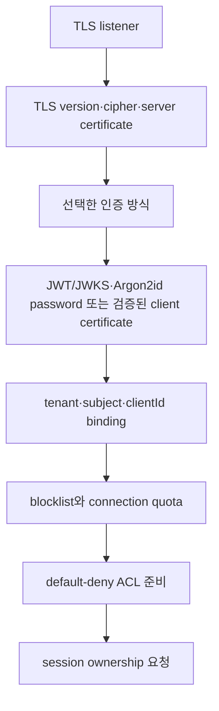

# Tenant와 security 스펙

이 문서는 MQTT·관리 요청을 tenant에 귀속하고, topic·상태·자원을 격리하며, 인증·인가·감사를 일관되게 적용하는 외부 동작을 정의한다.

| 항목 | 값 |
| --- | --- |
| 상태 | Active (Phase 1 security and tenant isolation slice) |
| 적용 범위 | TEN-01~TEN-05, SEC-02~SEC-04, SEC-06, SEC-08의 JWKS fail-closed 동작, SEC-10 Management API 인증·RBAC·node-local 감사 조회, SEC-07 credential 회전·폐기와 SEC-12 client·identity·IP blocklist를 정의한다. Dynamic cluster의 tenant별 저장 quota(TEN-08)는 [ADR-0017](../decisions/ADR-0017-tenant-storage-quota.md) 범위에서 제공한다. TEN-06·TEN-07의 node-local 연결·session·subscription·PUBLISH traffic 한도는 §5.2를 따른다. Management plane 감사는 §8과 [ADR-0039](../decisions/ADR-0039-management-audit-log.md)를 따르되, SEC-10의 인증·RBAC와 node-local 감사 조회 범위는 [ADR-0048](../decisions/ADR-0048-management-api-oidc-api-key-rbac.md)을 따른다. MQTT data-plane 거절 감사는 §8과 [ADR-0046](../decisions/ADR-0046-mqtt-data-plane-denial-audit.md)를 따른다. SEC-12는 [ADR-0050](../decisions/ADR-0050-mqtt-client-blocklist.md)을 따른다. Rollout controller 감사는 후속 범위다. Metrics는 인증 성공·실패, session gauge, 저장 quota 및 tenant 한도 거절을 포함하며, 상세 observability 정책은 §8과 Management API 스펙을 따른다. |
| 근거 | [PRD 9.3절, 9.4절과 11.4절](../requirements/PRD.md), [RFC 8725](https://www.rfc-editor.org/rfc/rfc8725.html) |
| 관련 spec | [MQTT protocol과 session](mqtt-protocol-and-session.md), [Management API](management-api-and-observability.md) |
| 관련 Architecture | [Security boundaries](../architectures/security-boundaries.md), [Threat model](../architectures/threat-model.md), [System overview](../architectures/system-overview.md) |
| 관련 Contract | [Audit event v1](../contracts/audit-event-v1.md), [Management API v1](../contracts/management-api-v1.md) |

## 1. 인증 결과 계약

인증 adapter는 성공 시 다음 논리 값을 반환해야 한다. 외부 provider의 원본 자료형을 이 경계 밖으로 노출해서는 안 된다.

| 필드 | 의미 |
| --- | --- |
| `tenantId` | 신뢰된 설정 또는 credential binding에서 결정한 tenant |
| `subject` | issuer 안에서 검증된 principal 식별자 |
| `credentialId` | 회전·폐기와 감사를 위한 비밀이 아닌 식별자 |
| `allowedClientIds` | 정확한 값 또는 승인된 pattern으로 표현한 허용 범위 |
| `roles` | 관리 plane의 RBAC role 목록 |
| `expiresAt` | 재인증 또는 연결 재평가에 쓰는 만료 시각 |

client가 username, token claim, MQTT property 또는 topic으로 제출한 `tenantId`를 독립적인 신뢰 근거 없이 사용해서는 안 된다. 인증 성공 뒤에도 tenant와 clientId binding, 차단 목록과 listener 정책을 확인해야 한다.

## 2. MQTT 연결 인증



어느 단계든 실패하면 session ownership을 요청해서는 안 된다. 실패는 protocol version이 허용하는 CONNACK reason 또는 연결 종료로 표현하고 인증 실패 Metric을 기록해야 한다.

### 2.1 TLS와 mTLS

- TLS listener는 TLS 1.2 이상만 허용해야 한다.
- 허용 protocol과 cipher suite는 listener별 allowlist로 관리해야 한다.
- mTLS는 configured trust anchor, 유효 기간, key usage와 identity mapping을 모두 검증해야 한다.
- 신뢰하지 않는 CA, 만료·폐기 인증서 또는 identity 불일치는 거절해야 한다.
- node 간 연결은 별도 trust domain의 mTLS와 member allowlist를 모두 통과해야 한다.
- MQTT client mTLS의 verified certificate는 `commonName`, `dnsSan`, `emailSan` selector 중 설정된
  하나와 case-sensitive exact match되어 하나의 static binding을 선택해야 한다. zero match는
  unmapped, multiple match는 ambiguous로 fail-closed한다.
- TLS handshake가 trust chain, validity와 client-auth EKU를 확인하고, application authentication
  adapter가 certificate identity를 tenant·subject·credential·allowed Client ID·roles로 변환한다.
  인증서 원문과 chain은 application/domain 경계로 넘기지 않는다.

### 2.2 JWT와 JWKS

JWT validator는 다음 순서를 지켜야 한다.

1. CONNECT Password의 UTF-8 compact JWT를 읽고, configured algorithm allowlist에 없는 `alg`이면 서명 검증 전에 거절한다.
2. 필수 `kid`를 확인하고, cache의 JWKS key set에서 후보 key를 찾는다.
3. 후보 key로 서명을 검증한다. `kid`와 서명 검증은 configured issuer의 key set 안에서만 수행한다.
4. `iss`를 configured issuer와 정확히 비교하고, `aud`가 configured audience를 포함하는지 확인한다.
5. 비어 있지 않은 `sub`와 `exp`를 확인하고, 선택적인 `nbf`를 configured clock skew와 함께 검증한다.
6. 검증된 `(iss, sub)`를 정적 binding에 대조해 tenant, credential, 허용 Client ID와 roles를 결정한다. Token claim은 이 값을 덮어쓸 수 없다.

JWKS cache는 `fetchedAt`, TTL 만료 시각과 마지막 refresh 시각을 함께 소유한다. 비어 있거나 만료된 cache는 하나의 동시 fetch만 수행하는 mandatory refresh가 성공해야 인증을 진행한다. 유효 cache에서 알려지지 않은 `kid`는 `refreshCooldown`이 허용할 때 하나의 coalesced early refresh를 수행한다. early refresh가 실패하면 해당 `kid`는 거절하지만, 만료되지 않은 기존 key set으로 알려진 `kid`를 검증하는 동작은 유지한다. cooldown 안의 알려지지 않은 `kid`는 I/O 없이 거절한다. 성공한 fetch는 key set, `fetchedAt`, TTL과 refresh-attempt 시각을 원자적으로 교체하고, 실패한 fetch는 TTL을 연장하지 않는다. TTL이 끝난 뒤 refresh가 실패하면 fail-closed로 거절한다.

### 2.3 CONNECT credential과 strict security configuration

MQTT CONNECT는 configured credential 방식 하나를 선택한다. Verified client certificate가
있으면 mTLS를 선택한다. Certificate가 없으면 security configuration에서 선택한 JWT 또는
password provider를 사용한다. Configuration은 JWT와 nonempty `passwordIdentities`를 함께
허용하지 않는다.

- Verified client certificate가 있으면 MQTT `Username`과 `Password` flag를 모두 보내지
  않아야 한다. Certificate가 unmapped, ambiguous 또는 application-level `NotAfter` 만료이면
  다른 방식으로 fallback하지 않고 거절한다.
- JWT provider를 사용하면 `HasUsername=true`와 `HasPassword=true`를 보내야 한다.
  Username은 identity로 사용하지 않으며 Password에는 하나의 UTF-8 compact JWT를 넣는다.
- Password provider를 사용하면 두 flag를 모두 보내야 한다. Username은 비어 있지 않은
  case-sensitive exact key다. Password는 1~65,535 bytes의 원문 byte로 검증한다.
- mTLS certificate와 MQTT `Username` 또는 `Password` flag를 함께 제출하면 거절한다.
  Credential을 합치거나 provider 사이에서 fallback하지 않는다.
- Configured credential provider와 mTLS provider가 모두 없을 때만 개발용 anonymous CONNECT를 허용한다.

Credential, certificate identity, Client ID binding 또는 Will ACL이 실패하면 MQTT 3.1.1
CONNACK `0x05`, MQTT 5 CONNACK `0x87`을 반환하고 연결을 닫는다. Unknown username과
잘못된 password는 모두 `invalid_credentials`로 처리한다. 인증 실패는 session, timer,
route, queue, retained message와 Will을 변경하지 않는다.

TLS listener(`-tcp-listen` 또는 `-tls-listen`)를 여는 Broker 시작에는
`-security-config <path>`가 필수다. 파일은 알 수 없는 field와 두 번째 JSON value를
거절하는 strict decoder로 한 JSON value만 읽는다. JWT 설정의 duration은 양수인 Go
duration string이어야 한다.
`tenantLimits.maxWait`는 §5.2의 `0s`~`10s`를 따른다. Configuration decode와 JWT/JWKS,
password, mTLS provider 생성은 listener socket을 열기 전에 끝나야 하며, 누락·충돌·오류가
있으면 시작을 실패시킨다. TLS listener의 `request|require` client authentication은
최소 하나의 `mtlsIdentities` binding을 요구하고, binding이 있으면 `client-auth none`을
사용할 수 없다. `request`는 mTLS certificate가 없는 client에 JWT 또는 password provider가
configured된 경우 인증을 허용한다. `require`는 모든 TLS client에 verified certificate를
요구한다.

유일한 개발·benchmark 예외는 `-tcp-listen`과 `-allow-insecure-anonymous-mqtt`를 함께 사용하고
`-tls-listen`을 비워 둔 경우다. `-tcp-listen`은 literal `127.0.0.0/8` 또는 `::1` loopback이어야
하며, `-security-config`와 예외 flag를 함께 사용할 수 없다. MQTT listener 없이 예외 flag만 주거나
TLS listener와 함께 주는 경우도 거절한다. 이 예외는 production security mode가 아니며 Phase 1
보안 완료 증거로 사용할 수 없다. MQTT listener가 없는 management-only 실행에는
`-security-config`를 요구하지 않는다.

```json
{
  "jwt": {
    "issuer": "https://issuer.example",
    "audience": "narumq",
    "algorithms": ["RS256"],
    "jwksUrl": "https://issuer.example/.well-known/jwks.json",
    "cacheTtl": "15m",
    "refreshCooldown": "30s",
    "clockSkew": "30s",
    "httpTimeout": "5s"
  },
  "identities": [
    {
      "issuer": "https://issuer.example",
      "subject": "device-1",
      "tenantId": "tenant-a",
      "credentialId": "device-1-key",
      "allowedClientIds": ["device-1"],
      "roles": ["publisher"]
    }
  ],
  "mtlsIdentities": [
    {
      "identityKind": "commonName",
      "identity": "device-1-cert",
      "tenantId": "tenant-a",
      "subject": "device-1-cert",
      "credentialId": "device-1-cert-key",
      "allowedClientIds": ["device-1-cert"],
      "roles": ["publisher"]
    }
  ],
  "acl": [
    {
      "tenantId": "tenant-a",
      "role": "publisher",
      "effect": "allow",
      "action": "publish",
      "topicFilter": "sensors/#"
    }
  ]
}
```

`mtlsIdentities` entry는 `identityKind`, `identity`, `tenantId`, `subject`, `credentialId`,
`allowedClientIds`, `roles` field만 사용한다. `identityKind`는 `commonName`, `dnsSan`,
`emailSan` 중 하나이며 identity 비교는 case-sensitive exact match다. 하나의 certificate가
zero entry와 match하면 unmapped, 둘 이상의 entry와 match하면 ambiguous다. `NotAfter`는
새 principal의 만료 시각으로 사용하며 trust chain·certificate validity·client-auth EKU는
TLS handshake에서 먼저 검증한다. URI SAN/SPIFFE·fingerprint selector와 cluster-peer mTLS는 이 인증 mapping slice에 포함하지 않는다. Client certificate 폐기는 §7의 `credentialId` 폐기 규칙을 따른다.

이 slice는 issuer와 audience를 각각 정확히 하나만 허용한다. JWT identities의 `(issuer, subject)` binding, mTLS identities의 `(identityKind, identity)` selector, allowed Client IDs와 roles는 각각 고유해야 한다. Password identities는 같은 `subject`를 공유할 수 있지만 `username`과 `credentialId`는 고유해야 한다. JWT·password·mTLS 전체에서 `credentialId`는 UTF-8 1~512 bytes이며 중복될 수 없다. ACL `effect`는 `allow|deny`, `action`은 `publish|subscribe|unsubscribe|will`만 허용한다. 중복 ACL rule과 malformed MQTT filter는 startup에서 거절한다. `jwksUrl`은 절대 `https` URL이어야 하며, deterministic test를 위해 IP-literal loopback host의 HTTP만 예외로 허용한다. `cacheTtl`, `refreshCooldown`, `clockSkew`, `httpTimeout`은 모두 양수여야 한다. Credential 회전과 폐기는 §7을 따른다. 운영 중 reload는 제공하지 않는다.


### 2.4 Username/password

Password authentication은 `passwordIdentities`가 하나 이상 있을 때 활성화된다. 각 entry는
`username`, `passwordHash`, `tenantId`, `subject`, `credentialId`, `allowedClientIds`,
`roles` field만 사용한다. Plaintext `password` field는 strict decoder가 거절한다.
Username은 비어 있지 않은 case-sensitive exact key이며 같은 configuration 안에서 중복할 수 없다. Password identities는 같은 `subject`를 공유할 수 있지만 각 `credentialId`는 JWT·mTLS identity를 포함해 고유해야 한다. `credentialId`는 UTF-8 1~512 bytes여야 한다. Tenant·Client ID·role의 필수·중복 검사는 JWT/mTLS binding과 같은 기준을 따른다. JWT provider와 nonempty password identity 목록을 함께 설정하면 startup이 실패한다. Password 목록이 없거나 비어 있으면 password authentication은 활성화되지 않는다.
Dynamic cluster에서 password를 회전할 때는 새 `username`·`passwordHash`·`credentialId` entry를 추가하고 rolling restart를 수행한다. Client를 새 credential로 전환한다. 기존 `credentialId`를 폐기한다. 다음 rolling restart에서 이전 entry를 제거한다.

`passwordHash`는 다음 Argon2id PHC profile만 허용한다.

```text
$argon2id$v=19$m=19456,t=2,p=1$<salt>$<digest>
```

Salt는 16 bytes, digest는 32 bytes다. 둘 다 padding 없는 canonical standard base64로
인코딩한다. Version, parameter, 길이 또는 encoding이 다르면 startup에서 거절한다.
Profile은 OWASP Password Storage Cheat Sheet의 Argon2id 권장값인 19 MiB, 2회,
1 lane을 따른다. Password는 복호화 가능한 형식이나 평문으로 저장하지 않는다.

`narumq -hash-password`는 stdin에서 1~65,535 bytes를 읽어 salt가 다른 PHC hash를 stdout에
출력한다. 입력 마지막의 LF 한 개와 바로 앞 CR 한 개만 제거한다. 그 밖의 공백과 binary
byte는 보존한다. Password를 flag, environment variable 또는 임시 file에 전달하는 기능은
제공하지 않는다. Secret manager 등의 pipe 입력을 사용하고 shell history에 평문 password를
입력하지 않는다.

Provider는 최대 4개의 Argon2 계산만 동시에 수행한다. Slot이 없으면 대기하지 않고 일반
인증 실패로 거절한다. 이 제한은 계산 중인 작업 수를 제한하며 GC가 회수하기 전 process
heap의 상한을 보장하지 않는다. Unknown username에도 저장 hash와 같은 profile의 계산을
수행한다. Unknown username, 빈 username과 잘못된 password는 같은 CONNACK, 인증 실패
Metric과 감사 결과를 사용한다. 이 동작은 정확히 같은 wall time을 보장하지 않는다.

Password principal의 만료는 기존 principal·persisted Will 형식을 유지하기 위해 `time.UnixMilli(math.MaxInt64)`로 표현한다. Password 별도 만료는 제공하지 않는다. Password와 hash는 error, log, audit field 또는 Metric label에 넣지 않는다. CONNECT 거절 감사는 `authMethod: "password"`를 사용한다.

## 3. Tenant namespace

외부 MQTT topic과 filter 표기는 변경하지 않는다. Broker 내부에서는 tenant와 namespace를 문자열 prefix로 이어 붙이지 않고, 비교 가능한 typed value로 함께 표현한다.

- `NewTenantID(raw string) (TenantID, error)`는 비어 있거나 유효하지 않은 tenant를 거절한다.
- `NewSessionKey(tenantID TenantID, clientID string) (SessionKey, error)`는 tenant와 비어 있지 않은 Client ID를 결합하며 field를 외부에서 만들 수 없게 한다.
- `NewTopic(tenantID TenantID, name string) (Topic, error)`는 concrete MQTT topic을 검증한다.
- `NewTopicFilter(tenantID TenantID, filter string) (TopicFilter, error)`는 MQTT filter 또는 shared subscription을 검증한다.

각 value는 private field와 read-only `TenantID()`, `ClientID()`, `Name()`, `Filter()` accessor만 제공한다. 서로 다른 tenant의 같은 외부 이름은 비교에서 절대 같은 값이 되지 않는다. Cross-tenant 비교는 거절한다. 향후 persistence·wire adapter만 unsigned-varint byte length 뒤에 UTF-8 tenant와 topic/filter bytes를 직렬화할 수 있으며, 이 slice에는 string compatibility key나 내부 prefix encoding을 두지 않는다.

Topic/filter validation과 MQTT wildcard matcher는 하나만 유지한다. Shared subscription은 먼저 `$share/{ShareName}/{TopicFilter}`로 분해하고 ACL과 containment/intersection 비교에는 underlying filter만 사용한다. `$` system topic의 첫 level wildcard 제한을 포함한 기존 MQTT matching 의미를 그대로 적용한다. Unicode normalization, case folding, slash 병합은 하지 않는다.

Namespace binding은 publish, subscribe, unsubscribe, retained, shared subscription, Will과 session key에 동일하게 적용한다. Client가 제출한 tenant claim, topic prefix 또는 이중 encoding으로 tenant를 선택하거나 변경할 수 없다.

## 4. ACL

ACL 입력은 `tenantId`, `subject`, `clientId`, action, canonical topic/filter, listener와 연결 속성이다.

| Action | 판정 시점 | 거절 결과 |
| --- | --- | --- |
| `publish` | message를 durable log나 route에 넣기 전 | MQTT 5 `Not authorized`가 허용되면 반환하고, 아니면 연결을 종료할 수 있다. |
| `subscribe` | route를 만들기 전 | 해당 SUBACK 항목을 거절한다. |
| `unsubscribe` | target session과 filter를 바꾸기 전 | protocol이 허용하는 거절 또는 연결 종료 |
| `will` | CONNECT에서 등록할 때와 실제 발행 직전 | 등록 또는 발행을 거절하고 감사 가능한 사유를 남긴다. |

- 일치하는 allow가 없으면 deny다.
- 명시적 deny는 allow보다 우선해야 한다.
- policy backend 오류 또는 timeout은 deny로 처리해야 한다.
- policy 변경의 적용 version을 연결과 감사 이벤트에서 확인할 수 있어야 한다.
- 기존 연결 재평가·재인증 정책은 credential 종류별로 문서화해야 한다.

### 4.1 Phase 1 ACL 판정과 Will

ACL은 authenticated principal이 가진 모든 role의 tenant-local rule을 대상으로 평가한다. matching deny가 하나라도 있으면 거절하고, deny가 없으며 matching allow가 있으면 허용하고, 둘 다 없으면 default deny다.

- `publish`와 `will`은 concrete `Topic`이 rule `TopicFilter`와 match하는지 평가한다.
- `subscribe`와 `unsubscribe`는 요청한 모든 topic을 포함하는 rule filter가 있어야 allow가 된다. 요청 filter와 deny rule이 한 topic이라도 교차하면 거절한다.
- Shared subscription syntax는 먼저 parse하고 underlying filter로 위 두 판정을 수행한다.
- CONNECT Will은 등록 시점과 실제 publication 직전에 같은 principal snapshot으로 다시 authorize한다. delayed Will의 authorization 실패는 broker state를 변경하지 않고 Will을 버린다.

`Principal`과 `SessionKey`의 tenant와 Client ID가 일치하지 않으면 모든 authorization은 거절한다. Principal은 CONNECT 시점에 session에 snapshot으로 저장하며 기존 연결은 live TCP connection이나 timer map에서 identity를 다시 읽지 않는다.

## 5. Quota와 rate limit

모든 quota는 tenant별로 계산하고 한 tenant의 초과가 다른 tenant의 정상 traffic을 직접 거절하게 해서는 안 된다.

| 범주 | 최소 제한 단위 | 초과 동작 |
| --- | --- | --- |
| 연결 상태 | connection, session, subscription | 새 생성 거절. 기존 정상 상태를 임의 삭제하지 않는다. |
| traffic | message rate, byte rate, payload size | bounded backpressure 후 protocol reason으로 거절하거나 연결 종료 |
| 저장 | offline queue message/bytes, retained bytes, 전체 저장량 | 새 durable state를 거절하고 기존 state를 보존한다. Dynamic cluster의 tenant별 저장 quota와 초과 동작은 §5.1을 따른다. |
| 선택 Metric | exact topic 등록 수, TTL | wildcard 거절, 상한 초과 등록 거절 |

저장 quota 상한과 초과 정책은 [ADR-0017](../decisions/ADR-0017-tenant-storage-quota.md)에 따른다. Cluster는 초과 시 eviction 없이 새 state만 거절해야 하며, quota 축소 뒤에도 기존 state를 보존하고 usage를 줄이는 변경을 허용해야 한다.

### 5.1 저장 quota

Dynamic cluster는 tenant별 retained bytes, offline queue와 저장 총량을 제한해야 한다. 한 tenant의 초과가 다른 tenant에 설정된 한도를 바꾸지 않는다. 적용 차원, byte 계산, global limit 우선순위와 profile version은 [ADR-0017](../decisions/ADR-0017-tenant-storage-quota.md)을 따른다.

| 설정 key | 집계 대상 | cluster-wide 최대값 |
| --- | --- | ---: |
| `retainedBytes` | 해당 tenant의 retained value 계산 bytes 합 | 16 MiB |
| `offlineQueueMessages` | QoS 0 offline message와 durable delivery outbound message(QUEUED·inflight) 수 | 8,192 |
| `offlineQueueBytes` | 위 message들의 계산 bytes 합 | 32 MiB |
| `storageBytes` | retained, QoS 0 offline, durable delivery outbound·inbound QoS 2 bytes 합 | 48 MiB |

`-cluster-config`에는 다음 형태의 `tenantQuotas` profile을 선택적으로 지정한다. 명시 profile의 `version`은 1 이상이며, tenant별 항목은 `tenantId` 순으로 적용된다.

```json
{
  "tenantQuotas": {
    "version": 1,
    "default": {
      "retainedBytes": 16777216,
      "offlineQueueMessages": 8192,
      "offlineQueueBytes": 33554432,
      "storageBytes": 50331648
    },
    "tenants": [
      {
        "tenantId": "acme",
        "retainedBytes": 1048576,
        "offlineQueueMessages": 256,
        "offlineQueueBytes": 1048576,
        "storageBytes": 4194304
      }
    ]
  }
}
```

Profile은 더 높은 version의 Raft command가 commit된 뒤 모든 replica에 적용된다. 설정에 tenant 항목이 없으면 `default`를 사용한다. `tenantQuotas`를 생략하면 각 dimension의 cluster-wide 최대값인 version 0 built-in profile이 사용된다. 새 저장이 quota를 넘으면 retained/offline mutation은 기존 capacity 결과로 거절한다. Durable delivery는 [Cluster §4.5](cluster-session-and-delivery.md#45-publish-backpressure-admission)의 ingress 사전 판정에서 전역·tenant 한도 초과 publish를 거절한다. MQTT 5는 `0x97`, MQTT 3.1.1은 연결 종료를 반환한다. Tenant 초과는 `narumq_tenant_quota_rejections_total`에 기록한다. Apply 시점 경합은 기존 `Saturated` 처리다. Session당 한도와 RELEASE 시점 포화도 target을 건너뛰는 기존 동작을 유지한다.

Proposer node는 `narumq_tenant_quota_rejections_total{tenant,dimension}` counter를 올리고 같은 tenant·dimension 경보 log를 10초 rate-limit한다. Tenant label은 최대 1,024개까지 보존하고 나머지는 `_overflow` label로 집계한다. Profile commit 여부, version과 local config mismatch는 각각 `narumq_tenant_quota_profile_committed`, `narumq_tenant_quota_profile_version`, `narumq_tenant_quota_config_mismatch`로 노출한다. Committed profile이 복구되기 전에는 cluster MQTT readiness를 허용하지 않는다.
### 5.2 연결 상태와 traffic 한도

`-security-config` JSON에 선택 object `tenantLimits`를 둔다. Standalone과 cluster가 같은 schema를 사용한다. `tenantLimits`를 생략하면 tenant 한도가 없다.

```json
"tenantLimits": {
  "maxWait": "1s",
  "default": {
    "maxConnections": 1000, "maxSessions": 2000, "maxSubscriptions": 10000,
    "messagesPerSecond": 500, "bytesPerSecond": 1048576, "maxPayloadBytes": 262144
  },
  "tenants": [ { "tenantId": "acme", "maxConnections": 10, "messagesPerSecond": 0 } ]
}
```

- **default.** 모든 field는 선택이다. 생략하거나 0이면 그 차원은 제한하지 않는다.
- **tenants[].** `tenantId`는 필수이고 `tenancy.NewTenantID`로 검증한다. 같은 tenant가 두 번 나오면 거절한다. 최대 4,096개다. 생략한 field는 `default` 값을 상속한다. 명시한 0은 그 tenant에서 제한을 끈다.
- **허용 범위.**
  - `maxConnections`, `maxSessions`, `maxSubscriptions`, `messagesPerSecond`: 0~1,000,000.
  - `bytesPerSecond`: 0~1,099,511,627,776(1<<40).
  - `maxPayloadBytes`: 0~268,435,455.
  - `maxWait`: Go duration, `0s`~`10s`. 생략하면 `1s`다. `0s`는 대기 없이 바로 거절한다.
  - 알 수 없는 field, 범위 밖 값, 음수, 잘못된 duration은 startup에서 거절한다.

한도는 인증된 principal(`principal.Subject() != ""`)에만 적용한다. Security config가 없는 loopback 개발 모드와 anonymous session에는 한도가 없다.

| 차원 (`dimension`) | 집계 대상 | 검사 시점 | 초과 응답 MQTT 5 / 3.1.1 |
| --- | --- | --- | --- |
| `connections` | 이 node session repository에서 `Connected()==true`인 tenant lifecycle 수 | CONNECT에서 `session.Open` 성공 뒤, ownership 획득 전. 기존 lifecycle이 이미 연결 중이면 증가로 보지 않는다. | CONNACK `0x97` / CONNACK `0x03`. State를 바꾸지 않는다. |
| `sessions` | 이 node session repository의 tenant lifecycle 수(연결 중 + detached) | 같은 시점. 기존 lifecycle이 없을 때만(`!found`) 검사한다. Resume과 clean start 대체는 새 session이 아니다. | 같음 |
| `subscriptions` | Route table에서 tenant에 bind된 session의 shared·non-shared subscription 수. Cluster에서는 committed projection 전체다. | SUBSCRIBE filter마다 ACL 검사 뒤, commit 전. 같은 session에 같은 filter가 이미 있으면(replace) 검사하지 않는다. | 해당 filter의 SUBACK `0x97` / `0x80`. 다른 filter는 독립 처리한다. |
| `payload_size` | PUBLISH payload byte 길이 | TCP `readLoop`에서 decode 직후, dispatch 전. 대기 없음. | QoS 1 PUBACK `0x97`, QoS 2 PUBREC `0x97`, QoS 0 DISCONNECT `0x97` 뒤 종료 / 종료 |
| `message_rate` | Tenant의 초당 PUBLISH 수 (node별 token bucket) | 같은 위치. 최대 `maxWait`까지 대기한다. | QoS 1 PUBACK `0x97`, QoS 2 PUBREC `0x97`, QoS 0 DISCONNECT `0x96` 뒤 종료 / 종료 |
| `byte_rate` | Tenant의 초당 payload byte (node별 token bucket) | 같은 위치 | `message_rate`와 같음 |

연결, session, rate는 node별로 센다. Subscription은 각 node의 route table에 있는 tenant 전체 수로 판정한다. Standalone에서는 해당 node의 수이고, cluster에서는 committed projection 기준 cluster 전체 수다. 같은 node의 제한 대상 SUBSCRIBE·UNSUBSCRIBE는 판정부터 commit과 route 변경까지 직렬화한다. Replacement와 removal이 경쟁해도 local 한도를 넘기지 않는다. 다른 node에서 동시에 SUBSCRIBE하면 projection 반영 시점 때문에 잠시 한도를 넘을 수 있다. Replicated schema, feature gate, Raft command는 바꾸지 않는다.

#### 검사 순서와 과금

- **검사 순서.**
  - CONNECT: `connections` → `sessions`.
  - PUBLISH: Receive Maximum → `payload_size` → rate. 그 뒤 기존 ACL·cluster·backpressure 검사가 이어진다. 따라서 ACL로 거절될 PUBLISH도 rate token을 쓴다.
- **과금 대상.** 새 PUBLISH만 과금한다. QoS 0은 항상 새 PUBLISH다. QoS 1/2는 `admitInboundPublish`가 처음 예약한 Packet ID일 때만 과금한다. 미완료 ID의 재전송은 과금하지 않는다. PUBREL, 서버 Will, retained 재전송, cluster forward는 과금하지 않는다.

#### Token bucket과 대기

- **Token bucket.** 용량과 초당 보충량은 설정 rate와 같다. 시작할 때 bucket은 가득 차 있다. Clock이 뒤로 가면 보충하지 않는다.
  - 예약하면 token에서 message 1개와 payload byte를 뺀다. Token은 음수가 될 수 있다. 이 음수가 대기열 역할을 한다.
  - 대기 시간은 `max(부족 message/messagesPerSecond, 부족 byte/bytesPerSecond)`다.
  - 대기 시간이 `maxWait`를 넘으면 token을 빼지 않고 거절한다. 두 차원이 모두 넘으면 `message_rate`를 보고한다.
- **대기.** Rate 초과 시 해당 연결의 읽기를 최대 `maxWait`(기본 1s, 최대 10s)만큼 멈추고 token을 기다린다. 대기 중에는 연결의 다음 packet을 읽지 않으므로 TCP 수준 backpressure가 생긴다. 연결이 닫히면 대기를 즉시 끝낸다. Token이 충분하지 않으면 거절한다.

#### Metric과 log

- Counter `narumq_tenant_limit_rejections_total{tenant,dimension}`을 둔다. `dimension`은 위 6개 값만 허용한다.
- `tenant` label은 기존 저장 quota metric과 같은 1,024개 tenant 집합을 공유한다. 집합을 넘으면 `_overflow`로 모은다.
- 거절마다 counter를 올린다. Warn log `tenant limit rejected a request`(`tenant`, `dimension`)는 tenant·dimension마다 10초에 한 번만 남긴다.


## 6. 관리 plane RBAC

| Permission | 의미·route | `ReadOnly` | `Operator` | `SecurityAdmin` | `ClusterAdmin` |
| --- | --- | --- | --- | --- | --- |
| `PermissionRead` | 기존 ReadOnly route 전체: 조회, drain·rebalance GET, membership-operation GET, feature GET, 405 응답 route, 익명 외 `/metrics`·probe | ✓ | ✓ | ✓ | ✓ |
| `PermissionOperate` | drain POST/DELETE, rebalance POST/DELETE |  | ✓ |  | ✓ |
| `PermissionAuditRead` | `GET /api/v1/audit/events` |  |  | ✓ | ✓ |
| `PermissionClusterAdmin` | `/api/v1/tenants`, members POST/DELETE와 그 non-mutation 분기, feature POST, backups |  |  |  | ✓ |
| `PermissionCredentialAdmin` | credential revocation과 client blocklist list·block·unblock route |  |  | ✓ | ✓ |
| delegated tenant role | 자기 tenant의 credential, ACL과 quota만 관리 (`TEN-10·API-07 후속 범위`) |  |  |  |  |

Principal은 여러 role을 가질 수 있으며, 할당된 role 중 하나라도 해당 permission을 부여하면 요청을 허용한다. 권한은 resource와 action마다 확인해야 한다. 단순히 UI에서 control을 숨기는 것으로 권한 검사를 대신해서는 안 된다. 목록과 상세 조회에서도 tenant scope를 적용해 IDOR를 막아야 한다.

## 7. Credential 회전·폐기와 차단

Credential rotation과 expiry 정책은 credential 종류별로 적용해야 한다. Security configuration은 startup에서만 읽는다. 운영 중 reload를 제공해서는 안 된다.

- **공통 회전:** 새 credential을 기존 credential과 함께 security configuration에 추가하고 기존 rolling restart로 모든 node에 반영해야 한다. Client가 새 credential로 전환한 뒤 이전 credential을 폐기해야 한다. 이전 설정 entry는 다음 rolling restart에서 제거할 수 있다.
- **JWT 회전:** JWT는 짧은 `exp`와 JWKS key 회전을 함께 사용해야 한다. Static `(issuer, subject)` binding은 하나만 허용한다. Credential 폐기는 해당 binding 전체에서 발급된 JWT를 거절한다.
- **Password 회전:** Dynamic cluster 절차는 §2.4를 따른다. Password identity는 subject 중복을 허용하지만 username과 credential ID는 고유해야 한다.
- **Credential 폐기:** 폐기는 Dynamic cluster의 관리 API로 제공한다. Feature `credential-revocation`을 활성화해야 한다. 폐기 단위는 전체 `credentialId`이며 JWT, password와 client mTLS 인증에 같은 규칙을 적용한다. 폐기된 ID는 `DELETE`로 복구할 때까지 모든 CONNECT를 거절해야 한다. 한 cluster는 최대 4096개 ID를 폐기할 수 있다. ID는 UTF-8 1~512 bytes여야 한다.
- **전파와 최신성:** 각 node는 committed 폐기 entry를 apply한 즉시 새 인증과 기존 연결에 적용해야 한다. 별도 propagation 설정값은 없다. `UseCase.ConnectContext`는 인증 뒤, allowed Client ID 검사와 session·ownership 변경 전에 폐기 여부를 committed-state read로 확인해야 한다. Checker 오류는 server-unavailable CONNACK으로 fail-closed해야 한다. TCP `connection.activate`는 ownership commit 뒤, CONNACK 직전에 다시 확인해 두 검사 사이의 폐기 적용 경쟁을 막아야 한다. 이 검사에 필요한 quorum을 얻지 못하면 연결을 수락해서는 안 된다.
- **기존 연결 회수:** 폐기 entry를 apply한 node는 해당 credential의 연결을 종료하고 Will을 폐기해야 한다. MQTT 5에서 이미 CONNACK을 보낸 연결은 DISCONNECT `0x87`을 보낸 뒤 2초 후 강제 close해야 한다. MQTT 3.1.1 연결과 CONNACK 전 연결은 즉시 close해야 한다. Revoked CONNECT는 MQTT 3.1.1 CONNACK `0x05`, MQTT 5 CONNACK `0x87`로 거절해야 한다. Revocation checker 오류는 MQTT 3.1.1 `0x03`, MQTT 5 `0x88` server-unavailable CONNACK으로 거절해야 한다.
- **Credential 만료:** JWT `exp`와 client certificate `NotAfter`에서 연결을 종료해야 한다. JWT `clockSkew`는 CONNECT 검증에만 적용한다. MQTT 5는 DISCONNECT `0xA0` 뒤 2초 후 close하고, MQTT 3.1.1은 즉시 close해야 한다. 만료 종료는 `DisconnectAbnormal` 규칙을 사용해 Will을 처리해야 한다. Password의 `time.UnixMilli(math.MaxInt64)`와 익명 principal(`Subject()==\"\"`)에는 timer를 두지 않는다.
- **재인증과 범위:** MQTT 5 `AUTH` 재인증은 제공하지 않는다. Client는 새 credential로 다시 연결해야 한다. Standalone은 credential 폐기 API·management mutation·관련 감사 event를 제공하지 않지만 credential 만료 종료는 적용해야 한다.
- **감사:** 폐기와 복구 mutation은 `security.credential.revoke`·`security.credential.restore` action과 `mqtt_credential` target을 기록해야 한다. Dynamic cluster의 CONNECT 거절과 지연 Will 거절은 `credential_revoked` reason으로 기록해야 한다.
### 7.1 Client·identity·IP 차단(SEC-12)

Blocklist는 Dynamic cluster에서만 제공한다. 모든 node가 같은 `client-blocklist` build feature를 광고해야 한다. 운영자는 기존 `POST /api/v1/cluster/features/client-blocklist`로 feature를 활성화한 뒤 관리 API를 사용해야 한다. Standalone에는 blocklist route, matcher, mutation 또는 관련 감사 event가 없다.

Entry kind와 비교 값은 다음과 같다.

| Kind | 범위와 일치 규칙 |
| --- | --- |
| `clientId` | `(tenantId, clientId)` exact match. 같은 Client ID라도 다른 tenant에는 적용하지 않는다. 익명 cluster 연결은 tenant `default`를 쓴다. |
| `username` | MQTT CONNECT User Name 원문과 case-sensitive exact match. `HasUsername=true`일 때만 비교한다. JWT·password·익명 연결에도 같은 규칙을 적용한다. |
| `certificateSha256` | TLS에서 검증된 leaf certificate DER의 SHA-256 fingerprint와 lowercase hex exact match. |
| `ipPrefix` | 연결 source IP를 IPv4·IPv6 CIDR prefix와 비교한다. IPv4-mapped IPv6 source address는 IPv4 주소로 바꾼 뒤 비교한다. |

`clientId` entry의 `tenantId`는 `tenancy.NewTenantID`를 통과하는 UTF-8 1~128 byte 값이어야 한다. `clientId` 값은 UTF-8 1~256 bytes여야 한다. `username` 값은 UTF-8 1~256 bytes이며 U+0000을 포함할 수 없다. Certificate fingerprint는 소문자 64자리 hex여야 한다. `ipPrefix`는 `netip.ParsePrefix`가 받는 canonical CIDR이어야 한다. Prefix는 이미 mask되어야 하며 IPv4-mapped IPv6 prefix는 허용하지 않는다. 단일 IP는 IPv4 `/32`, IPv6 `/128`로 쓴다. `clientId` 이외 kind의 `tenantId`는 비워 둬야 한다. 자동 정규화는 하지 않는다.

Cluster 전체에서 kind를 합쳐 최대 4096개 entry를 저장한다. 한도를 넘으면 `409 blocklist_capacity_exceeded`로 거절한다. Entry는 `kind`, `tenantId`, `value` 오름차순으로 저장한다. 같은 entry의 block과 존재하지 않는 entry의 unblock은 상태를 바꾸지 않는다.

CONNECT는 다음 순서로 검사한다.

1. 인증 전에 source IP, 검증된 certificate fingerprint, CONNECT User Name을 확인한다. 일치하면 authenticator와 ownership을 호출하지 않는다.
2. 인증 성공 뒤 trusted tenant가 정해지면 `(tenantId, clientId)`를 확인한다. 익명 Dynamic cluster 연결은 `default` tenant로 확인한다. 이 단계는 allowed Client ID와 session·ownership mutation보다 먼저 끝난다.
3. Ownership commit 뒤 `bindSession`과 CONNACK 직전에 local committed blocklist를 다시 확인한다. 두 검사는 blocklist apply와 같은 TCP lock을 사용해 경쟁을 닫는다. CONNECT마다 quorum barrier를 추가하지 않는다.

어느 kind가 여러 개 일치하면 `ipPrefix`, `certificateSha256`, `username`, `clientId` 순서로 첫 kind를 사용한다. Block된 CONNECT는 MQTT 5 CONNACK `0x8A`(Banned), MQTT 3.1.1 CONNACK `0x05`로 거절한다. Data-plane audit reason과 인증 attempt reason은 `blocked`다.

Block mutation의 Raft command가 apply되면 해당 entry에 일치하는 기존 연결을 종료하고 Will을 폐기한다. MQTT 5에서 이미 CONNACK을 보낸 연결은 DISCONNECT `0x98`(Administrative action)을 받고 2초 뒤 강제 종료한다. MQTT 3.1.1과 CONNACK 전 연결은 즉시 종료한다. 이미 끊긴 session의 지연 Will은 이후 blocklist로 억제하지 않는다.

`policyVersion`은 Entry 집합을 실제로 바꾼 마지막 blocklist command의 Raft index다. 변경 전 값은 0이다. 중복 block과 없는 entry의 unblock은 version을 바꾸지 않는다. `GET /api/v1/security/blocklist`는 현재 node에 apply된 `policyVersion`과 정렬된 entry 목록을 반환한다. Mutation은 `PermissionCredentialAdmin`을 요구한다. Block과 unblock은 결과 상태가 정해진 집합 연산이므로 `Idempotency-Key`를 요구하지 않는다.

Mutation 성공 응답 뒤 5초 안에 모든 node가 block을 새 CONNECT에 적용하고 일치하는 기존 연결을 종료해야 한다. Unblock은 각 node가 command를 apply한 뒤 새 CONNECT를 허용한다. 운영자는 `client-blocklist` feature를 활성화하고 POST로 entry를 차단한다. 각 node의 GET 응답에서 같은 `policyVersion`을 확인한다. 해제할 때 DELETE를 호출한다.

Mutation audit action은 `security.blocklist.add`와 `security.blocklist.remove`다. Target type은 `mqtt_blocklist_entry`, target ID는 `BlockEntry.Key()` 형식(`clientId:<tenant>/<client>`, `username:<value>`, `certificateSha256:<value>`, `ipPrefix:<value>`)이다.

## 8. 감사와 비밀정보

Dynamic cluster의 활성 Management API mutation 18개와 인증 `401`·인가 `403` 거절은 audit event를 생성한다. Management event 형식은 [Audit event v1 계약 §5](../contracts/audit-event-v1.md#5-broker-producer-범위)를 따른다.

Management mutation은 실행 전에 node-local publisher의 준비 상태를 확인해야 한다. Publisher를 쓸 수 없으면 handler를 호출하지 않고 retryable `503 audit_unavailable`을 반환한다. Mutation 뒤 event 기록이 실패하면 작업을 되돌리지 않고 error log와 Metric으로 드러낸다.

Event는 `management.auditDirectory`의 JSONL 파일에 append하며 각 줄을 fsync한다. 이전 줄의 SHA-256을 연결하는 hash chain은 손상과 연결된 줄의 누락을 검출한다. Broker는 크기 기준으로만 rotation하고 파일을 삭제하지 않는다. 외부 collector는 rotation 파일 중 가장 오래된 연속 prefix만 삭제할 수 있다. `GET /api/v1/audit/events`는 node-local 저장 record를 읽기 전용으로 조회하며, 보존 기간·SIEM 수집과 장기 검색·접근 권한은 외부 SIEM 책임이다.

Standalone mode에는 감사 publisher를 연결하지 않는다. Standalone은 이 계약의 Dynamic cluster mutation을 제공하지 않으며, standalone 401·403 event도 기록하지 않는다.

Audit directory는 필수 cluster 설정이다. Raft data directory와 같거나 서로 포함하면 startup을 거절하고, 각 node는 별도 directory를 사용한다. `narumq -audit-verify <directory>`는 저장된 chain을 읽기 전용으로 검증한다.

Bearer token, API key, body, query와 원문 secret은 Management event에 기록하지 않는다. Named API key와 OIDC subject는 actor를 key·개인 단위로 식별하며, break-glass token만 공유 credential로 남는다. Management 인증·인가·rate-limit 거절은 node별 초당 20개 한도를 공유한다. 초과 event는 저장하지 않고 `denial_suppressed` Metric으로만 센다. 이 한도는 MQTT data-plane 감사 한도와 분리한다.

Dynamic cluster는 CONNECT 인증·Client ID binding·Will 검증 또는 blocklist 거절, PUBLISH·SUBSCRIBE·UNSUBSCRIBE ACL 거절과 지연 Will 재인가 거절을 기존 node-local hash chain에 기록한다. Data-plane 감사는 fail-open이며 node별 초당 20개, queue capacity 256을 적용한다. 한도 초과·queue 포화·종료 뒤 event는 기록하지 않고 Metric으로 센다. 이 경로는 caller를 막지 않으며 MQTT 응답을 바꾸지 않는다. Tenant, subject, credential ID, roles, Client ID, source IP host와 topic/filter는 원문으로 기록한다. Payload, password, token과 인증서 원문은 기록하지 않는다. 폐기 credential CONNECT와 지연 Will 거절은 `credential_revoked`, blocklist CONNECT 거절은 `blocked` reason으로 기록한다. 빈 Client ID, 지원하지 않는 protocol, tenant 한도·저장 quota, cluster readiness, listener admission, protocol error와 principal snapshot이 없는 Will은 기록하지 않는다. 상세 event field와 길이 규칙은 [Audit event v1 계약 §5](../contracts/audit-event-v1.md#5-broker-producer-범위)를 따른다.

Rollout controller producer와 SIEM consumer의 unknown action/reason 검증은 후속 범위다. Hash chain은 파일 전체를 다시 쓰는 권한 보유자 공격을 막지 않으므로 SIEM 보관과 접근 통제를 대체하지 않는다.

## 9. 수용 시험과 범위

| ID | 수용 기준 | 시험 |
| --- | --- | --- |
| SEC-01 | TLS 1.2 이상, TLS 1.0/1.1 거절, AEAD cipher allowlist와 TLS/mTLS listener 왕복을 검증한다. | `tests/integration/mqtt_tls_test.go`의 `TestMQTTTLS_ConnectionAndDelivery`, `TestMQTTTLS_RejectInsecureTLSVersion` |
| SEC-02 | algorithm allowlist, required `kid`, cached JWKS signature, exact issuer, audience membership, subject, exp/nbf와 clock skew를 순서대로 검증하고 key rotation을 fail-closed로 처리한다. MQTT listener startup은 `-security-config`를 요구하며, 유일한 예외는 literal loopback `-tcp-listen`과 `-allow-insecure-anonymous-mqtt`의 development·benchmark 조합이다. | `internal/adapters/authentication`의 JWT/JWKS cache 시험, `cmd/narumq/main_test.go`의 `TestRunWithContextMQTTSecurityMode`와 `TestRunWithContextSecurityConfig` |
| SEC-03 | trusted CA와 mapped certificate 성공, untrusted CA·TLS 만료 certificate·application-level `NotAfter` 만료 certificate 거절을 검증한다. | `tests/integration/mqtt_tls_test.go`의 `TestMQTTTLS_mTLS_TrustedMappedCertificate`, `TestMQTTTLS_mTLS_UntrustedCA_Rejected`, `TestMQTTTLS_mTLS_ExpiredCert_Rejected`, `internal/adapters/authentication`의 certificate expiry 시험 |
| SEC-04 | 인증서 CN/SAN exact mapping, unmapped·ambiguous identity, dual credential 거절을 검증하고, mTLS와 JWT 인증 결과의 exact allowed Client ID가 아니면 MQTT 3.1.1 `0x05` 또는 MQTT 5 `0x87`로 거절하고 state를 만들지 않는다. | `tests/integration/mqtt_tls_test.go`의 mTLS principal acceptance/rejection 시험, `internal/application/connect`, `tests/integration/mqtt_ingress_test.go`의 `TestMQTTSecurity` |
| SEC-05 | Username/password는 고정 Argon2id PHC hash로 인증한다. JWT와 password 설정은 상호 배타다. mTLS와 password는 함께 사용할 수 있다. MQTT 3.1.1·5의 성공·거절, tenant·Client ID·Will 경계, state 무변경, 인증 실패 Metric·audit method와 설정·저장 파일·log·Metric에서 password 원문 부재를 확인한다. | `internal/adapters/authentication/password_test.go`, `cmd/narumq/password_hash_test.go`, `internal/application/connect`, `cmd/narumq/security_config_test.go`, `tests/integration/mqtt_tls_test.go::TestMQTTTLS_PasswordAuthentication`, `tests/integration/cluster_password_process_test.go::TestDynamicClusterPasswordAuthenticationProcessAcceptance` |
| SEC-07 | Rolling restart로 credential 설정을 회전한다. Dynamic cluster의 committed 폐기는 새 CONNECT와 기존 session에 적용되고 revoked Will을 억제한다. CONNECT 폐기는 allowed Client ID·session·ownership 변경 전에 거절하며, TCP adapter가 ownership commit 뒤 다시 검사한다. JWT `exp`·certificate `NotAfter`의 protocol별 종료, password subject 중복, RBAC·audit도 확인한다. | `internal/domain/session` lifecycle; `internal/application/membership/credential_revocation_test.go`, `credential_revocation_service_test.go`; `internal/application/connect/dataplane_audit_test.go::TestCredentialRevocationRejectsBeforeOwnershipSideEffects`, `TestCredentialRevocationSuppressesImmediateAndDelayedWills`; `internal/adapters/authentication/mtls_test.go::TestMTLSAuthenticationProviderMatchesConfiguredSelectorKinds`; `internal/adapters/tls/listener_test.go::TestExtractVerifiedClientCertificateDTO`; `internal/adapters/tcp/server_credential_lifecycle_test.go::TestTCPConnectRejectsRevokedCredentialAfterOwnershipCommit`, `TestTCPCommittedRevocationClosesSessionsAndBlocksLocalReconnection`, `TestTCPCredentialExpiryDisconnectsAndProcessesWill`; `internal/adapters/http/management/credential_revocation_handlers_test.go`; `cmd/narumq/security_config_test.go`; `tests/contracts/management-api-v1/contract_test.go::TestCredentialRevocationHandlerResponsesMatchOpenAPI`, `tests/contracts/audit-event-v1`; `tests/integration/cluster_credential_lifecycle_process_test.go`의 `TestDynamicClusterCredentialRevocationProcessAcceptance`, `TestDynamicClusterCredentialExpiryProcessAcceptance` |
| SEC-08 | JWKS가 비어 있거나 TTL 만료 후 refresh에 실패하면 fail-closed한다. Metrics와 audit sink은 이 slice의 범위가 아니다. | `internal/adapters/authentication`의 `TestJWKSBootstrapFailureCollapses` 등 시험 |
| SEC-09 | node 간 복제와 internal transport mTLS를 분리 검증한다. | 별도 cluster transport acceptance suite |
| TEN-01 | 유효한 JWT와 정적 `(issuer, subject)` binding 없이 CONNECT가 성공하지 않고, token claim이 tenant를 선택하지 못한다. | `internal/adapters/authentication`의 JWT 검증 시험, `tests/integration/mqtt_ingress_test.go`의 `TestMQTTSecurity` |
| TEN-02 | Client ID uniqueness와 session ownership의 key가 `(tenant, clientId)`이며 같은 Client ID를 다른 tenant가 사용할 수 있다. | `internal/domain/session`, `internal/adapters/memory/sessionstore`, `tests/integration/mqtt_ingress_test.go`의 `TestMQTTSecurity` |
| TEN-03 | 같은 외부 topic과 filter가 tenant별 typed value로 격리되며 retained·shared·Will에도 같은 binding이 적용된다. | `internal/domain/tenancy`, `internal/domain/routing`, `tests/integration/mqtt_ingress_test.go`의 `TestMQTTSecurity` |
| TEN-04 | ACL은 tenant-local canonical typed value를 기준으로 평가하고 내부 prefix injection이나 이중 encoding으로 우회할 수 없다. | `internal/domain/security` policy 시험, `tests/integration/mqtt_ingress_test.go`의 `TestMQTTSecurity` |
| TEN-05 | system topic, retained, shared subscription, Will과 session이 tenant 경계를 넘지 않는다. | tenancy/routing/session 시험, `tests/integration/mqtt_ingress_test.go`의 `TestMQTTSecurity` |
| TEN-06 | Tenant별 연결·session 제한은 node별로, subscription 제한은 route table의 tenant 수로 적용한다. 한 tenant의 초과는 다른 tenant를 거절하지 않으며, 초과 응답과 state 무변경을 확인한다. 같은 node의 동시 add와 replace/remove는 직렬화한다. | `internal/application/connect`, `internal/application/subscribe`의 `TestSubscribeTenantQuotaSerializesLocalAdmission`, `TestSubscribeTenantQuotaSerializesReplacementAndRemoval`, `internal/adapters/memory/sessionstore`, `internal/domain/routing`, `tests/integration/mqtt_tenant_limits_test.go` (`TestMQTTTenantLimits`), `tests/integration/cluster_tenant_limits_process_test.go` (`TestDynamicClusterTenantLimitsProcessAcceptance`) |
| TEN-07 | Tenant별 payload 크기·message rate·byte rate를 제한한다. Rate 초과는 최대 `maxWait`까지 대기하고, MQTT 응답과 다른 tenant의 독립성을 확인한다. | `internal/application/tenantlimit`, `internal/adapters/tcp/server_tenant_limits_test.go`, `internal/adapters/metrics`, `cmd/narumq/security_config_test.go`, `cmd/narumq/tenant_limits_test.go`, `tests/integration/mqtt_tenant_limits_test.go` (`TestMQTTTenantLimits`) |
| SEC-11 | Dynamic cluster는 활성 Management API mutation 18개, 401·403 거절과 ADR-0046의 MQTT CONNECT·Will·PUBLISH·SUBSCRIBE·UNSUBSCRIBE 거절을 node-local JSONL hash chain에 기록한다. Management audit unavailable은 mutation을 막고 503을 반환한다. MQTT audit는 초당 20개·queue 256 한도에서 fail-open이며 응답을 바꾸지 않는다. | `internal/adapters/http/management/audit_test.go`, `internal/application/audit/dataplane_test.go`, `internal/application/connect`, `internal/application/subscribe`, `internal/adapters/tcp`, `tests/contracts/audit-event-v1/contract_test.go::TestDataPlaneDenialEventsMatchSchema`, `tests/integration/cluster_audit_process_test.go::TestDynamicClusterMQTTDenialAuditProcessAcceptance`, `TestDynamicClusterManagementAuditProcessAcceptance` |
| SEC-12 | Dynamic cluster에서 tenant-scoped Client ID, CONNECT User Name, verified leaf certificate fingerprint와 source IP prefix 차단을 확인한다. 적용 version·entry 목록, 5초 전파, MQTT 3.1.1·5 거절·기존 연결 종료·Will 억제, feature gate, management RBAC·audit도 확인한다. | `internal/domain/security/blocklist_test.go`, `internal/domain/session/state_test.go::TestLifecycleDisconnectAccessRevokedDiscardsWill`, `internal/application/membership/blocklist_test.go`, `blocklist_service_test.go`, `internal/adapters/raft/records/blocklist_codec_test.go`, `cmd/narumq/cluster_records_blocklist_test.go`, `internal/application/connect/blocklist_test.go`, `internal/adapters/tcp/server_blocklist_test.go`, `internal/adapters/tls/listener_test.go`, `internal/adapters/http/management/blocklist_handlers_test.go`, `tests/contracts/management-api-v1/contract_test.go`, `tests/contracts/audit-event-v1/contract_test.go`, `tests/integration/mqtt_tls_test.go::TestMQTTTLSBlockedCertificateFingerprintRejected`, `tests/integration/cluster_blocklist_process_test.go::TestDynamicClusterClientBlocklistProcessAcceptance` |
| NFR-17 | 기록된 event의 줄 순서·hash 연결·변조 검출, 중첩 details의 잘못된 UTF-8 거절, handler panic의 감사 HTTP 상태 500, Windows rotation 충돌 보호와 audit/Raft directory 경계를 확인한다. 보존 기간 값과 SIEM 접근 권한은 외부 결정으로 미정이다. | `internal/application/audit/service_test.go`, `internal/adapters/http/management/audit_test.go`, `internal/adapters/auditlog/file_publisher_test.go`, `internal/adapters/auditlog/persist_windows_test.go`, `cmd/narumq/cluster_config_test.go`, `cmd/narumq/main_test.go::TestAuditVerifyCommandVerifiesAndLeavesFilesReadOnly`, `tests/contracts/audit-event-v1/contract_test.go`, `tests/integration/cluster_audit_process_test.go::TestDynamicClusterManagementAuditProcessAcceptance` |
| NFR-19 | MQTT data plane과 Management API의 tenant 격리·인증·권한 공격 사례를 실제 3-node cluster에서 실행하고 threat model 위협 ID와 연결한다. 독립 penetration test와 threat model 승인은 남는다. | `tests/integration/cluster_tenant_isolation_pentest_process_test.go::TestDynamicClusterTenantIsolationPenetrationProcessAcceptance`, [Threat model](../architectures/threat-model.md) |

SEC-03/SEC-04의 certificate-to-tenant acceptance와 TEN-06·TEN-07의 §5.2 범위를 구현했다. TEN-08 저장 quota는 §5.1과 ADR-0017의 채택 범위를 따른다. SEC-05 password 인증은 [ADR-0047](../decisions/ADR-0047-mqtt-password-authentication.md)의 범위에서 구현·수용 시험을 완료했으며 실행 증거는 §9.5에 있다. SEC-07 credential rotation과 폐기 계약은 [ADR-0049](../decisions/ADR-0049-mqtt-credential-revocation.md)에 따라 §7과 §9.7에서 관리한다. SEC-12의 동작 기준은 §7.1, 구현 실행 증거는 §9.8에서 관리한다. TEN-09·TEN-10, rollout controller producer, 보존 기간과 SIEM 접근 권한은 후속 범위다.

### 9.1 TEN-06·TEN-07 실행 증거

2026-10-05 저장소 루트에서 Windows x64와 Go 1.26.5로 실행했다. 아래 시간은 해당 명령 묶음의 wall time이며, 하위 시험 시간은 Go 출력값이다.

| 검증 | 명령 | 결과·시간 |
| --- | --- | --- |
| 빌드·vet와 두 수용 시험 | 수용 명령 A(아래) | PASS, 19.90s. MQTT 5 하위 시험 6개 PASS(1.66s). 실제 binary 3-node 시험 PASS(6.35s). |
| 변경 package 회귀 | `go test ./internal/application/tenantlimit ./internal/adapters/memory/sessionstore ./internal/domain/routing ./internal/application/connect ./internal/application/subscribe ./internal/adapters/tcp ./internal/adapters/metrics ./cmd/narumq -count=1` | PASS, 19.01s. 8개 package가 통과했다. |
| 기존 보안·listener·저장 quota 회귀 | 회귀 명령 B(아래) | PASS, 15.02s. 보안 4개 하위 시험, listener 2개 시험, 실제 binary 저장 quota 시험이 통과했다. |
| 전체 local gate 첫 실행 | `GOMAXPROCS=4 go run ./tools/verify local` | FAIL, 191.83s. `tests/benchmark/internal/environment`의 `TestRunClusterTargetKeepsPublishedOwnerPortAcrossBrokerRestart`에서 stats sampler가 `exit status 1`로 종료했다. Integration(108.732s), race, fuzz, traceability와 architecture는 통과했다. Coverage 판정 단계에는 도달하지 못했다. |
| Benchmark restart sampler 단독 확인 | `GOMAXPROCS=4 go test ./tests/benchmark/internal/environment -run '^TestRunClusterTargetKeepsPublishedOwnerPortAcrossBrokerRestart$' -count=1 -v` | PASS, 16.52s(시험 14.11s). 해당 코드를 바꾸지 않았다. 단독 통과만으로 첫 실패의 원인을 확정하지 않는다. |
| 전체 local gate 두 번째 실행 | `GOMAXPROCS=4 go run ./tools/verify local` | FAIL, 147.56s. 새 `TestConnectTenantQuotaPreservesDetachedTimers`가 unordered snapshot 두 개를 순서대로 비교해 실패했다. Lifecycle을 `SessionKey`로 조회해 비교하도록 시험을 고쳤다. Broker 코드는 바꾸지 않았다. Benchmark 환경 package와 integration(99.278s)은 통과했다. |
| Timer 시험 100회와 직렬화 보완 전 전체 local gate | `gofmt -w internal/application/connect/tenant_limits_test.go && go test ./internal/application/connect -run '^TestConnectTenantQuotaPreservesDetachedTimers$' -count=100 && GOMAXPROCS=4 go run ./tools/verify local` | PASS, 묶음 전체 184.96s. Timer 시험 100회 PASS(0.520s). Unit, integration, race, fuzz, vet, traceability, architecture와 coverage gate가 모두 통과했다. |
| Local subscription 경쟁 재현(수정 전) | `go test ./internal/application/subscribe -run '^TestSubscribeTenantQuotaSerializes' -count=1 -v` | FAIL, 5.12s(시험 package 0.561s). 한도 1에서 두 add가 모두 성공했다. 대기 중인 replacement가 완료된 remove를 덮어썼다. |
| 직렬화 보완 뒤 build·회귀·race·수용 시험 | 직렬화 명령 C(아래) | PASS, 묶음 전체 43.00s. 경쟁 회귀 2개 PASS(2.509s), subscribe race PASS(3.612s), MQTT 5 수용 시험 6개 PASS(1.63s), 실제 binary 3-node 시험 PASS(6.87s). |
| 직렬화 보완 뒤 최종 전체 local gate | `GOMAXPROCS=4 go run ./tools/verify local` | PASS, 171.69s. Unit, integration(98.231s), race, fuzz, vet, traceability, architecture와 coverage gate가 모두 통과했다. |

최종 coverage 증거는 `.artifacts/verification/coverage.out`과 `.artifacts/verification/coverage-summary.json`이다. 전체 line coverage는 85.97%, function coverage는 97.40%이며 core package 기준도 통과했다. Threshold는 바꾸지 않았다. Branch coverage는 승인된 instrumentation 도구가 설정되지 않아 `not_evaluated`다. 이번 결과는 local 실행 증거이며 CI·release의 branch coverage gate를 대신하지 않는다.

수용 명령 A:

```sh
go build ./... && go vet ./... && GOMAXPROCS=4 go test ./tests/integration -run '^(TestMQTTTenantLimits|TestDynamicClusterTenantLimitsProcessAcceptance)$' -count=1 -v -timeout 20m
```

회귀 명령 B:

```sh
GOMAXPROCS=4 go test ./tests/integration -run '^(TestMQTTSecurity|TestMQTTListenerAdmission.*|TestDynamicClusterTenantStorageQuotaProcessAcceptance)$' -count=1 -v -timeout 20m
```

직렬화 명령 C:

```sh
gofmt -w internal/application/subscribe/subscribe.go internal/application/subscribe/tenant_limits_test.go &&
go build ./... &&
go test ./internal/application/subscribe -run '^TestSubscribeTenantQuotaSerializes' -count=1 -v &&
go test -race ./internal/application/subscribe -count=1 &&
GOMAXPROCS=4 go test ./tests/integration -run '^(TestMQTTTenantLimits|TestDynamicClusterTenantLimitsProcessAcceptance)$' -count=1 -v -timeout 20m
```

MQTT 5 시험은 연결 상한 2, session 상한 3, subscription 상한 2를 확인했다. 17-byte payload는 상한 16을 넘어 PUBACK `0x97`로 거절되며 subscriber에 전달되지 않았다. Rate 시험은 실제 clock과 여러 연결의 tenant 공통 bucket을 사용했다. Rate 2/s와 `maxWait=1s`에서 burst 2건 뒤의 성공 ACK는 400ms 이상 늦었고, 추가 3건 중 1건은 `0x97`로 거절됐다. Tenant-b의 override 0은 tenant-a의 한도와 독립적으로 동작했다.

별도 TCP 시험은 고정된 policy clock과 실제 timer로 같은 연결의 세 번째 ACK 지연과 다섯 번째 `0x97`을 확인한다. QoS별 MQTT 5·3.1.1 응답, pending QoS 2 DUP의 과금 제외, shutdown 중 대기 취소, Receive Maximum 우선순위와 거절 ACK 뒤 슬롯 회수를 함께 확인한다.

실제 binary 시험은 committed subscription projection을 세 node에서 확인한 뒤 node3의 SUBACK `0x80`을 확인했다. Node1에서 CONNACK `0x03`으로 거절된 client가 node2에서는 연결됐다. 각 거절 node의 `/metrics` counter가 1이었다.

초기 수용 시험 실행은 신규 시험 코드의 type 오류와 process helper의 CONNECT credential flag 오류로 실패했다. 시험 코드를 고친 뒤 위 명령 묶음이 통과했다. 실패를 broker 동작의 통과 증거로 계산하지 않는다.

### 9.2 SEC-11 / NFR-17 실행 증거

2026-10-08 저장소 루트에서 Windows x64와 Go 1.26.5로 실행했다.

| 검증 | 명령 | 결과 |
| --- | --- | --- |
| 감사 회귀 package | `go test ./internal/application/audit ./internal/adapters/http/management ./internal/adapters/auditlog ./cmd/narumq ./tests/contracts/audit-event-v1 ./internal/adapters/metrics -count=1` | PASS. 6개 package. 중첩된 잘못된 UTF-8과 unexported embedded struct의 exported field, panic의 HTTP 상태 500, Windows rotation 대상 보존, 다른 volume 경로 허용, schema contract와 metric 시험이 통과했다. |
| Audit metric contract | `go test ./internal/adapters/metrics -count=1` | PASS. Fixed outcome series, unknown outcome와 readiness gauge 시험이 통과했다. |
| 실제 3-process cluster | `go test ./tests/integration -run '^TestDynamicClusterManagementAuditProcessAcceptance$' -count=1 -timeout=10m -v` | PASS, 3.92s. Node 1의 drain mutation은 `503 audit_unavailable`로 거절됐다. `/metrics`에서 `narumq_audit_publisher_ready 0`과 `mutation_rejected` 1을 확인했고 MQTT CONNECT는 성공했다. Node 2의 두 event는 401 거절과 feature 활성화 실패이며 response request ID와 일치했다. CLI는 2개 record를 검증했고 변조한 사본은 `audit.jsonl:1`에서 거절했다. |
| Historical release compatibility | `NARUMQ_RELEASE_COMPAT=1 go test ./tests/integration -run 'TestDynamicClusterHistoricalReleaseCompatibilityProcessAcceptance|TestClusterBackupRestoreHistoricalReleaseProcessAcceptance' -count=1 -timeout 60m` | PASS, 82.671s. 두 historical process acceptance 시험이 통과했다. |
| 전체 Go package build | `go build ./...` | PASS. |
| Go vet | `go vet ./...` | PASS. |
| Traceability·architecture | `go run ./tools/verify traceability && go run ./tools/verify architecture` | PASS. |
| Full local gate | `GOMAXPROCS=4 go run ./tools/verify local` | PASS, 135.814s. Profile 줄바꿈이 이전 실패의 원인이었으며, LF 규칙과 BP-06 digest 고정값을 바꾼 뒤 통과했다. `.artifacts/verification/coverage-summary.json`의 전체 line coverage는 85.12%, function coverage는 97.43%다. |

첫 Full local gate 실행은 working tree의 CRLF 줄바꿈 때문에 BP-07 digest 시험에서 실패했다. `.gitattributes`의 LF 규칙과 BP-06 digest 고정값을 바꾼 뒤 재실행이 PASS했다. Digest 기준은 [성능 §3](performance-and-verification.md#3-benchmark-공통-계약)을 따른다. 처음 실패한 실행을 통과 증거로 계산하지 않는다.

### 9.3 NFR-19 자동 penetration test 실행 증거

2026-10-09 저장소 루트에서 Windows x64와 Go 1.26.5(`windows/amd64`)로 실행했다. 시간은 명령의 wall time이다. 자동 공격 시험은 사전 시험이며 NFR-19는 `미검증`이다. [Threat model](../architectures/threat-model.md)은 사용자 승인 전 `Draft`다.

| 검증 | 명령 | 결과 |
| --- | --- | --- |
| 공용 helper 변경 | `go vet ./tests/integration` | PASS, 1.45s. 기존 caller는 tenant `acceptance`를 명시한다. |
| 실제 3-node 단일 실행 | `go test ./tests/integration -run '^TestDynamicClusterTenantIsolationPenetrationProcessAcceptance$' -count=1 -v -timeout 20m` | PASS, 27.42s. 13개 subtest 모두 PASS. |
| 반복 안정성 | `go test ./tests/integration -run '^TestDynamicClusterTenantIsolationPenetrationProcessAcceptance$' -count=3 -v -timeout 20m` | PASS, 59.27s. 3회 모두 통과. |
| 민감도 확인 | `go test ./tests/integration -run '^TestDynamicClusterTenantIsolationPenetrationProcessAcceptance$/^T-01_T-05_WildcardWithInjectedTenantClaim$' -count=1 -v -timeout 20m` | 예상 FAIL, 12.17s. B identity를 `tenant-a`로 바꾸자 bAll에서 A payload의 unexpected PUBLISH(kind=3)를 감지했다. |
| 민감도 변경 원복 뒤 전체 공격 실행 | `go test ./tests/integration -run '^TestDynamicClusterTenantIsolationPenetrationProcessAcceptance$' -count=1 -v -timeout 20m` | PASS, 24.31s. 13개 subtest 모두 PASS. |
| Traceability | `go run ./tools/verify traceability` | PASS, 1.24s. `traceability: PASS (P0 mapped 66/81, exceptions 15)`로 기존 값과 같았다. SEC-10은 새 시험 marker에 넣지 않았다. |
| Threat model·문서 연결 | 일회성 Python 검사로 위협·위험 ID 집합, subtest 이름과 상대 파일 링크 확인 | PASS. 위협 19개, 승인 대기 위험 7개, subtest 연결 13개. 갱신 문서 6개의 상대 파일 링크 151개가 유효했다. |
| 전체 local gate | `go run ./tools/verify local` | PASS, 153.89s. Branch instrumentation, 전체 package·integration(106.001s), race, 5개 fuzz target, vet, traceability, architecture와 coverage가 통과했다. 최종 출력은 `coverage: PASS`, `local: PASS`다. |

민감도 검사는 B binding만 바꾸면 초기 tenant별 projection 검사에서 멈춘다. 목표한 도청 감지까지 실행하도록 일회성으로 초기 예상 projection을 합치고 T-01/T-05 subtest만 선택했다. Binding과 초기 예상 projection은 모두 원복했다. Broker 코드는 변경하지 않았다.

전체 local gate의 coverage 산출물은 `.artifacts/verification/coverage.out`, `.artifacts/verification/coverage-summary.json`과 `.artifacts/verification/branch/manifest.json`이다. CI·독립 보안 시험의 실행 증거는 아니다.

MQTT 3.1.1의 다른 tenant Client ID 요청은 CONNACK `0x05`로 거절됐다. `GET /api/v1/clients/tenant-a/b-all`은 `404`였다. `$SYS`는 ACL로 허용한 A client가 발행하고 A만 수신했다. Shared subscription projection은 underlying filter `jobs/#`였다. MQTT 3.1.1 persistent session은 B가 node 3에서 session-present=true로 재개하고 offline payload를 수신했다. A의 같은 Client ID는 session-present=false였으며 B payload를 받지 않았다.

독립 penetration test, production 환경 시험, threat model 승인과 R-01~R-03·R-05~R-07 해결 또는 위험 승인은 미실행·미결정이다. 자동 시험 통과는 이를 대신하지 않는다.

### 9.4 SEC-11 MQTT data-plane denial audit 실행 증거

2026-10-09 저장소 루트에서 Windows x64와 Go 1.26.5 (`windows/amd64`)로 실행했다. 아래 결과는 이 작업의 SEC-11 변경과 관련된 시험이다.

| 검증 | 명령 | 결과 |
| --- | --- | --- |
| Application·TCP·metric·schema package | `go test ./internal/application/audit ./internal/application/connect ./internal/application/subscribe ./internal/adapters/tcp ./internal/adapters/metrics ./tests/contracts/audit-event-v1 -count=1` | PASS. 6개 package의 관련 시험이 통과했다. |
| Recorder race | `go test -race ./internal/application/audit -run 'DataPlane' -count=20` | PASS. 20회 반복에서 data-plane recorder race가 없었다. |
| Dynamic cluster process acceptance | `go test ./tests/integration -run '^TestDynamicCluster(MQTTDenialAudit|ManagementAudit|TenantIsolationPenetration)ProcessAcceptance$' -count=1 -v -timeout 20m` | PASS. MQTT denial 시험은 invalid credential, 거절 Client ID, SUBSCRIBE와 PUBLISH 거절 4건을 기록하고 schema·hash chain·field redaction·source IP·suppressed/dropped metric을 확인했다. Management audit와 13개 NFR-19 subtest도 통과했다. |
| Build·vet | `go build ./... && go vet ./...` | PASS. |
| Architecture 문서 검증 | `go run ./tools/verify architecture` | PASS. |
| 전체 local gate | `GOMAXPROCS=4 go run ./tools/verify local` | PASS. Branch instrumentation, 전체 package·integration, race, fuzz, vet, traceability, architecture와 coverage gate가 통과했다. 마지막 출력은 `coverage: PASS`, `local: PASS`다. |
| Diff coverage | `go run ./tools/verify coverage --profile .artifacts/verification/coverage.out --report .artifacts/verification/diff-summary.json --base HEAD` | PASS. |
| 최종 traceability | `go run ./tools/verify traceability` | PASS. `P0 mapped 66/81, exceptions 15`. |

첫 전체 local gate는 `TestClusterConcurrentOriginsReadBurstCompletesAfterEgressDrain`에서 peer rejection 1건으로 실패했다. 해당 시험의 단독 normal·race 실행과 artifact 재생성 뒤의 전체 local gate는 통과했다.

Data-plane recorder는 node별 초당 20건과 queue capacity 256을 적용한다. MQTT 응답은 기록 실패나 한도 초과 때문에 바뀌지 않는다. NFR-19의 독립 penetration test와 threat model 승인은 이 실행 증거에 포함되지 않는다.

### 9.5 SEC-05 password authentication 실행 증거

2026-10-09 저장소 루트에서 Windows x64, Go 1.26.5 (`windows/amd64`)로 실행했다. 아래 시간은 명령의 wall time이다.

| 검증 | 명령 | 결과 |
| --- | --- | --- |
| Provider·CLI·CONNECT·TCP package | `go test ./internal/adapters/authentication ./cmd/narumq ./internal/application/connect ./internal/adapters/tcp -count=1` | PASS, 30.12s. 4개 package가 통과했다. |
| Authentication race | `go test -race ./internal/adapters/authentication ./internal/application/connect ./cmd/narumq -count=1 -timeout 20m` | PASS, 52.30s. 3개 package가 통과했다. |
| TLS·cluster process acceptance | `go test ./tests/integration -run '^(TestMQTTTLS_PasswordAuthentication|TestDynamicClusterPasswordAuthenticationProcessAcceptance|TestDynamicClusterMQTTDenialAuditProcessAcceptance)$' -count=1 -v -timeout 20m` | PASS, 10.799s. 3개 acceptance 시험이 통과했다. |
| Secret-output scan | `go test ./tests/integration -run '^TestDynamicClusterPasswordAuthenticationProcessAcceptance$' -count=1 -v -timeout 20m` | PASS, 9.741s. Metric 응답, audit JSONL, process log에서 시험용 password와 Argon2id PHC hash가 출력되지 않는지 검사했다. |
| P0 traceability | `go run ./tools/verify traceability` | PASS. `P0 mapped 67/81, exceptions 14`. |
| Architecture | `go run ./tools/verify architecture` | PASS. |
| Full local gate | `go run ./tools/verify local` | PASS, 157.72s. Branch instrumentation, 전체 package·integration, race, fuzz, vet, traceability, architecture와 coverage gate가 통과했다. 마지막 출력은 `coverage: PASS`, `local: PASS`다. |

`TestMQTTTLS_PasswordAuthentication`는 MQTT 3.1.1·5의 password CONNECT를 실제 TLS socket에서 확인했다. 3-node process acceptance는 각 node에서 성공·잘못된 password·unknown username·허용되지 않은 Client ID를 확인했다. 인증 Metric은 node별 `success=2`, `invalid_credentials=4`, `client_id_not_allowed=2`였고, denial audit에는 `authMethod=password`가 기록됐다. Metric 응답·audit JSONL·process log에서 시험용 password와 Argon2id PHC hash가 나오지 않는지 검사했다. 설정·fixture 임시 파일·process log에는 원문 password가 없는지도 확인했다.

SEC-05 구현 acceptance는 완료했다. Credential 회전·폐기와 만료 연결 종료는 §7과 §9.7에서 다룬다. MQTT 5 `AUTH` 재인증은 제공하지 않는다. SEC-12 blocklist는 §7.1과 §9.8을 따른다.

### 9.6 SEC-10 실행 증거

2026-10-10 저장소 루트에서 실행했다. 아래 결과는 SEC-10 구현, named credential fixture와 Dashboard regression의 검증이다.

| 검증 | 명령 | 결과·시간 |
| --- | --- | --- |
| JWT/JWKS verifier와 설정 | `go test ./internal/adapters/authentication ./cmd/narumq -run 'JWT|JWKS|SecurityConfig' -count=1` | PASS. |
| Cluster 설정·credential 적재 | `go test ./cmd/narumq -count=1` | PASS. |
| Management RBAC와 authentication | `go test ./internal/adapters/http/management -count=1` | PASS. |
| Audit query application·file reader·handler | `go test ./internal/application/audit ./internal/adapters/auditlog ./internal/adapters/http/management -count=1` | PASS. |
| Audit query race | `go test -race ./internal/application/audit ./internal/adapters/auditlog ./internal/adapters/http/management -count=1` | PASS. |
| Management API와 audit event contracts | `go test ./tests/contracts/... -count=1` | PASS. |
| 실제 3-node RBAC acceptance | `go test ./tests/integration -run '^TestDynamicClusterManagementRBACProcessAcceptance$' -count=1 -v -timeout 20m` | PASS, 시험 7.38초. |
| Process 회귀 | `go test ./tests/integration -run '^(TestDynamicClusterTenantIsolationPenetrationProcessAcceptance|TestDynamicClusterConnectionRebalanceProcessAcceptance|TestDashboardProvisioningMatchesContracts)$' -count=1 -v -timeout 20m` | PASS. |
| Dashboard Docker E2E | `NARUMQ_DASHBOARD_E2E=1 NARUMQ_DASHBOARD_E2E_HOLD=90s go test ./tests/integration -run '^TestDashboardStackProcessAcceptance$' -count=1 -v -timeout 20m` | PASS, 시험 228.46초, package 229.503초. |
| Traceability | `go run ./tools/verify traceability` | PASS. P0 81개 중 68개가 시험에 연결됐고 예외 13개가 남았다. SEC-10은 16개 시험에 연결됐다. |
| Architecture | `go run ./tools/verify architecture` | PASS, 3.76초. |
| Full local gate | `go run ./tools/verify local` | PASS, 205.10초. Branch instrumentation, traceability, 5개 fuzz target, architecture, 전체 package·integration, race, vet와 coverage가 통과했다. Integration package는 125.359초였다. |

실제 3-node RBAC acceptance는 named ReadOnly·Operator API key, SecurityAdmin OIDC subject binding과 ClusterAdmin break-glass를 확인했다. OIDC token의 `ClusterAdmin` role claim은 설정된 `SecurityAdmin` 권한을 바꾸지 않았다. Operator rebalance, audit filter·cursor·actor·role과 node-local hash chain도 통과했다. Dashboard E2E는 named ReadOnly key로 cluster GET을 허용하고 backup·drain mutation을 거절했다.

SEC-10의 저장소 acceptance와 local verification은 완료했다. Production IdP, production deployment와 CI merge gate는 이번 검증에 포함되지 않았다. NFR-19 독립 penetration test와 threat model 승인은 남는다.

### 9.7 SEC-07 credential 회전·폐기 실행 증거

2026-10-10 저장소 루트에서 Windows x64, Go 1.26.5 (`windows/amd64`)로 실행했다.

| 검증 | 명령 | 결과 |
| --- | --- | --- |
| Regression before fix | `go test ./internal/application/connect -run '^TestCredentialRevocationRejectsBeforeOwnershipSideEffects$' -count=1 -v` | 예상 FAIL로 재현했다. 폐기 credential과 checker 오류 모두 `Accepted=true`, `OwnershipEpoch=7`로 반환됐다. Disallowed Client ID 시험에서는 checker가 호출되지 않았다. |
| CONNECT·TCP regression after fix | `go test ./internal/application/connect ./internal/adapters/tcp -count=1` | PASS. 2개 package가 통과했다. CONNECT 거절의 session·ownership·Will 무변경과 TCP의 post-ownership recheck를 확인했다. |
| 실제 3-node Dynamic cluster | `go test ./tests/integration -run '^TestDynamicClusterCredential(Revocation|Expiry)ProcessAcceptance$' -count=1 -v -timeout 20m` | PASS, 22.244초. Revocation 9.50초, expiry 11.72초. 모든 node의 revoked CONNECT 거절, MQTT 3.1.1 즉시 close, MQTT 5 `0x87`, 새 credential 유지, 복구 뒤 재인증과 Will 억제를 확인했다. JWT expiry는 MQTT 3.1.1·5 종료와 Will 전달을 확인했다. |
| Build·vet | `go build ./... && go vet ./...` | PASS, 6.76초. |
| Traceability·architecture | `go run ./tools/verify traceability && go run ./tools/verify architecture` | PASS. `P0 mapped 69/81, exceptions 12`. SEC-07 exception을 제거했고 새 CONNECT regression test도 traceability에 포함했다. |
| Full local gate | `GOMAXPROCS=4 go run ./tools/verify local` | PASS, 181.94초. Branch instrumentation, traceability, fuzz, architecture, 전체 package·integration, race와 coverage가 통과했다. `tests/integration` package는 115.718초였다. |

Regression test는 수정 전 CONNECT가 ownership을 얻고 허용되는 문제를 재현했다. 수정 뒤에는 checker가 credential을 revoke했다고 하거나 checker 오류를 내면 `ConnectContext`가 Client ID 검사와 session·ownership 작업 전에 거절한다. Test는 repository load/save, ownership 호출, queue 등록·제거, timer와 superseded Will publication이 없음을 확인한다. TCP adapter의 ownership 뒤 재검사는 유지한다.

`internal/adapters/tls/listener_test.go::TestExtractVerifiedClientCertificateDTO`는 verified certificate의 `NotAfter`가 DTO에 복사되는지 확인한다. `internal/adapters/authentication/mtls_test.go::TestMTLSAuthenticationProviderMatchesConfiguredSelectorKinds`는 provider의 `Result.ExpiresAt`을 확인한다. `internal/adapters/tcp/server_credential_lifecycle_test.go::TestTCPCredentialExpiryDisconnectsAndProcessesWill`은 별도로 `Principal.ExpiresAt` timer와 protocol별 close·Will 동작을 확인한다. 실제 TLS handshake에서 certificate expiry까지 이어지는 process acceptance는 실행하지 않았다. `internal/application/connect/dataplane_audit_test.go::TestCredentialRevocationSuppressesImmediateAndDelayedWills`는 폐기된 credential의 즉시·지연 Will 억제와 denial audit을 확인한다.

Process acceptance는 Dynamic 3-node cluster에서 password credential을 revoke하고 node별 새 MQTT 3.1.1·5 CONNECT를 거절했다. 이미 열린 연결은 즉시 close 또는 MQTT 5 `0x87` DISCONNECT를 받았다. Subscriber는 revoked credential의 Will을 받지 않았다. 새 credential은 계속 연결됐고, restore 뒤 이전 credential도 다시 연결됐다. JWT expiry acceptance는 MQTT 3.1.1·5에서 연결을 종료하고 두 Will을 전달했다.

저장소 acceptance는 production IdP, secret manager, certificate 발급·회전 절차, deployment rollout controller, production 환경 또는 독립 penetration test를 검증하지 않는다. MQTT 5 `AUTH` 재인증은 제공하지 않는다. 이 저장소에는 실행 결과를 연결할 CI run이 없어 local verification만 기록했다. 운영 절차는 [credential 회전·폐기 how-to](../how-to/credential-rotation-and-revocation.md)에 있다.

### 9.8 SEC-12 blocklist 실행 증거

2026-10-10 저장소 루트에서 Windows x64와 Go 1.26.5 (`windows/amd64`)로 실행했다. `verify ci`는 이 workstation에서 실행한 저장소 gate이며 hosted CI run을 뜻하지 않는다.

| 검증 | 명령 | 결과 |
| --- | --- | --- |
| SEC-12 domain·application·adapter·contract package | `go test ./internal/domain/security ./internal/domain/session ./internal/application/membership ./internal/application/connect ./internal/adapters/raft/records ./internal/adapters/tcp ./internal/adapters/tls ./internal/adapters/metrics ./internal/adapters/http/management ./cmd/narumq ./tests/contracts/... -count=1` | PASS. Blocklist 값 검증·match 우선순위, membership service와 Raft codec, CONNECT 경계, TCP 회수, TLS fingerprint, management API·audit contract 시험이 통과했다. |
| 실제 cluster·TLS acceptance | `go test ./tests/integration -run '^(TestDynamicClusterClientBlocklistProcessAcceptance|TestMQTTTLSBlockedCertificateFingerprintRejected)$' -count=1 -v -timeout 20m` | PASS, package 11.020초. 실제 3-node 시험은 Client ID·username·IP 전파, tenant 분리, MQTT 3.1.1·5 거절, 기존 연결 종료·Will 억제, unblock과 audit을 확인했다. 별도 TLS socket 시험은 verified leaf fingerprint 거절을 확인했다. |
| SEC-07 credential process 회귀 | `go test ./tests/integration -run '^TestDynamicClusterCredential(Revocation|Expiry)ProcessAcceptance$' -count=1 -v -timeout 20m` | PASS, package 22.328초. Credential revoke·expiry의 기존 cluster 동작이 유지됐다. |
| Build·vet | `go build ./... && go vet ./...` | PASS. |
| Traceability·architecture | `go run ./tools/verify traceability && go run ./tools/verify architecture` | PASS. `P0 mapped 69/81, exceptions 12`. |
| Full local gate | `powershell.exe -NoProfile -Command "$env:GOMAXPROCS='4'; go run ./tools/verify local"` | PASS, 169.67초. Branch instrumentation, 전체 package·integration, race, fuzz, vet, traceability, architecture와 coverage gate가 통과했다. 마지막 출력은 `coverage: PASS`, `local: PASS`다. |
| Local CI gate | `go run ./tools/verify ci --base HEAD` | PASS, 1547.41초. Branch instrumentation, 전체 검증과 mutation gate가 통과했다. Mutation 결과는 516 killed, 0 lived, 6 not covered, test efficacy 100%, mutator coverage 98.85%다. |

첫 full local gate는 core `internal/domain/security` line coverage 92.41%와 branch coverage 87.79%로 coverage gate에서 실패했다. Canonical 값 오류, 전체 comparator 순서, 알 수 없는 kind의 안전한 무시와 policy filter 동작을 확인하는 시험을 추가했다. Threshold는 바꾸지 않았다. 다음 full local gate와 local CI gate는 통과했다.

실행 증거는 저장소 acceptance와 local verification 범위다. Hosted CI, production 환경, 독립 penetration test와 threat model 승인은 이 실행에 포함되지 않는다. NFR-19는 별도 release gate로 유지한다.
