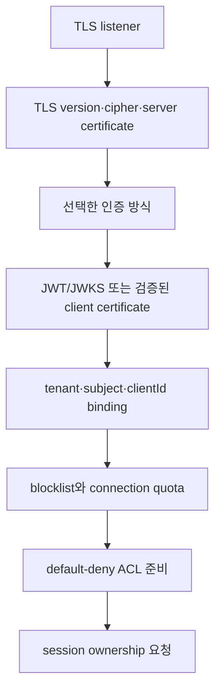

# Tenant와 security 스펙

이 문서는 MQTT·관리 요청을 tenant에 귀속하고, topic·상태·자원을 격리하며, 인증·인가·감사를 일관되게 적용하는 외부 동작을 정의한다.

| 항목 | 값 |
| --- | --- |
| 상태 | Active (Phase 1 security and tenant isolation slice) |
| 적용 범위 | Phase 1에서 구현하는 TEN-01~TEN-05, SEC-02~SEC-04, SEC-06과 SEC-08의 JWKS fail-closed 동작. quota·blocklist, management API, audit sink과 기존 연결 재인증은 후속 범위다. Metrics는 인증 성공·실패와 session gauge를 포함한 현재 구현 범위만 다루며, 상세 observability 정책은 후속 범위다. |
| 근거 | [PRD 9.3절, 9.4절과 11.4절](../requirements/PRD.md), [RFC 8725](https://www.rfc-editor.org/rfc/rfc8725.html) |
| 관련 spec | [MQTT protocol과 session](mqtt-protocol-and-session.md), [Management API](management-api-and-observability.md) |
| 관련 Architecture | [Security boundaries](../architectures/security-boundaries.md), [System overview](../architectures/system-overview.md) |
| 관련 Contract | [Audit event v1](../contracts/audit-event-v1.md), [Management API v1](../contracts/management-api-v1.md) |

## 1. 인증 결과 계약

인증 adapter는 성공 시 다음 논리 값을 반환해야 한다. 외부 provider의 원본 자료형을 이 경계 밖으로 노출해서는 안 된다.

| 필드 | 의미 |
| --- | --- |
| `tenantId` | 신뢰된 설정 또는 credential binding에서 결정한 tenant |
| `subject` | issuer 안에서 검증된 principal 식별자 |
| `credentialId` | 회전·폐기와 감사를 위한 비밀이 아닌 식별자 |
| `allowedClientIds` | 정확한 값 또는 승인된 pattern으로 표현한 허용 범위 |
| `roles` | 관리 plane의 RBAC role 목록 |
| `expiresAt` | 재인증 또는 연결 재평가에 쓰는 만료 시각 |

client가 username, token claim, MQTT property 또는 topic으로 제출한 `tenantId`를 독립적인 신뢰 근거 없이 사용해서는 안 된다. 인증 성공 뒤에도 tenant와 clientId binding, 차단 목록과 listener 정책을 확인해야 한다.

## 2. MQTT 연결 인증



어느 단계든 실패하면 session ownership을 요청해서는 안 된다. 실패는 protocol version이 허용하는 CONNACK reason 또는 연결 종료로 표현하고 인증 실패 Metric을 기록해야 한다.

### 2.1 TLS와 mTLS

- TLS listener는 TLS 1.2 이상만 허용해야 한다.
- 허용 protocol과 cipher suite는 listener별 allowlist로 관리해야 한다.
- mTLS는 configured trust anchor, 유효 기간, key usage와 identity mapping을 모두 검증해야 한다.
- 신뢰하지 않는 CA, 만료·폐기 인증서 또는 identity 불일치는 거절해야 한다.
- node 간 연결은 별도 trust domain의 mTLS와 member allowlist를 모두 통과해야 한다.
- MQTT client mTLS의 verified certificate는 `commonName`, `dnsSan`, `emailSan` selector 중 설정된
  하나와 case-sensitive exact match되어 하나의 static binding을 선택해야 한다. zero match는
  unmapped, multiple match는 ambiguous로 fail-closed한다.
- TLS handshake가 trust chain, validity와 client-auth EKU를 확인하고, application authentication
  adapter가 certificate identity를 tenant·subject·credential·allowed Client ID·roles로 변환한다.
  인증서 원문과 chain은 application/domain 경계로 넘기지 않는다.

### 2.2 JWT와 JWKS

JWT validator는 다음 순서를 지켜야 한다.

1. CONNECT Password의 UTF-8 compact JWT를 읽고, configured algorithm allowlist에 없는 `alg`이면 서명 검증 전에 거절한다.
2. 필수 `kid`를 확인하고, cache의 JWKS key set에서 후보 key를 찾는다.
3. 후보 key로 서명을 검증한다. `kid`와 서명 검증은 configured issuer의 key set 안에서만 수행한다.
4. `iss`를 configured issuer와 정확히 비교하고, `aud`가 configured audience를 포함하는지 확인한다.
5. 비어 있지 않은 `sub`와 `exp`를 확인하고, 선택적인 `nbf`를 configured clock skew와 함께 검증한다.
6. 검증된 `(iss, sub)`를 정적 binding에 대조해 tenant, credential, 허용 Client ID와 roles를 결정한다. Token claim은 이 값을 덮어쓸 수 없다.

JWKS cache는 `fetchedAt`, TTL 만료 시각과 마지막 refresh 시각을 함께 소유한다. 비어 있거나 만료된 cache는 하나의 동시 fetch만 수행하는 mandatory refresh가 성공해야 인증을 진행한다. 유효 cache에서 알려지지 않은 `kid`는 `refreshCooldown`이 허용할 때 하나의 coalesced early refresh를 수행한다. early refresh가 실패하면 해당 `kid`는 거절하지만, 만료되지 않은 기존 key set으로 알려진 `kid`를 검증하는 동작은 유지한다. cooldown 안의 알려지지 않은 `kid`는 I/O 없이 거절한다. 성공한 fetch는 key set, `fetchedAt`, TTL과 refresh-attempt 시각을 원자적으로 교체하고, 실패한 fetch는 TTL을 연장하지 않는다. TTL이 끝난 뒤 refresh가 실패하면 fail-closed로 거절한다.

### 2.3 CONNECT credential과 strict security configuration

MQTT CONNECT는 configured authentication method 중 정확히 하나를 선택한다.

- verified client certificate가 있으면 mTLS를 선택하고 MQTT `Username`과 `Password` flag를 모두
  보내지 않아야 한다. mTLS provider는 certificate selector를 static binding에 대조해 tenant,
  subject, credential ID, allowed Client IDs와 roles를 결정한다. 인증서가 unmapped, ambiguous
  또는 application-level `NotAfter` 만료이면 JWT로 fallback하지 않고 거절한다.
- verified client certificate가 없고 JWT provider가 있으면 `HasUsername=true`와
  `HasPassword=true`를 모두 보내야 한다. Username은 비어 있어도 되며 identity로 사용하지 않고,
  Password에는 하나의 UTF-8 compact JWT만 넣는다.
- mTLS와 JWT credential을 함께 제출하면 거절한다. 두 방식의 identity를 합치거나 우선순위를
  추론하지 않는다.
- provider가 하나도 없는 경우에만 개발용 anonymous CONNECT를 허용한다.

credential, certificate identity, Client ID binding 또는 Will ACL이 실패하면 MQTT 3.1.1 CONNACK
`0x05`, MQTT 5 CONNACK `0x87`을 반환하고 연결을 닫는다. 실패 시 session, timer, route,
queue, retained message와 Will을 변경하지 않는다.

TLS listener(`-tcp-listen` 또는 `-tls-listen`)를 여는 Broker 시작에는 `-security-config <path>`가
필수다. 파일은 알 수 없는 field와 두 번째 JSON value를 거절하는 strict decoder로 한 JSON value만
읽는다. duration은 양수인 Go duration string이어야 한다. 이 설정의 decode와 JWT/JWKS·mTLS
provider 생성은 listener socket을 열기 전에 끝나야 하며, 누락·충돌·오류가 있으면 시작을
실패시킨다. TLS listener의 `request|require` client authentication은 최소 하나의
`mtlsIdentities` binding을 요구하고, binding이 있으면 `client-auth none`을 사용할 수 없다.
`request`는 JWT provider가 함께 configured된 경우에만 certificate 없는 client를 허용하며,
`require`는 모든 TLS client에 verified certificate를 요구한다.

유일한 개발·benchmark 예외는 `-tcp-listen`과 `-allow-insecure-anonymous-mqtt`를 함께 사용하고
`-tls-listen`을 비워 둔 경우다. `-tcp-listen`은 literal `127.0.0.0/8` 또는 `::1` loopback이어야
하며, `-security-config`와 예외 flag를 함께 사용할 수 없다. MQTT listener 없이 예외 flag만 주거나
TLS listener와 함께 주는 경우도 거절한다. 이 예외는 production security mode가 아니며 Phase 1
보안 완료 증거로 사용할 수 없다. MQTT listener가 없는 management-only 실행에는
`-security-config`를 요구하지 않는다.

```json
{
  "jwt": {
    "issuer": "https://issuer.example",
    "audience": "narumq",
    "algorithms": ["RS256"],
    "jwksUrl": "https://issuer.example/.well-known/jwks.json",
    "cacheTtl": "15m",
    "refreshCooldown": "30s",
    "clockSkew": "30s",
    "httpTimeout": "5s"
  },
  "identities": [
    {
      "issuer": "https://issuer.example",
      "subject": "device-1",
      "tenantId": "tenant-a",
      "credentialId": "device-1-key",
      "allowedClientIds": ["device-1"],
      "roles": ["publisher"]
    }
  ],
  "mtlsIdentities": [
    {
      "identityKind": "commonName",
      "identity": "device-1-cert",
      "tenantId": "tenant-a",
      "subject": "device-1-cert",
      "credentialId": "device-1-cert-key",
      "allowedClientIds": ["device-1-cert"],
      "roles": ["publisher"]
    }
  ],
  "acl": [
    {
      "tenantId": "tenant-a",
      "role": "publisher",
      "effect": "allow",
      "action": "publish",
      "topicFilter": "sensors/#"
    }
  ]
}
```

`mtlsIdentities` entry는 `identityKind`, `identity`, `tenantId`, `subject`, `credentialId`,
`allowedClientIds`, `roles` field만 사용한다. `identityKind`는 `commonName`, `dnsSan`,
`emailSan` 중 하나이며 identity 비교는 case-sensitive exact match다. 하나의 certificate가
zero entry와 match하면 unmapped, 둘 이상의 entry와 match하면 ambiguous다. `NotAfter`는
새 principal의 만료 시각으로 사용하며 trust chain·certificate validity·client-auth EKU는
TLS handshake에서 먼저 검증한다. URI SAN/SPIFFE·fingerprint selector, revocation·rotation,
기존 연결 종료·reauthentication, quota·blocklist·audit과 cluster-peer mTLS는 이 slice에
포함하지 않는다.

이 slice는 issuer와 audience를 각각 정확히 하나만 허용한다. algorithms, JWT identities,
mTLS identities, credential IDs, tenant IDs, `(issuer, subject)` binding, `(identityKind,
identity)` selector, allowed Client IDs와 roles는 비어 있지 않고 각각 중복되지 않아야 한다.
JWT credential ID와 mTLS credential ID도 서로 중복될 수 없다. ACL `effect`는 `allow|deny`,
`action`은 `publish|subscribe|unsubscribe|will`만 허용한다. 중복 ACL rule과 malformed MQTT
filter는 startup에서 거절한다. `jwksUrl`은 절대 `https` URL이어야 하며, deterministic test를
위해 IP-literal loopback host의 HTTP만 예외로 허용한다. `cacheTtl`, `refreshCooldown`,
`clockSkew`, `httpTimeout`은 모두 양수여야 한다. Reload 동작은 이 slice에 포함하지 않는다.


### 2.4 Username/password

이 방식이 활성화되면 password 검증에 salt를 포함한 승인된 password hashing scheme을 사용해야 한다. 평문이나 복호화 가능한 password를 저장해서는 안 된다. 실패 응답은 계정 존재 여부를 구분하지 않아야 한다.

## 3. Tenant namespace

외부 MQTT topic과 filter 표기는 변경하지 않는다. Broker 내부에서는 tenant와 namespace를 문자열 prefix로 이어 붙이지 않고, 비교 가능한 typed value로 함께 표현한다.

- `NewTenantID(raw string) (TenantID, error)`는 비어 있거나 유효하지 않은 tenant를 거절한다.
- `NewSessionKey(tenantID TenantID, clientID string) (SessionKey, error)`는 tenant와 비어 있지 않은 Client ID를 결합하며 field를 외부에서 만들 수 없게 한다.
- `NewTopic(tenantID TenantID, name string) (Topic, error)`는 concrete MQTT topic을 검증한다.
- `NewTopicFilter(tenantID TenantID, filter string) (TopicFilter, error)`는 MQTT filter 또는 shared subscription을 검증한다.

각 value는 private field와 read-only `TenantID()`, `ClientID()`, `Name()`, `Filter()` accessor만 제공한다. 서로 다른 tenant의 같은 외부 이름은 비교에서 절대 같은 값이 되지 않는다. Cross-tenant 비교는 거절한다. 향후 persistence·wire adapter만 unsigned-varint byte length 뒤에 UTF-8 tenant와 topic/filter bytes를 직렬화할 수 있으며, 이 slice에는 string compatibility key나 내부 prefix encoding을 두지 않는다.

Topic/filter validation과 MQTT wildcard matcher는 하나만 유지한다. Shared subscription은 먼저 `$share/{ShareName}/{TopicFilter}`로 분해하고 ACL과 containment/intersection 비교에는 underlying filter만 사용한다. `$` system topic의 첫 level wildcard 제한을 포함한 기존 MQTT matching 의미를 그대로 적용한다. Unicode normalization, case folding, slash 병합은 하지 않는다.

Namespace binding은 publish, subscribe, unsubscribe, retained, shared subscription, Will과 session key에 동일하게 적용한다. Client가 제출한 tenant claim, topic prefix 또는 이중 encoding으로 tenant를 선택하거나 변경할 수 없다.

## 4. ACL

ACL 입력은 `tenantId`, `subject`, `clientId`, action, canonical topic/filter, listener와 연결 속성이다.

| Action | 판정 시점 | 거절 결과 |
| --- | --- | --- |
| `publish` | message를 durable log나 route에 넣기 전 | MQTT 5 `Not authorized`가 허용되면 반환하고, 아니면 연결을 종료할 수 있다. |
| `subscribe` | route를 만들기 전 | 해당 SUBACK 항목을 거절한다. |
| `unsubscribe` | target session과 filter를 바꾸기 전 | protocol이 허용하는 거절 또는 연결 종료 |
| `will` | CONNECT에서 등록할 때와 실제 발행 직전 | 등록 또는 발행을 거절하고 감사 가능한 사유를 남긴다. |

- 일치하는 allow가 없으면 deny다.
- 명시적 deny는 allow보다 우선해야 한다.
- policy backend 오류 또는 timeout은 deny로 처리해야 한다.
- policy 변경의 적용 version을 연결과 감사 이벤트에서 확인할 수 있어야 한다.
- 기존 연결 재평가·재인증 정책은 credential 종류별로 문서화해야 한다.

### 4.1 Phase 1 ACL 판정과 Will

ACL은 authenticated principal이 가진 모든 role의 tenant-local rule을 대상으로 평가한다. matching deny가 하나라도 있으면 거절하고, deny가 없으며 matching allow가 있으면 허용하고, 둘 다 없으면 default deny다.

- `publish`와 `will`은 concrete `Topic`이 rule `TopicFilter`와 match하는지 평가한다.
- `subscribe`와 `unsubscribe`는 요청한 모든 topic을 포함하는 rule filter가 있어야 allow가 된다. 요청 filter와 deny rule이 한 topic이라도 교차하면 거절한다.
- Shared subscription syntax는 먼저 parse하고 underlying filter로 위 두 판정을 수행한다.
- CONNECT Will은 등록 시점과 실제 publication 직전에 같은 principal snapshot으로 다시 authorize한다. delayed Will의 authorization 실패는 broker state를 변경하지 않고 Will을 버린다.

`Principal`과 `SessionKey`의 tenant와 Client ID가 일치하지 않으면 모든 authorization은 거절한다. Principal은 CONNECT 시점에 session에 snapshot으로 저장하며 기존 연결은 live TCP connection이나 timer map에서 identity를 다시 읽지 않는다.

## 5. Quota와 rate limit

모든 quota는 tenant별로 계산하고 한 tenant의 초과가 다른 tenant의 정상 traffic을 직접 거절하게 해서는 안 된다.

| 범주 | 최소 제한 단위 | 초과 동작 |
| --- | --- | --- |
| 연결 상태 | connection, session, subscription | 새 생성 거절. 기존 정상 상태를 임의 삭제하지 않는다. |
| traffic | message rate, byte rate, payload size | bounded backpressure 후 protocol reason으로 거절하거나 연결 종료 |
| 저장 | offline queue message/bytes, retained bytes, 전체 저장량 | 새 durable state 거절 또는 사전 확정된 eviction 정책 적용 |
| 선택 Metric | exact topic 등록 수, TTL | wildcard 거절, 상한 초과 등록 거절 |

저장 quota의 eviction 순서와 상한은 configuration spec에서 확정해야 한다. 어떤 정책이든 이미 성공 durable ACK한 message를 보장 범위 밖에서 조용히 삭제해서는 안 된다. expiry 또는 명시한 quota 정책으로 삭제하면 사유별 Metric과 감사 가능한 기록을 남겨야 한다.

## 6. 관리 plane RBAC

| Role | 최소 권한 |
| --- | --- |
| `ReadOnly` | 허용 범위의 cluster·tenant 상태와 Metric 조회 |
| `Operator` | drain, client disconnect·redirect와 운영 mutation |
| `SecurityAdmin` | credential, ACL, blocklist와 감사 조회 |
| `ClusterAdmin` | cluster 전체 설정과 tenant 관리 |
| delegated tenant role | 자기 tenant의 credential, ACL과 quota만 관리 |

권한은 resource와 action마다 확인해야 한다. 단순히 UI에서 control을 숨기는 것으로 권한 검사를 대신해서는 안 된다. 목록과 상세 조회에서도 tenant scope를 적용해 IDOR를 막아야 한다.

## 7. Credential 회전·폐기와 차단

- 새 credential을 추가한 뒤 기존 credential을 겹쳐 허용하는 회전 구간을 설정할 수 있어야 한다.
- 폐기는 configured propagation 목표 안에 모든 node에 반영해야 한다.
- 강제 재인증 또는 기존 connection 종료 여부는 credential 정책에 따라 일관되게 적용해야 한다.
- `clientId`, username, certificate identity와 IP 차단은 P1이다. 적용 결과와 source policy version을 조회할 수 있어야 한다.
- node가 최신 보안 policy를 확인할 수 없고 cache TTL도 지났다면 새 인증을 허용해서는 안 된다.

## 8. 감사와 비밀정보

관리 mutation과 보안 관련 거절은 최소 다음 필드를 가진 감사 이벤트를 생성해야 한다.

```json
{
  "timestamp": "2026-08-16T00:00:00Z",
  "requestId": "opaque-request-id",
  "actor": { "subject": "opaque-subject", "tenantId": "opaque-tenant" },
  "action": "node.drain.start",
  "target": { "type": "node", "id": "opaque-node-id" },
  "result": "allowed",
  "reason": "policy-code",
  "policyVersion": "opaque-version"
}
```

audit event에는 password, bearer token, session cookie, private key와 원문 secret을 넣어서는 안 된다. Client ID, username, certificate identity와 IP는 권한과 보존 정책에 따라 마스킹할 수 있어야 한다. 보존 기간과 위변조 방지 방식은 보안 운영 spec에서 확정한다.

## 9. 수용 시험과 범위

| ID | 수용 기준 | 시험 |
| --- | --- | --- |
| SEC-01 | TLS 1.2 이상, TLS 1.0/1.1 거절, AEAD cipher allowlist와 TLS/mTLS listener 왕복을 검증한다. | `tests/integration/mqtt_tls_test.go`의 `TestMQTTTLS_ConnectionAndDelivery`, `TestMQTTTLS_RejectInsecureTLSVersion` |
| SEC-02 | algorithm allowlist, required `kid`, cached JWKS signature, exact issuer, audience membership, subject, exp/nbf와 clock skew를 순서대로 검증하고 key rotation을 fail-closed로 처리한다. MQTT listener startup은 `-security-config`를 요구하며, 유일한 예외는 literal loopback `-tcp-listen`과 `-allow-insecure-anonymous-mqtt`의 development·benchmark 조합이다. | `internal/adapters/authentication`의 JWT/JWKS cache 시험, `cmd/narumq/main_test.go`의 `TestRunWithContextMQTTSecurityMode`와 `TestRunWithContextSecurityConfig` |
| SEC-03 | trusted CA와 mapped certificate 성공, untrusted CA·TLS 만료 certificate·application-level `NotAfter` 만료 certificate 거절을 검증한다. | `tests/integration/mqtt_tls_test.go`의 `TestMQTTTLS_mTLS_TrustedMappedCertificate`, `TestMQTTTLS_mTLS_UntrustedCA_Rejected`, `TestMQTTTLS_mTLS_ExpiredCert_Rejected`, `internal/adapters/authentication`의 certificate expiry 시험 |
| SEC-04 | 인증서 CN/SAN exact mapping, unmapped·ambiguous identity, dual credential 거절을 검증하고, mTLS와 JWT 인증 결과의 exact allowed Client ID가 아니면 MQTT 3.1.1 `0x05` 또는 MQTT 5 `0x87`로 거절하고 state를 만들지 않는다. | `tests/integration/mqtt_tls_test.go`의 mTLS principal acceptance/rejection 시험, `internal/application/connect`, `tests/integration/mqtt_ingress_test.go`의 `TestMQTTSecurity` |
| SEC-06 | publish, subscribe, unsubscribe와 Will은 deny > allow > default-deny를 적용하고 거절 전에는 mutation을 수행하지 않는다. | `internal/domain/security`, application mutation-order 시험, `tests/integration/mqtt_ingress_test.go`의 `TestMQTTSecurity` |
| SEC-08 | JWKS가 비어 있거나 TTL 만료 후 refresh에 실패하면 fail-closed한다. Metrics와 audit sink은 이 slice의 범위가 아니다. | `internal/adapters/authentication`의 `TestJWKSBootstrapFailureCollapses` 등 시험 |
| SEC-09 | node 간 복제와 internal transport mTLS를 분리 검증한다. | 별도 cluster transport acceptance suite |
| TEN-01 | 유효한 JWT와 정적 `(issuer, subject)` binding 없이 CONNECT가 성공하지 않고, token claim이 tenant를 선택하지 못한다. | `internal/adapters/authentication`의 JWT 검증 시험, `tests/integration/mqtt_ingress_test.go`의 `TestMQTTSecurity` |
| TEN-02 | Client ID uniqueness와 session ownership의 key가 `(tenant, clientId)`이며 같은 Client ID를 다른 tenant가 사용할 수 있다. | `internal/domain/session`, `internal/adapters/memory/sessionstore`, `tests/integration/mqtt_ingress_test.go`의 `TestMQTTSecurity` |
| TEN-03 | 같은 외부 topic과 filter가 tenant별 typed value로 격리되며 retained·shared·Will에도 같은 binding이 적용된다. | `internal/domain/tenancy`, `internal/domain/routing`, `tests/integration/mqtt_ingress_test.go`의 `TestMQTTSecurity` |
| TEN-04 | ACL은 tenant-local canonical typed value를 기준으로 평가하고 내부 prefix injection이나 이중 encoding으로 우회할 수 없다. | `internal/domain/security` policy 시험, `tests/integration/mqtt_ingress_test.go`의 `TestMQTTSecurity` |
| TEN-05 | system topic, retained, shared subscription, Will과 session이 tenant 경계를 넘지 않는다. | tenancy/routing/session 시험, `tests/integration/mqtt_ingress_test.go`의 `TestMQTTSecurity` |

이 변경은 mTLS client principal mapping과 SEC-03/SEC-04의 certificate-to-tenant acceptance를
완료로 표시한다. security metrics의 상세 정책, revocation·rotation, quota, blocklist,
management API, audit sink, reload과 기존 연결 token reauthentication은 완료로 표시하지
않는다. 위 표 밖의 SEC-05, SEC-07, SEC-10~SEC-12와 TEN-06~TEN-10은 후속 acceptance scope다.
