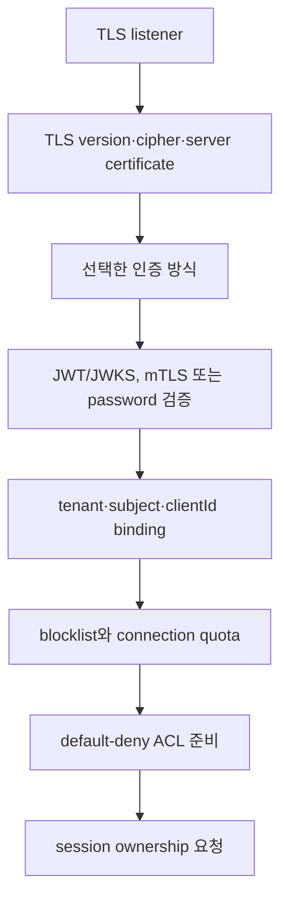

# Tenant와 security 스펙

이 문서는 MQTT·관리 요청을 tenant에 귀속하고, topic·상태·자원을 격리하며, 인증·인가·감사를 일관되게 적용하는 외부 동작을 정의한다.

| 항목 | 값 |
| --- | --- |
| 상태 | Draft |
| 관련 요구사항 | TEN-01~TEN-10, SEC-01~SEC-12, NFR-16~NFR-19 |
| 근거 | [PRD 9.3절, 9.4절과 11.4절](../requirements/PRD.md), [RFC 8725](https://www.rfc-editor.org/rfc/rfc8725.html) |
| 관련 spec | [MQTT protocol과 session](mqtt-protocol-and-session.md), [Management API](management-api-and-observability.md) |
| 관련 Architecture | [Security boundaries](../architectures/security-boundaries.md), [System overview](../architectures/system-overview.md) |
| 관련 Contract | [Audit event v1](../contracts/audit-event-v1.md), [Management API v1](../contracts/management-api-v1.md) |

## 1. 인증 결과 계약

인증 adapter는 성공 시 다음 논리 값을 반환해야 한다. 외부 provider의 원본 자료형을 이 경계 밖으로 노출해서는 안 된다.

| 필드 | 의미 |
| --- | --- |
| `tenantId` | 신뢰된 설정 또는 credential binding에서 결정한 tenant |
| `subject` | issuer 안에서 검증된 principal 식별자 |
| `credentialId` | 회전·폐기와 감사를 위한 비밀이 아닌 식별자 |
| `allowedClientIds` | 정확한 값 또는 승인된 pattern으로 표현한 허용 범위 |
| `roles` | 관리 plane의 RBAC role 목록 |
| `expiresAt` | 재인증 또는 연결 재평가에 쓰는 만료 시각 |

client가 username, token claim, MQTT property 또는 topic으로 제출한 `tenantId`를 독립적인 신뢰 근거 없이 사용해서는 안 된다. 인증 성공 뒤에도 tenant와 clientId binding, 차단 목록과 listener 정책을 확인해야 한다.

## 2. MQTT 연결 인증



어느 단계든 실패하면 session ownership을 요청해서는 안 된다. 실패는 protocol version이 허용하는 CONNACK reason 또는 연결 종료로 표현하고 인증 실패 Metric을 기록해야 한다.

### 2.1 TLS와 mTLS

- TLS listener는 TLS 1.2 이상만 허용해야 한다.
- 허용 protocol과 cipher suite는 listener별 allowlist로 관리해야 한다.
- mTLS는 configured trust anchor, 유효 기간, key usage와 identity mapping을 모두 검증해야 한다.
- 신뢰하지 않는 CA, 만료·폐기 인증서 또는 identity 불일치는 거절해야 한다.
- node 간 연결은 별도 trust domain의 mTLS와 member allowlist를 모두 통과해야 한다.

### 2.2 JWT와 JWKS

JWT validator는 다음 순서를 지켜야 한다.

1. configured issuer와 token type에 허용한 algorithm인지 확인한다. token의 `alg`만 보고 algorithm을 선택해서는 안 된다.
2. `kid`로 후보 key를 찾고 서명을 검증한다.
3. `iss`, `aud`, `sub`, `exp`, `nbf`와 configured clock skew를 검증한다.
4. issuer·subject와 tenant·clientId binding을 확인한다.
5. token purpose가 다른 validation rule과 혼동되지 않게 issuer·audience·type별 규칙을 분리한다.

JWKS cache는 TTL과 마지막 성공 시각을 가져야 한다. 알 수 없는 `kid`는 정책이 허용한 제한된 refresh를 유발할 수 있다. Refresh 실패 뒤 유효 cache TTL이 끝나면 fail-closed로 거절해야 한다. 폐기된 key를 cache TTL 이상 계속 허용해서는 안 된다.

### 2.3 Username/password

이 방식이 활성화되면 password 검증에 salt를 포함한 승인된 password hashing scheme을 사용해야 한다. 평문이나 복호화 가능한 password를 저장해서는 안 된다. 실패 응답은 계정 존재 여부를 구분하지 않아야 한다.

## 3. Tenant namespace

외부 topic은 인증된 tenant와 결합해 내부 canonical topic으로 변환한다. 실제 prefix encoding은 `SPEC-TBD-05`지만 다음 속성은 고정이다.

1. 서로 다른 tenant의 같은 외부 topic은 서로 다른 canonical topic이 되어야 한다.
2. 변환은 publish, subscribe, unsubscribe, retained, Will, shared subscription과 관리 조회에 동일하게 적용해야 한다.
3. 외부 입력이 내부 prefix를 직접 지정하거나 이중 encoding으로 다른 tenant에 도달해서는 안 된다.
4. ACL은 외부 표기나 변환 전 문자열이 아니라 canonical topic/filter를 기준으로 평가해야 한다.
5. system topic 규칙을 적용한 뒤에도 tenant namespace를 벗어나서는 안 된다.

topic 정규화는 MQTT 문자열 의미를 임의로 바꾸면 안 된다. Unicode normalization, case folding 또는 slash 병합을 암묵적으로 수행해서는 안 된다.

## 4. ACL

ACL 입력은 `tenantId`, `subject`, `clientId`, action, canonical topic/filter, listener와 연결 속성이다.

| Action | 판정 시점 | 거절 결과 |
| --- | --- | --- |
| `publish` | message를 durable log나 route에 넣기 전 | MQTT 5 `Not authorized`가 허용되면 반환하고, 아니면 연결을 종료할 수 있다. |
| `subscribe` | route를 만들기 전 | 해당 SUBACK 항목을 거절한다. |
| `unsubscribe` | target session과 filter를 바꾸기 전 | protocol이 허용하는 거절 또는 연결 종료 |
| `will` | CONNECT에서 등록할 때와 실제 발행 직전 | 등록 또는 발행을 거절하고 감사 가능한 사유를 남긴다. |

- 일치하는 allow가 없으면 deny다.
- 명시적 deny는 allow보다 우선해야 한다.
- policy backend 오류 또는 timeout은 deny로 처리해야 한다.
- policy 변경의 적용 version을 연결과 감사 이벤트에서 확인할 수 있어야 한다.
- 기존 연결 재평가·재인증 정책은 credential 종류별로 문서화해야 한다.

## 5. Quota와 rate limit

모든 quota는 tenant별로 계산하고 한 tenant의 초과가 다른 tenant의 정상 traffic을 직접 거절하게 해서는 안 된다.

| 범주 | 최소 제한 단위 | 초과 동작 |
| --- | --- | --- |
| 연결 상태 | connection, session, subscription | 새 생성 거절. 기존 정상 상태를 임의 삭제하지 않는다. |
| traffic | message rate, byte rate, payload size | bounded backpressure 후 protocol reason으로 거절하거나 연결 종료 |
| 저장 | offline queue message/bytes, retained bytes, 전체 저장량 | 새 durable state 거절 또는 사전 확정된 eviction 정책 적용 |
| 선택 Metric | exact topic 등록 수, TTL | wildcard 거절, 상한 초과 등록 거절 |

저장 quota의 eviction 순서와 상한은 configuration spec에서 확정해야 한다. 어떤 정책이든 이미 성공 durable ACK한 message를 보장 범위 밖에서 조용히 삭제해서는 안 된다. expiry 또는 명시한 quota 정책으로 삭제하면 사유별 Metric과 감사 가능한 기록을 남겨야 한다.

## 6. 관리 plane RBAC

| Role | 최소 권한 |
| --- | --- |
| `ReadOnly` | 허용 범위의 cluster·tenant 상태와 Metric 조회 |
| `Operator` | drain, client disconnect·redirect와 운영 mutation |
| `SecurityAdmin` | credential, ACL, blocklist와 감사 조회 |
| `ClusterAdmin` | cluster 전체 설정과 tenant 관리 |
| delegated tenant role | 자기 tenant의 credential, ACL과 quota만 관리 |

권한은 resource와 action마다 확인해야 한다. 단순히 UI에서 control을 숨기는 것으로 권한 검사를 대신해서는 안 된다. 목록과 상세 조회에서도 tenant scope를 적용해 IDOR를 막아야 한다.

## 7. Credential 회전·폐기와 차단

- 새 credential을 추가한 뒤 기존 credential을 겹쳐 허용하는 회전 구간을 설정할 수 있어야 한다.
- 폐기는 configured propagation 목표 안에 모든 node에 반영해야 한다.
- 강제 재인증 또는 기존 connection 종료 여부는 credential 정책에 따라 일관되게 적용해야 한다.
- `clientId`, username, certificate identity와 IP 차단은 P1이다. 적용 결과와 source policy version을 조회할 수 있어야 한다.
- node가 최신 보안 policy를 확인할 수 없고 cache TTL도 지났다면 새 인증을 허용해서는 안 된다.

## 8. 감사와 비밀정보

관리 mutation과 보안 관련 거절은 최소 다음 필드를 가진 감사 이벤트를 생성해야 한다.

```json
{
  "timestamp": "2026-08-16T00:00:00Z",
  "requestId": "opaque-request-id",
  "actor": { "subject": "opaque-subject", "tenantId": "opaque-tenant" },
  "action": "node.drain.start",
  "target": { "type": "node", "id": "opaque-node-id" },
  "result": "allowed",
  "reason": "policy-code",
  "policyVersion": "opaque-version"
}
```

audit event에는 password, bearer token, session cookie, private key와 원문 secret을 넣어서는 안 된다. Client ID, username, certificate identity와 IP는 권한과 보존 정책에 따라 마스킹할 수 있어야 한다. 보존 기간과 위변조 방지 방식은 보안 운영 spec에서 확정한다.

## 9. 수용 시험

- 같은 clientId와 외부 topic을 쓰는 두 tenant가 session, route, retained, Will과 shared group을 공유하지 않는지 시험한다.
- 내부 prefix 주입, wildcard·system topic 우회와 이중 encoding을 거절하는지 시험한다.
- JWT algorithm confusion, 잘못된 issuer/audience/subject, expiry, `kid` rotation과 JWKS 장애를 시험한다.
- mTLS CA·expiry·identity와 node member allowlist 조합을 시험한다.
- ACL backend와 auth backend 장애가 cache TTL 뒤 fail-closed인지 확인한다.
- 모든 관리 API에 role·tenant별 positive/negative matrix와 IDOR 시험을 적용한다.
- secret scanner와 log/Metric assertion으로 비밀정보가 노출되지 않는지 검증한다.
